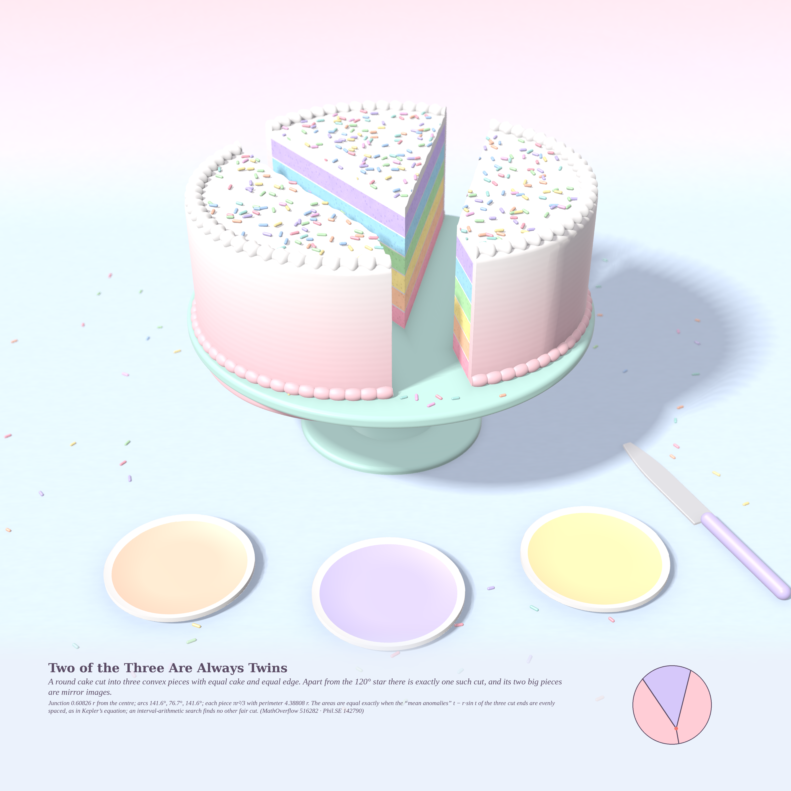
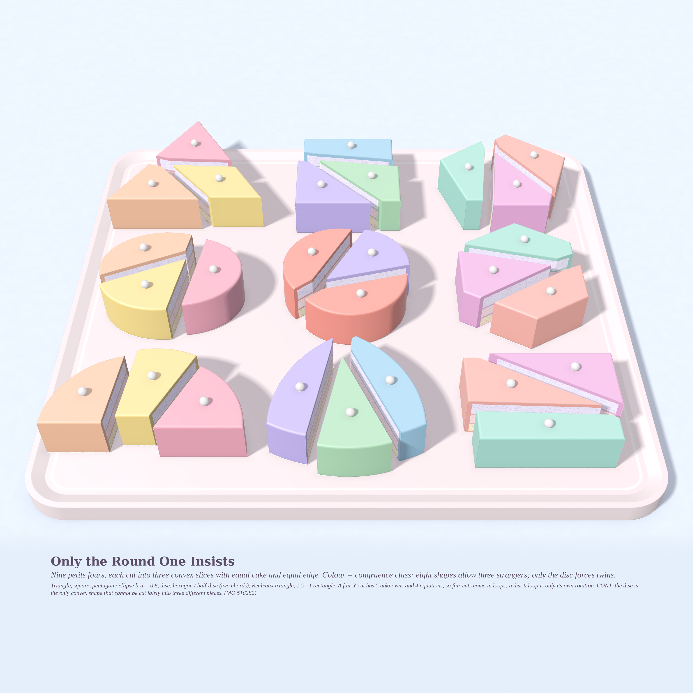
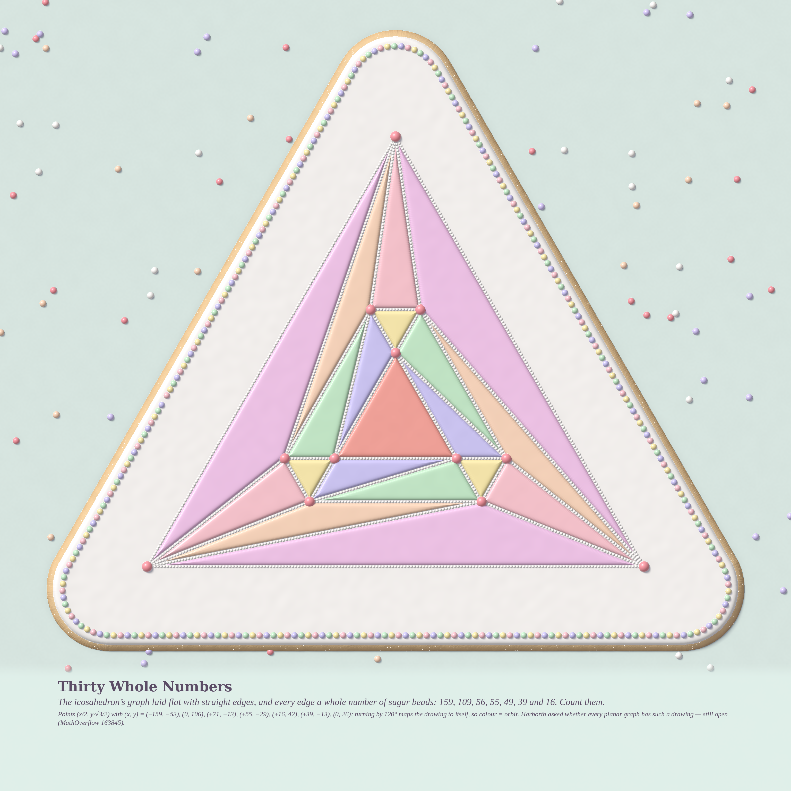

# WHAT THE KNIFE LEAVES — pastel #47 (Opus 5.5, run 26, 2026-10-23)

*Seeded by Philosophy.SE 142790 — “Is the absence of a thing, itself a thing?” — and MathOverflow
516282 (cut a disc into three convex pieces with equal area **and** equal perimeter, pairwise
non-congruent?) and 163845 (Harborth: does every planar graph have a straight-line drawing with
integer edge lengths?).*

A cut is an absence: a thin plane of nothing. But once it is there, it decides everything about the
pieces. So this run is a bakery. A layer cake, a tray of petits fours and an iced cookie, each one
shaped by its cuts or its gaps.

| # | piece | size | engine |
|---|---|---|---|
| 1 | **Two of the Three Are Always Twins** (hero) | 4096² | `cake/cake.py` numba SDF ray-marcher: rainbow layer cake, buttercream ombré, piped shells, hashed sprinkles, glazed stand, plates, knife |
| 2 | **Only the Round One Insists** | 3072² | `cake/petit.py` + `tray.py`: petits fours of any convex shape (half-planes ∩ discs, or an ellipse), cut by the agent’s exact partitions |
| 3 | **Thirty Whole Numbers** | 3072² | `icing/icing.py` height-field royal icing: flood, beaded piping, pearls, sanding-sugar glints |

### 1 · Two of the Three Are Always Twins

A round rainbow layer cake, cut fairly into three: every slice has the same amount of cake and the
same length of edge. Apart from the 120° star there is exactly one such cut. Its junction sits
0.60826 r from the centre and its arcs are 141.6°, 76.7° and 141.6°. The two big slices are mirror
images of each other, so the answer to MO 516282 for the disc is **no**. The inset in the caption
shows the cut from above.

### 2 · Only the Round One Insists

Nine petits fours: triangle, square, pentagon, ellipse (b/a = 0.8), **disc**, hexagon, half-disc,
Reuleaux triangle and a 1.5:1 rectangle. Each is cut by a fair partition the math agent found
(equal area, equal perimeter, all pieces convex). Colour marks congruence class. Eight cakes show
three different colours. Only the disc in the centre has two slices the same colour (coral), because
its slices are twins.

### 3 · Thirty Whole Numbers

The icosahedron’s graph, drawn flat with straight edges, where every edge is a whole number of sugar
beads long: 159 (outer triangle), 39 (inner triangle), and 109, 56, 55, 49, 16. That is 1,713 beads
in all, one per unit of length, so you can count each edge. Points are (x/2, y·√3/2) with (x, y) =
(±159, −53), (0, 106), (±71, −13), (±55, −29), (±16, 42), (±39, −13), (0, 26). Turning the drawing
by 120° maps it to itself, so flood colour marks the orbit, and the one face that is its own orbit
(the centre) is coral.

## Mathematics

**MO 516282, Q1 — disc: NO (computer-assisted).** Put the junction at p = (r, 0) and the cut ends
at angles tᵢ. By the shoelace formula, piece i has area ½[(tᵢ₊₁ − tᵢ) + r(sin tᵢ − sin tᵢ₊₁)].
So **the three areas are equal exactly when the “mean anomalies” Mᵢ = tᵢ − r sin tᵢ are equally
spaced.** This is Kepler’s equation, with the junction playing the focus. What remains is two
perimeter equations in (r, c). Interval branch-and-bound plus a Krawczyk test
(`math_fair/disc_certify.py`, 0.3 s) shows there are exactly two Y-cuts up to symmetry: the 120°
star, and the mirror cut that solves t − r sin t = 2π/3, √(1+r²−2r cos t) = 1 − r + 3r sin t. For
the mirror cut:
- r* = 0.608260026841411488330…
- t₁ = 2.471947061624889…
- common perimeter 4.388082885637147…
- angles at the junction 155.97°, 155.97°, 48.06°

Two disjoint chords never give a fair cut of the disc at all (cap perimeter 4.533 against 4.929 for
the middle piece). No closed form was found for r*. I verified the Kepler/shoelace identity by hand,
and checked the mirror solution independently with my own multistart Newton solver
(`math_fair/ysolve.py`); it finds only these two solutions.

**Q2 — other shapes: generically YES.** A Y-cut of a general shape has 5 unknowns and 4 equations,
so fair cuts come in closed one-parameter families. Along a family the pieces change shape, and a
congruent pair appears only at isolated points. For the disc, every family is just a rotation of
one cut, so the pieces never change shape. All 13 other shapes tested admit a convex, pairwise
non-congruent fair cut. The cleanest is the half-disc with two chords: pieces of perimeter 3.0227
whose unit-radius arcs measure 1.0855, 0.6993 and 1.3568, so no two pieces are congruent (this part
is rigorous). **CONJ: the disc is the only convex region with no fair convex 3-cut into pairwise
non-congruent pieces.** Even an ellipse with b/a = 0.95 already has one.

**MO 163845 (Harborth).** The agent searched lattices (x, y√k) with a 120° symmetry imposed and
found plane integral drawings of:
- the octahedron, max edge 26
- the **icosahedron**, max edge 159
- an integer-coordinate icosahedron, max edge 287
- the pentagonal bipyramid, snub disphenoid and triakis tetrahedron

I re-checked the icosahedron myself with sympy: all 30 squared edge lengths are perfect squares,
there are no crossings, and every vertex has degree 5. It is 5-regular, which is beyond the
degree ≤ 4 results of Biedl and Sun. I have not checked the literature for prior icosahedron
drawings.

## Tweet
> A round cake agreed to be cut fairly, with the same sponge and the same crust for all three, on one
> condition: two of the slices had to be twins. Every other shape on the tray let three strangers
> share. The gaps the knife left, which nobody could eat, were what made them slices at all.

Not posted to MO.
