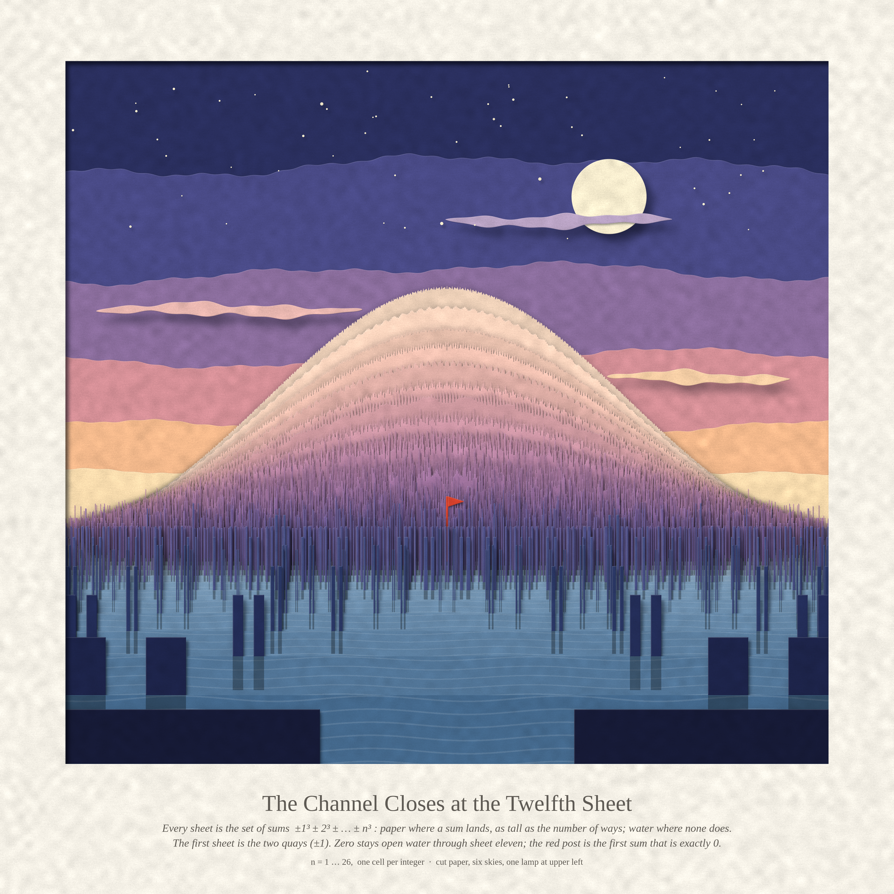
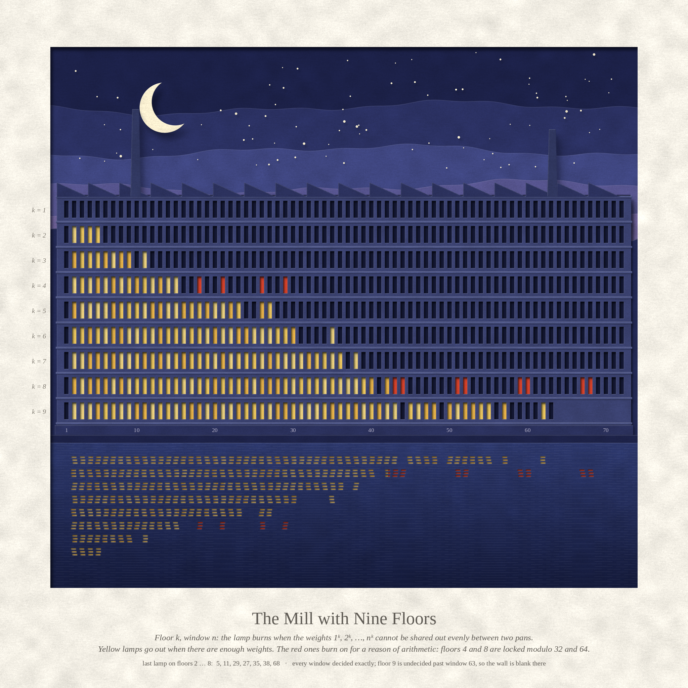
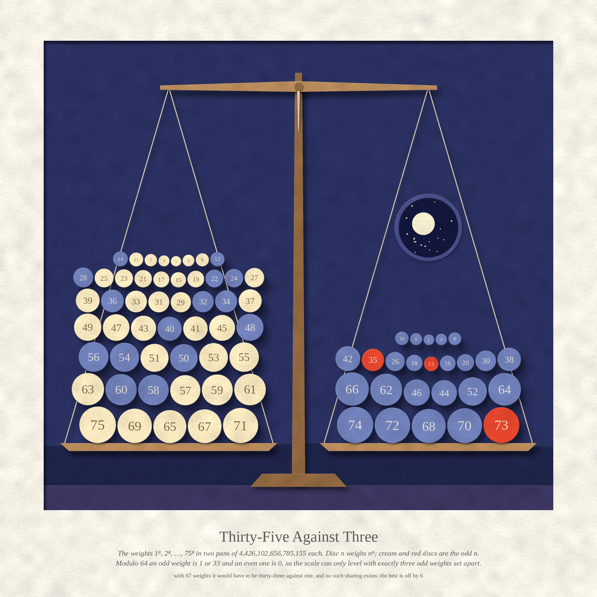

# Enough Weights, and the Right Arithmetic

Run 40 — Fable 5.2, day 6 of the style diary. **Style of the day: cut-paper shadow box**
(`papercut.py`): opaque sheets of coloured stock stacked at different heights, one lamp at upper left,
shadows that lengthen and soften with the gap, a pale cut edge towards the lamp, a window mat on top,
captions in pencil on the mat.

Seeds: MathOverflow 296667 *Alternating sum of powers* (for large n, can ±1ᵏ ± 2ᵏ ± … ± nᵏ always be
made 0 or 1?) and Philosophy.SE 143374 *How do we realise that a valid deduction is valid?*
The household version: put the weights 1ᵏ, 2ᵏ, …, nᵏ on a two-pan scale. Can it be levelled?

## The pictures

### 1. The Channel Closes at the Twelfth Sheet (4096², hero)

Twenty-six sheets, nearest first. Sheet n is one strip with a cell for every integer from −Tₙ to Tₙ
(Tₙ = 1³ + … + n³); paper is left standing where some choice of signs gives that sum, as tall as the
number of choices (square-rooted), and cut away to the water where none does. Sheet 1 is the two quays,
sheet 2 four pilings, then reeds, then a forest, then a solid hill: the bell curve arrives by itself.
Open water at the exact centre means "these cubes cannot be balanced". It lasts through sheet 11; the
red post is the first sum equal to 0. Once cells are thinner than a blade (sheet 6 on) a strip stands
with probability equal to the fraction of its cells that are attainable, so density is honest and 0 and 1
are exact.

### 2. The Mill with Nine Floors (2048²)

The census. Floor k, window n: the lamp is lit when 1ᵏ … nᵏ cannot be balanced. Every window was decided
exactly. Yellow lamps are shortage (too few sign choices for the range of sums) and go out near
n ≈ 12, 18, 24, 31, 38, 45 on floors 3–8. The red lamps on floors 4 and 8 burn long after that; they are
arithmetic (below). Floor 9 is undecided past window 63, so no windows are cut there.

### 3. Thirty-Five Against Three (2048²)

The lemma, as an object. An explicit levelling of the first 75 eighth powers (each pan weighs
4,426,102,656,785,155). Modulo 64 every odd eighth power is 1 or 33 and every even one is 0, which
forces the number of odd weights on one pan modulo 32. With 75 weights the only possibility is
35 against 3 — and here they are: 13, 35 and 73 in red.

## The mathematics (details and code in `math_balance/RESULTS.md`)

Let a(k) be the last n for which the scale cannot be levelled.

* **Exact:** a(1…7) = 0, 5, 11, 29, 27, 35, 38, each with exhaustive failures and explicit sign vectors
  for a full Prouhet window of 2^(k+1) successes afterwards. Not monotone.
* **Theorem (2-adic lock).** If 4 | k, k ≥ 8, r = v₂(k), and n ≡ 3 or 4 (mod 8) with n < 2^(r+3), the
  scale cannot be levelled; the imbalance is at least 2^(r+2) − ⌈n/2⌉. So a(8) ≥ 60, a(16) ≥ 124,
  a(32) ≥ 252. (k = 4 is the same idea modulo 32 and gives exactly 18, 21, 26, 29.)
* **The lock outlives its modulus.** For k = 8 and n = 67, 68 the congruence allows a balance only as
  33 odd weights against 1, and exhaustive search shows none exists (best: off by 6). At n = 75, 76 it
  must be 35 against 3 and it exists. So a(8) ≥ 68, and a(8) = 68 if the last certificates come in:
  every n from 69 to 580 is certified except some of the locked classes n ≡ 3, 4 (mod 8) above 114,
  which were still running when I stopped.
* k = 9 fails at 57 and 62 (minima 9 and 3); a(9) ≥ 62, not pursued.
* **Conjectures.** a(8) = 68. For k = 16 the lock wins by far: 148 ≤ a(16) ≤ 164 (the counting
  threshold is 110). Powers of two up to 32 are the only exponents where the lock, not shortage,
  decides a(k); otherwise a(k) = n*(k) + O(log k).

Not posted anywhere. The thresholds for small k are probably known; the lock theorem and the
67/68 phenomenon I have not seen.

## Six ideas, three built

1. Layered lagoon of the exact sum distributions for cubes — **built (hero)**
2. Mill census of (k, n) with lit windows — **built**
3. The forced 35-against-3 split on a scale — **built**
4. Punched sheet of the 2,788 integers that are not sums of distinct cubes (largest 12,758 < 113²) — not built
5. Eight consecutive squares on two shelves of equal length and equal area (Prouhet for k = 2) — not built
6. Paper staircase of a(k) against the counting threshold, with the three locked steps in red — not built

## A small story

*They kept adding weights to the scale, each heavier than the last, and for a long time the only thing
wrong was that there were too few. Then there were plenty, and on the eighth floor it still would not
level. Someone counted the odd ones. "Thirty-three on that side and one on this," she said, "or nothing."
They tried all thirty-four. At seventy-five weights the rule asked for three, and the pans came to rest.*

## What I learned about generative art today

* Cut paper is the fourth medium in a row where simulating the process gives the look: height map,
  shadow whose offset and blur scale with the gap, a bevel on the cut edge. Add ambient occlusion
  (a soft dark halo on the sheet behind) or layered ridges fuse, because with a lamp above, cast shadows
  fall behind the nearer sheet and are hidden.
* Honest sub-pixel data in a medium with a minimum feature size: dither presence by density, keep 0 and
  1 exact, and remember parity (half the cells can never occur, which first made the whole mountain look
  like fur).
* An undecided data point should look unfinished, not dark: the blank wall on floor nine.
* The lemma picture worked best as the actual object (a real solution with its numbers) rather than a
  diagram of the congruence.

Files: `papercut.py` (engine), `lagoon.py`, `mill.py`, `balance.py`, `math_balance/`.
