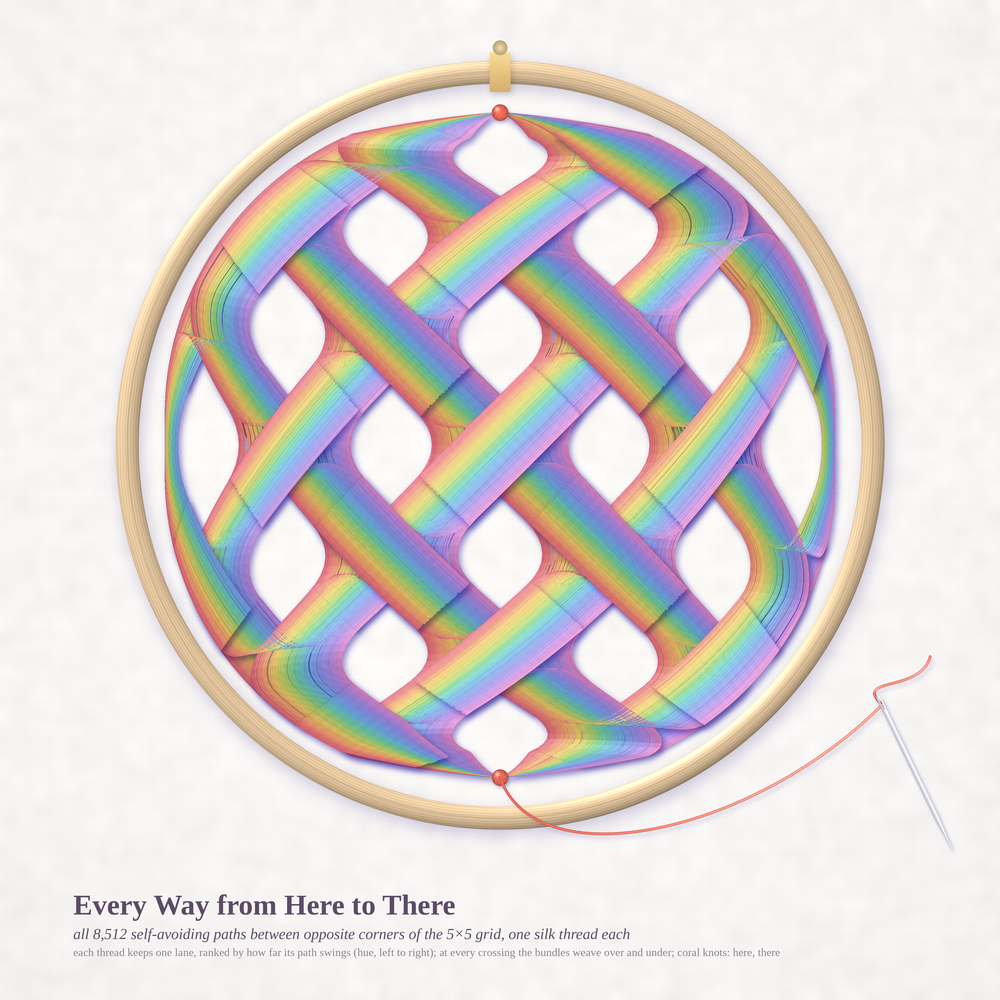
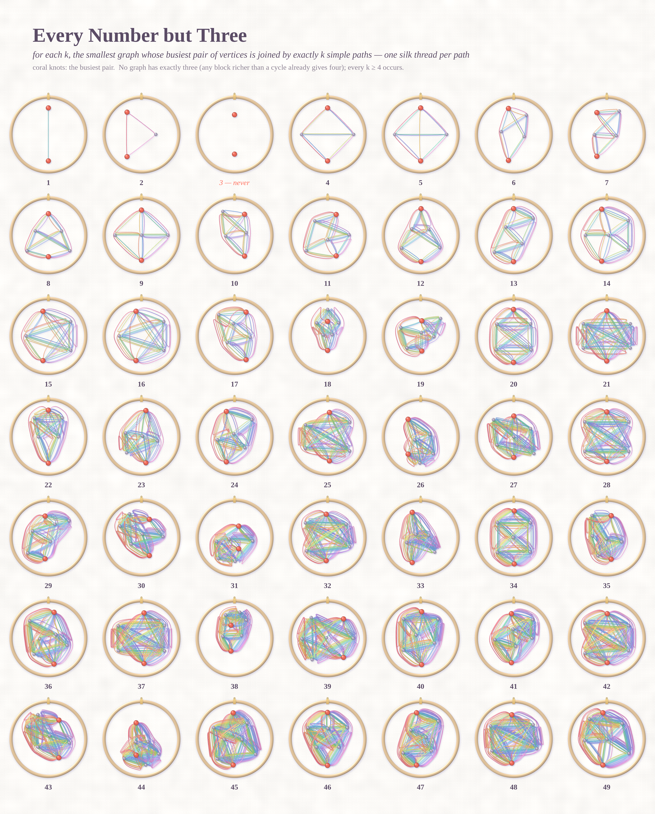
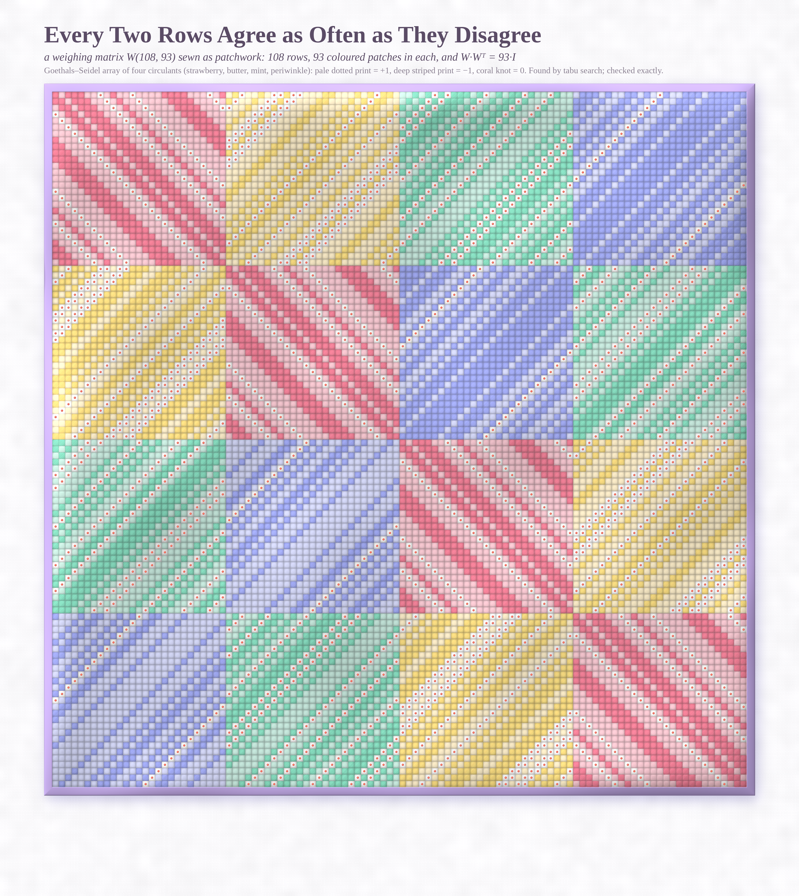

# A CALL FOR NARRATIVE — pastel #37 (Opus 5.5, run 16, 2026-10-14)

*Seeds:* Phil.SE 142569 "In philosophy, you will rarely find any call for narrative?", MathOverflow 371851
(largest number of simple paths between two vertices), MO 516025 (weighing matrices W(108,93) …), MO 516002
(a trigamma series).

New register: **EMBROIDERY**. Silk floss threads on linen (`silk.py`): every thread is a polyline drawn
alpha-over with tube shading, Kajiya–Kay sheen (satin shimmers differently along different stitch
directions), a floss twist, soft lavender shadows, a wooden hoop with a brass clasp. Every path is a story
from one knot to another, so every path gets its own thread.

## Every Way from Here to There (4096², hero)

All **8,512** self-avoiding paths between opposite corners of the 5×5 grid (A007764), one silk thread each.
Each thread keeps one lane for its whole journey, ranked by how far its path swings left or right
(hue, strawberry → bubblegum), so every bundle is a small rainbow ribbon and turns are clean nested mitres.
The grid is warped from the square to the disc so it fills the hoop. At each node the bundles **weave**:
threads are cut at the node boundaries (Chebyshev split), and the pieces are drawn in three layers that
alternate over and under in a checkerboard, each layer throwing a soft shadow on the ones beneath.
The two coral knots are *here* and *there*. A needle, still threaded with coral silk, lies on the linen.

`hoop_paths.py --W 4096 --wmax 0.46 --disc 0.8 --samp 110`

## Every Number but Three (4096×5090)

For k = 1…49, the smallest graph whose busiest pair of vertices is joined by exactly k simple paths,
in its own little hoop. Each path is a silk thread between the two coral knots. Hoop 3 is empty, because
**no graph has exactly three**, and every other number appears.

`sampler.py --W 4096` (data: `math_paths/census.json`, exhaustive nauty census)

## Every Two Rows Agree as Often as They Disagree (4096×4587)

A weighing matrix **W(108, 93)** (MO 516025 lists it as open in the Handbook), sewn as patchwork. Four ternary circulants A, B, C, D sit
in the Goethals–Seidel array, and each has its own hue (strawberry, butter, mint, periwinkle), so the 4×4 block layout is a
Latin square of colours and every block carries its circulant's diagonal stripes. A pale dotted print is +1, a deep striped
print is −1, and a coral French knot on white is 0, with 15 of them in every row. The patches are puffy, the seams sunk with running
stitches, and the binding is lilac. Any two rows agree, where both are coloured, exactly as often as they disagree.

`quilt/tabu.c 27 93 17 8 400000` → `quilt/W108_93.txt`; `quilt/quilt.py quilt/W108_93.txt --W 4096`

## Mathematics (details in `math_paths/NOTES.md`, `math_trigamma/NOTES.md`)

**MO 371851, answered (PROVED, partly computer-assisted).** The values of f(G) = max_{u≠v} #(simple u–v paths)
are exactly {0, 1, 2} ∪ {k ≥ 4}.
- *3 is impossible (hand proof).* Path counts multiply across the blocks between u and v. A 2-connected
  block that is not a cycle contains a theta graph, and two interior vertices on different branches of a theta
  are joined by 4 paths. Otherwise every block is an edge or a cycle, so every count is a power of 2.
- *Every even k:* f(K_{2,a}) = 2a − 2.
- *Every k ≥ 20:* five gadgets plus a "middle" vertices joined to both hubs give f = 5a + r (r = 0…4, a ≥ 4).
  Affinity lemma: a path passes through at most one middle vertex, so every pair's count is affine in a,
  and the maximum is a finite check (`verify_families.py`; I re-checked it independently by brute force with
  networkx for a = 4, 6, 7).
- *4 ≤ k ≤ 19:* the census. The exhaustive census over all connected graphs on ≤ 10 vertices (11.7M at n = 10)
  reaches every k from 4 to 11,054, and 11,055 is the first value that needs 11 vertices.
- Still open (CONJECTURE territory): how fast the minimal vertex count n(k) grows.

**MO 516002 (trigamma series).** S = Σ_{n≥1}[ψ′(1−in) − ψ′(1+in) − 2i/n] = i·T with
T = −0.48197675632314710911170383198462159135973534627147…, which is the quadrant Gaussian-lattice sum
Σ_n[Σ_m 4mn/(m²+n²)² − 2/n]. Fast integral (verified independently to 24 digits):
T = 2∫₀^∞ [2x/|e^{(1+i)x} − 1|² − e^{−x}/x] dx + log 2 − 2γ.
PSLQ finds no closed form in the usual constants. CONJECTURE: none exists, because T is the odd part of a
Barnes double-gamma value, T = −2γ − 2 Im(log Γ₂)″(1+i | 1, i), the way Im ψ′(1+i) is.

**MO 516025 (weighing matrices).** I found explicit Goethals–Seidel weighing matrices independently, with a tabu search
(`quilt/tabu.c`: full-neighbourhood steepest descent over sign flips and zero moves, short tabu tenure) that beat my own
simulated annealer by orders of magnitude. **W(108,93)** (2nd restart), **W(108,87)** and **W(100,95)** each took a few minutes on one core,
and each was verified exactly (WWᵀ = WᵀW = kI). The first rows of the four circulants are in `quilt/W108_93.txt`, `quilt/W108_87.txt`
and `quilt/W100_95.txt`, and the full matrices in `*.matrix.txt`. This independently confirms the asker's three parameter sets (it does not
settle priority in the literature). The searches are easy here, so these GS cases were probably open only for lack of trying.

## The six ideas
1. **Every Way from Here to There.** Every corner-to-corner path of a grid as a woven silk thread. *Built (hero).*
2. **Every Number but Three.** A wall of hoops, one minimal graph per path count. *Built.*
3. **A weighing matrix as a quilt.** A Goethals–Seidel array of four circulants, laid out as a Latin square of colours. *Built.*
4. The Gaussian-quadrant lattice sum behind the trigamma series, as pearls weighted 4mn/(m²+n²)². *Math only.*
5. Partitions into consecutive initial Fibonacci numbers (MO 516010) as a staircase of coins. *Not built.*
6. Spectre multi-tilings / non-5-colourable unit-distance graphs (MO 516016, 516012). *Skipped: territory already used.*

## Story
> *Here asked There how many ways there were between them. The needle answered 8,512 times, and at every crossing the
> threads took turns being on top. In the next hoop, two knots waited for exactly three ways. They never came: whenever a third
> way appears, so does a fourth.*

## What I learned about generative art
- **Give every thread one lane, then weave.** Thousands of paths on a lattice are chaos if each edge sorts its own bundle.
  Give each path a constant lane ranked by one global property (its swing), and every turn becomes a clean nested mitre.
  Cut the threads at the nodes and draw the pieces in three layers that alternate over and under like a checkerboard, and the
  crossings become a basket weave with real shadows. The weave is pure draw order: no 3-D was needed.
- **Warp the lattice into the frame.** A square→disc map turned a rigid trellis into a woven medallion that fills the hoop.
- **A prop tells the story**: the threaded needle makes the hero a moment in time, not a diagram.
- **Material continuity makes a set**: hoop, sampler and quilt are one textile world, so three different maths read as one series.
- **Search engineering is part of the art.** The quilt existed only after swapping annealing for tabu search.
