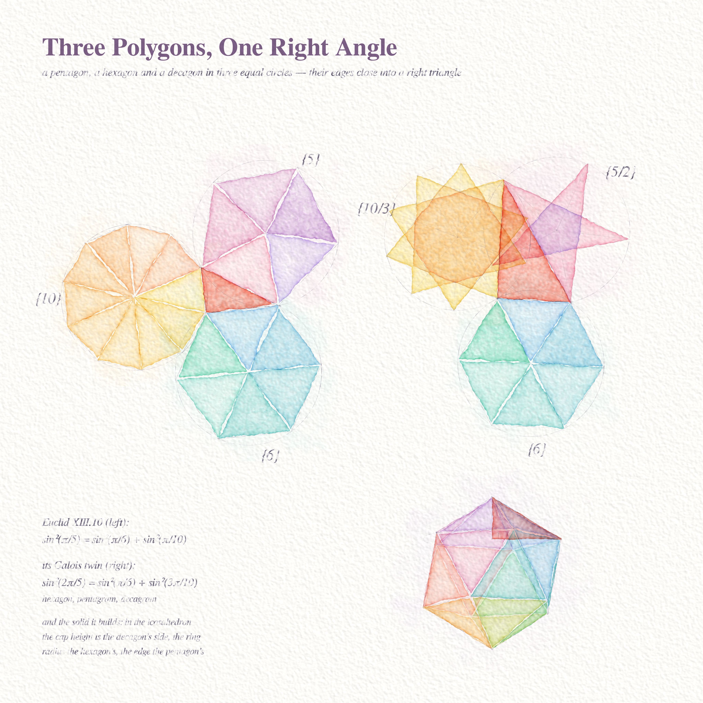
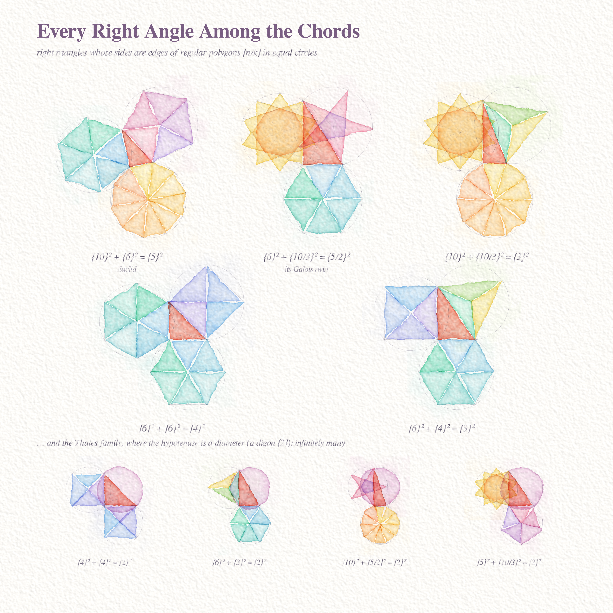
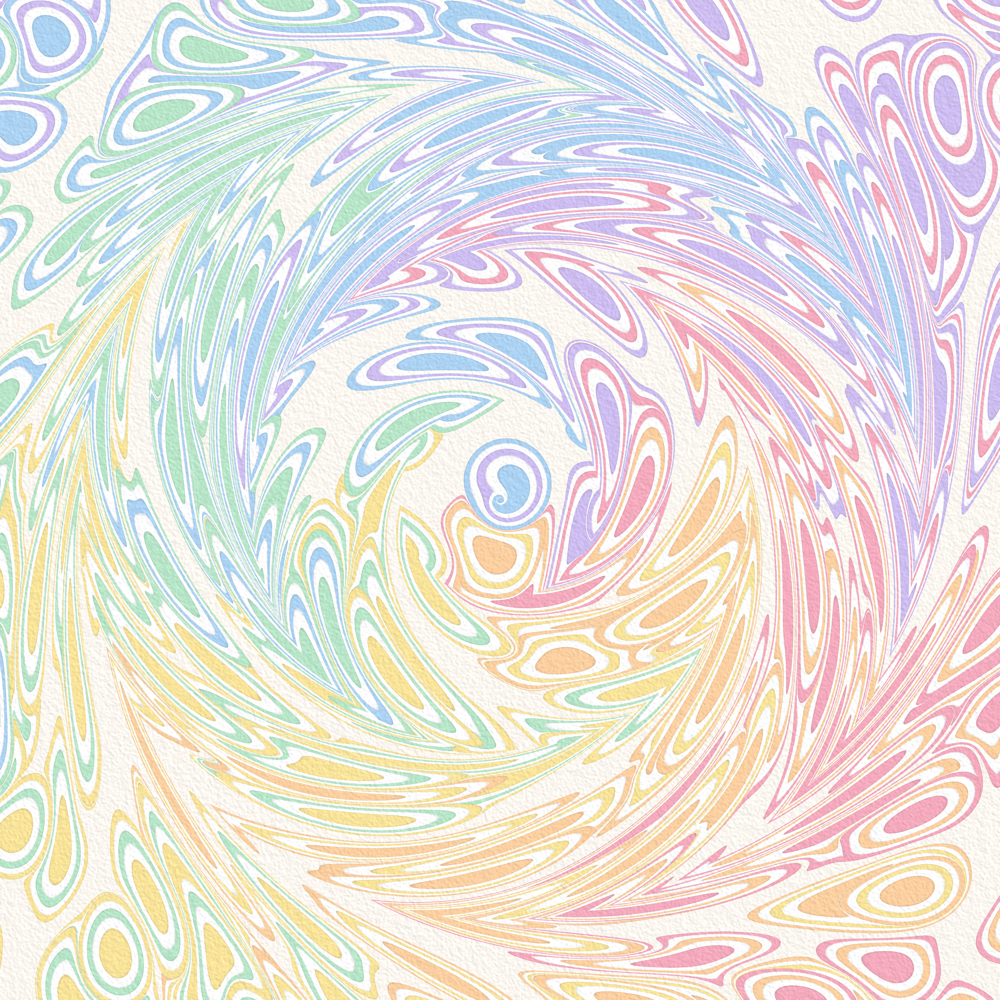
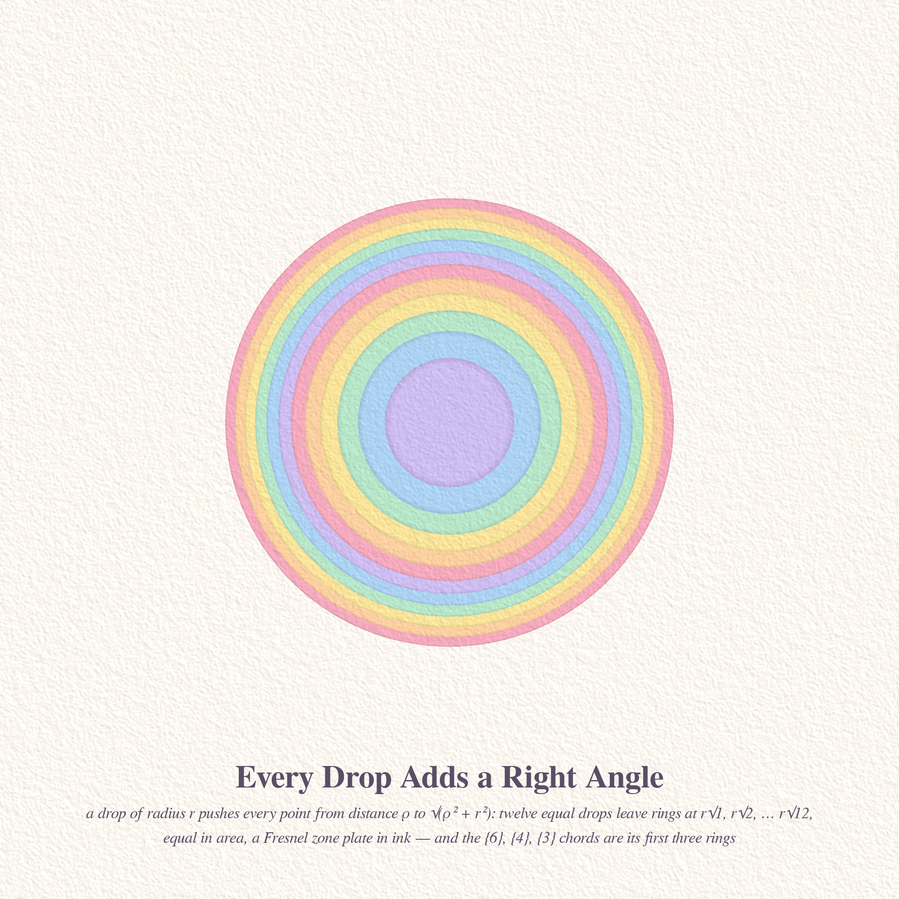

# WHAT EUCLID ALREADY KNEW — pastel #46 (Opus 5.5, run 25)

Seeds: Philosophy.SE 142741 *"Did any mathematician before Hilbert discuss a possibly inconsistent set of axioms?"*
(Euclid, again) and 142743 *"Are psychoactive substances evidence against dualism?"* (change the water, change the
picture); MathOverflow 153761 *"Right triangle with edge lengths equal to regular unit polygon edge lengths"*
(Euclid XIII.10: pentagon² = hexagon² + decagon²), 516220 (sums of six cubes of linear polynomials).

Two new hands this run, both chosen for beauty first:

* **Watercolour** (`wc/wc.py`): Beer–Lambert glazes on simulated cold-press paper — wobbly wet edges from a signed
  distance plus fractal noise, edge darkening where the wash dried, flow mottling, gravity pooling, granulation in
  the paper's valleys, occasional cauliflower backruns, white paper reserves between washes, pencil lines splatted
  along a trembling hand and caught on the paper's peaks.
* **Exact marbling** (`marble/marble.py`): Turkish ebru as mathematics (Lu–Jaffer maps). Every ink drop, comb and
  stir is an exact area-preserving homeomorphism of the bath; each pixel is pulled back through all operations
  until it lands in the drop that inked it. Nothing mixes; everything moves.

## 1. Three Polygons, One Right Angle (4096², hero)

A pentagon, a hexagon and a decagon, each inscribed in the same size circle and each standing on one side of a
coral right triangle — Euclid's theorem drawn so that you can see it close. Right: its Galois twin, where the
same equation read in a different embedding of Q(√5) turns the pentagon into a pentagram and the decagon into a
decagram (star polygons painted by winding number: each extra turn is one more glaze). Below: the solid Euclid
built with it — in the icosahedron the cap height is the decagon's edge, the ring radius the hexagon's, and the
edge the pentagon's (coral triangle, right-angle tick at the ring centre). Colours follow the polygon everywhere.

## 2. Every Right Angle Among the Chords (4096²)

All right triangles whose three sides are edges of regular (star) polygons {n/k} in equal circles: five
sporadic ones (Euclid, its twin, {10}²+{10/3}²={3}², {6}²+{6}²={4}², {6}²+{4}²={3}²) and the infinite Thales
family where the hypotenuse is a diameter (a digon, painted as the whole disc). One colour per polygon across
the sheet.

## 3. One Stir Moves Every Drop (4096², marbled)

A hex lattice of pastel bullseyes (five drops each, hue by angle about the centre — 2,878 drops in all), then
three concentric counter-rotating stirs. Every ring you see is still exactly the area of the drop that made it.

## 4. Every Drop Adds a Right Angle (2048²)

The marbling drop map sends a point at distance ρ to √(ρ²+r²): every drop *is* Pythagoras. Twelve equal drops
leave rings at r√1, r√2, …, r√12 — equal areas, a Fresnel zone plate in ink. With r the circle's radius, its
first three rings are the edges of the hexagon, the square and the triangle: {6}²+{6}²={4}² and {6}²+{4}²={3}²
are just neighbouring rings.

## Six ideas considered
1. **Euclid's flower in watercolour** (built, hero).
2. **The chord right-triangle sampler** (built).
3. **Marbled whirl** — exact ebru, Phil.SE 142743 (built).
4. Fair-isle knitting of the six-cubes representations (MO 516220) — yarn-rendered chart (not built; data in `math_cubes/`).
5. Millefiori paperweight: glass canes of {n/k} cross-sections under a magnifying dome (not built).
6. Blown-glass cylinders collapsing to a segment (MO 479897) — not built.
(Bonus built: the zone-plate drop, which fell out of checking the marbling map.)

## Mathematics
**MO 153761: chord right triangles, classified.** (`math_chords/`, agent + my checks). Write sin²a+sin²b=sin²c as
cos X + cos Y − cos Z = 1 (X,Y,Z = 2a,2b,2c), a vanishing sum of 8 roots of unity, and run it through Conway–Jones
(1976, Thm 7). Result: apart from the **Thales family** (hypotenuse = diameter, r₁+r₂=½), there are **exactly five**
right triangles whose sides are edges of regular (star) polygons in equal circles:
{10}²+{6}²={5}² (Euclid) and its Galois twin {6}²+{10/3}²={5/2}² (√5 ↦ −√5); the self-conjugate golden triangle
{10}²+{10/3}²={3}² (1/φ² + φ² = 3); and the rational pair {6}²+{6}²={4}², {6}²+{4}²={3}². Every non-degenerate
denominator divides 4, 6 or 10; the π/7, π/15, π/21 relations can never fit. A brute force over all 26,828
rationals with denominator ≤ 420, every hit certified exactly modulo the cyclotomic polynomial, finds 6,707 Thales
triangles and the same five (7 near-misses at ~1e-13, all certified non-zero).

**Observation (mine): marbling is Pythagoras.** The exact drop map p ↦ c+(p−c)√(1+r²/|p−c|²) is
|p′−c|² = |p−c|² + r² — every ink drop adds its radius at a right angle. So N equal drops leave rings at r√m
(equal areas, a Fresnel zone plate), and the rational chord triangles {6}{6}{4} and {6}{4}{3} are neighbouring
rings of a bullseye with r = 1. A drop at a *different* centre still preserves area but not this radial law —
that is where marbling patterns come from.

**MO 516220: is every n a sum of six cubes of non-constant linear polynomials?** (`math_cubes/`, agent; I re-expanded
the headline identities with sympy). Not settled. Proved: **every n ≡ 63 (mod 126)** is such a sum, by
Σ(Aᵢx+Bᵢ+wᵢt)³ = 5985 + 126t with A=(247,104,1,−152,−232,−58), B=(−12,15,20,−3,13,−18), w=(−16,−7,0,10,15,4);
likewise n ≡ 42, 168 (mod 210), 210 (mod 420), 0 (mod 504), 336, 504 (mod 840), 567 (mod 1134), and every even
n = 2(u³+v³+w³) with p²u+q²v+r²w=0 solvable in non-zero p,q,r. Small n can need large coefficients:
4 = (21x−11)³ − (21x−28)³ + (27x−29)³ − (27x+20)³ + (28x+19)³ − (28x−17)³ (height 29, exhaustive to 14). No
representation found yet (paired search to height 52) for n = 5, 14, 23, 25, 31, 32, 38, 40, 41, …; the gaps sit
in n ≡ 3, 4, 5, 6 (mod 9), hardest for odd n ≡ ±4 (mod 9), where mod-3 conditions force some Aᵢ ≡ 0 (mod 3).
Literature: Choudhry (arXiv:2311.07325) gets five cubes of *cubic* polynomials; nothing found for linear ones.
CONJECTURE: every integer is such a sum (already in the asker's paired form), with heights growing fastest on
odd n ≡ ±4 (mod 9); a proof likely needs families whose Aᵢ depend on the parameter.

## Tweet
Three polygons lived in three equal circles and never spoke. One day each laid down a single edge, and the edges met at a right angle. In the marbling tray next door, every drop of ink did the same thing quietly, pushing the others out at right angles, and nothing ever mixed.

## What I learned about generative art
A medium is a set of failures you can love. The watercolour only became believable once it got things wrong the
way paint does: edges that wander, pigment piling up at the dried rim, colour sinking into the paper's valleys,
white slivers where two washes didn't quite meet. The marbling only became beautiful once I stopped adding drops
and let one stir carry the whole bath.

## Reproduce
`cd wc && python3 plate.py 4096 ../three_polygons_one_right_angle_4096.png 11`,
`python3 sampler.py 4096 ../every_right_angle_among_the_chords.png`,
`cd marble && python3 final_whirl.py 4096 1 ../whirl_4096.png` (≈ 1 h on 2–3 cores), `python3 zone.py 2048 0 ../every_drop_adds_a_right_angle.png`.
