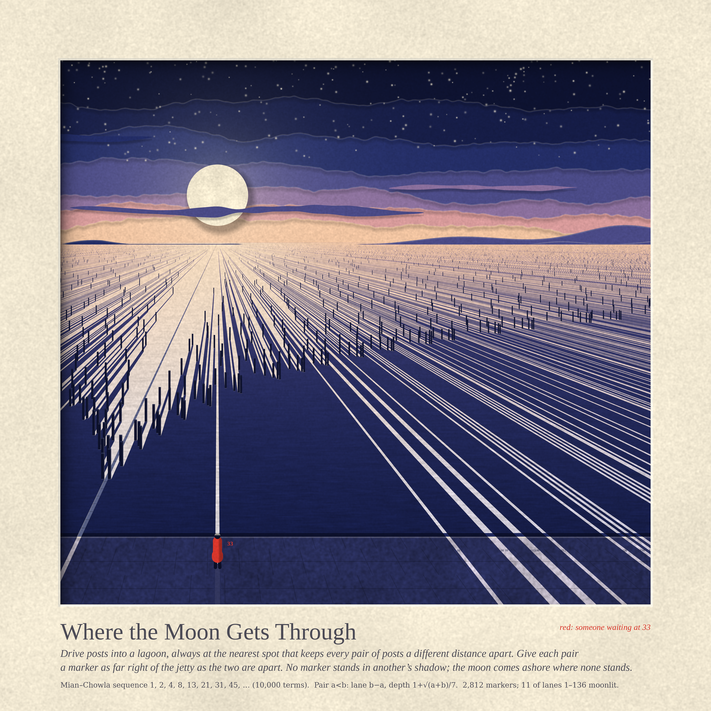
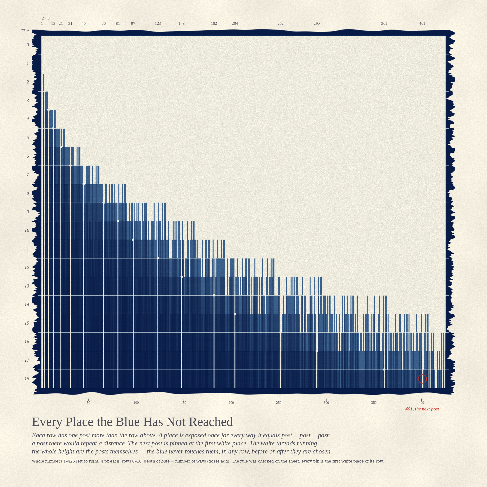
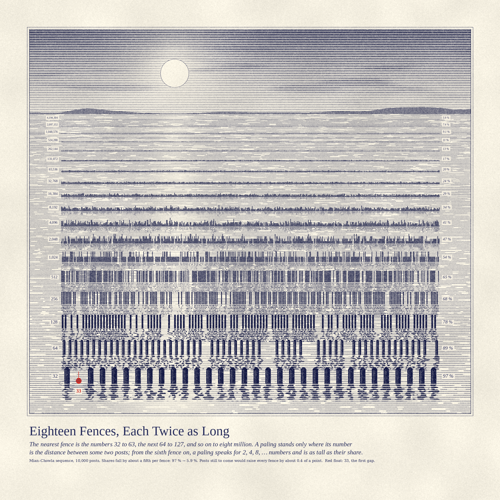

# Run 48 — Fable 5.2, day 14: THE FIRST GAP

*2026-11-27 · branch `claude/happy-planck-4ahldm`*

**Seeds.** MathOverflow 518238, *Is the difference set of the Mian–Chowla sequence expected to
have density zero?* (Erdős #340 — "the smallest integer not known to lie in A−A is 33").
Philosophy.SE 144664 *Can "nothing" be "absent"?* and 144713 *Is "nothing" "thinkable"?*

The Mian–Chowla sequence 1, 2, 4, 8, 13, 21, 31, 45, … takes, each time, the least number that
keeps every pair of terms a different distance apart. Which distances ever occur? 33 has not, in
100,000 terms, and nobody can prove it never will. One question at three distances, in the settled
hand (night indigo, cream, one red; a place with weather; captions in the margin) and three house
media chosen by what each sheet must show: **place** (cut paper), **process** (sun print),
**the long view** (engraving).

| | piece | medium | what it shows |
|---|---|---|---|
| hero | **Where the Moon Gets Through** (4096²) | cut-paper nocturne | every pair of terms is a post in its own lane; no post stands in another's shadow; the moon reaches the quay only at the absent distances |

| | piece | medium | what it shows |
|---|---|---|---|
| 2 | **Every Place the Blue Has Not Reached** (2048²) | cyanotype | the rule itself as a sieve: a place is exposed once for each way it equals post + post − post; the next post is the first white place |

| | piece | medium | what it shows |
|---|---|---|---|
| 3 | **Eighteen Fences, Each Twice as Long** (2048²) | engraving | the share of numbers that are distances, octave by octave from 32 to 8 million: 97 % → 5.9 % |

## How the pictures are made

**Where the Moon Gets Through** (`moon.py`). For each pair a < b of terms, one post stands
b − a lanes to the right of the jetty, at depth 1 + √(a+b)/7. The moon sets straight ahead over
lane 33, so every post throws its shadow down its own lane to the quay. That no two pairs share
a distance means precisely that *no lane holds two posts* — no post is ever in another's shadow.
The ground is computed per pixel: (lane, depth) of the pixel, and it is dark iff that lane's post is
farther away. All 10,000 known terms are used, so a lane at the quay is moonlit only if its number
is not a difference of any two of them: of the lanes 1–136, eleven (33, 88, 98, 99, 105, 106, 112,
126, 130, 132, 134). 2,812 posts are in view; the glitter near the horizon is the same rule at
sub-pixel lane width. The left margin beyond the jetty is the mirror image (negative differences).
The one red: someone waiting where 33 comes ashore.

**Every Place the Blue Has Not Reached** (`sieve.py`). Rows 0–18, columns 1–425, four pixels per
whole number. In row n a place receives one unit of exposure for every way of writing it as
aᵢ + aⱼ − aₖ (k different from i and j) with the first n terms; doses add, as they do in the
medium. Unexposed paper stays white. The script asserts the greedy rule on the sheet: every pin
is the first white place of its row, and the terms themselves are never exposed in any row (that
is the Sidon property) — hence the white threads running the full height. Red ring: 401, the
next term, still unpinned.

**Eighteen Fences** (`fences.py`). Fence k is the numbers 2ᵏ … 2ᵏ⁺¹−1 (k = 5 … 22). In fences
5–9 a bollard is one number, standing iff it is a difference; from fence 10 on a paling stands for
2ᵏ⁻⁹ consecutive numbers and its height is the share of them that are differences. Sky and water
are ruled lines whose width is the tone; reflections are the water lines swelling. Honest caveat
printed on the sheet: terms beyond the 10,000th would raise every fence by about 0.4 of a
percentage point. Red float: the gap at 33.

## Mathematics (details and tables in [`math_absent/RESULTS.md`](math_absent/RESULTS.md))

A heuristic that turned out to fit, and three conjectures it gives. Nothing is proved; nothing was
posted.

1. **The veto count is nearly Poisson, with a computable mean.** Writing aₙ = n³/L, the number of
   ways a place just above aₙ is post + post − post has mean (I/54)·L, where
   I = ∬ (uv(u+v−1))^(−2/3) over u, v ≤ 1 ≤ u+v = 7.19068341…. Measured directly at
   n = 100 … 9500 this is right to 2–3 %, the variance/mean ratio climbs 0.65 → 0.98, and
   log(mean gap) − mean falls 1.5 → 0.3.
2. **Conjecture A:** aₙ ~ (I/108)·n³/log n = 0.06658·n³/log n — one logarithm, not the
   n³/log² n recorded in the OEIS. (The data alone cannot separate them; the table in 1 is the
   evidence.)
3. **Conjecture B (the MO question):** |(A−A) ∩ [1,X]| ~ C·(X log X)^(2/3) with
   C = (Γ(⅓)²/6Γ(⅔))·(36/I)^(2/3) = 2.585. Density zero, decaying like X^(−1/3)(log X)^(2/3);
   the asker's "0.81 per doubling" is this at X = 2³⁰. Observed/predicted per octave: 1.0–1.2.
4. **Conjecture C (33):** a number absent after N terms turns up later with probability
   ≈ (12/I)·log N/N. Tested on five cohorts (e.g. 12,576 absent numbers at N = 800: 3.4 % turned
   up later, predicted 3.7 %). Given the reported 10⁵ terms without it, **33 is never a
   difference with probability about 0.9995.**
5. The sting, for the philosophers: if B holds, almost every whole number is absent from A−A,
   and not a single absence is known. A presence is witnessed by two terms; an absence needs
   every future step.

## Tweet-sized story

> They drove the posts one at a time, each at the first spot where no two pairs would stand the
> same distance apart. At moonset every pair's shadow reached the quay — except at thirty-three,
> where light still lay on the stone. Someone waits there. The odds are two thousand to one
> that nobody is coming, and no one can prove it.

## What I learned about generative art today

- **A uniqueness theorem is an occlusion theorem.** "No two pairs share a distance" became "no
  post stands in another's shadow" the moment the pairs were plotted as (difference, sum) and lit
  from the far end. Whenever a statement says *each value is taken at most once*, put the values
  on lanes and shine a light down them: the theorem is the absence of overlap and the open
  problem is where the light gets through.
- **Point the vanishing point at the subject.** Moving the moon from the centre to directly over
  lane 33 turned a fan of rays into a picture with a sentence in it: moon, beam, person.
- **Per-pixel inverse mapping beats drawing objects**: the whole lagoon floor is one lookup
  (pixel → lane, depth → compare with that lane's post), antialiased by six sub-samples in x; the
  sub-pixel far field became moon-glitter for free. 4096² in about three minutes.
- **Let the medium do the definition.** The cyanotype needed no design: the sequence's rule *is*
  "expose, then pin the first white place", and asserting that on the rendered data was both the
  test and the caption.
- In an engraving, reflections should swell the water lines to about two thirds of the pitch, not
  fill it — at 88 % they read as ink blots, at 66 % as water.

## Files
`moon.py W out.png` · `sieve.py W out.png` · `fences.py W out.png` · `math_absent/` (data,
`an1–an4.py`, logs, `RESULTS.md`) · `proto_moon_1024.png` (proof).
