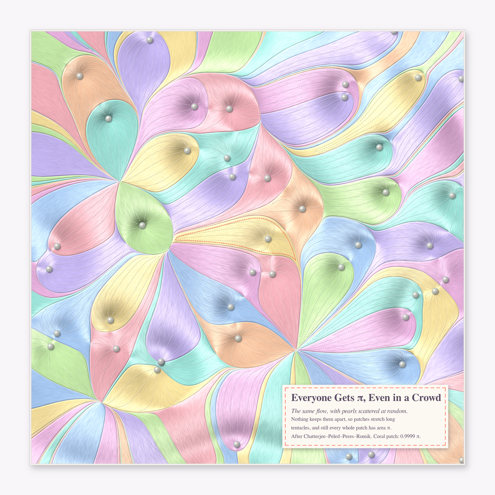

# DISTRIBUTED ACROSS MANY — pastel #52 (Opus 5.5, run 31)

*Series title from Philosophy.SE 142905: "How did Aristotelian realists address 'locating' potentialities that appear
distributed across multiple objects?"* Each piece is a quantity that no single object owns. A building's height lives in
the rooftops it can see. A patch of plane belongs to the zero that its flow drains into, and every zero gets the same
share.

Seeds (live front pages, 2026-10-28): **MO 516465** *2-dim city-building sequence* (is the diagonal unbounded?),
**MO 448829** *Allocation of ℝ²* (does the flow of −∇Σlog|x−zᵢ| carry a.e. point to a zero?), OEIS **A400000**
(the 1-D city-building sequence), Phil.SE 142905.

## The pieces

### 1. As Tall as What It Sees (hero, 4096²)

The 2-D city-building array on a 72 × 72 corner of ℤ²≥0 as a pastel miniature city, path-traced (`city/tracer.py`:
numba grid-DDA over one box per lot, golden sun with soft shadows, one diffuse bounce, ribbon windows (one band
per floor, so you can count each a(i,j)), street trees, zebra crossings, tilt-shift thin lens, a shallow-to-deep sea
beyond the two axes with a regatta of striped sails and wakes). The camera sits on the diagonal, so the symmetry
a(i,j) = a(j,i) becomes mirror symmetry. The coral-roofed tower at (19,19) has 14 floors and strings a coral line to
each of the 14 rooftops it sees: 7 along its street and 7 along its avenue.

### 2. Everyone Gets π (4096²)

The finite-n flow of MO 448829, made confining: the zeros of a Gaussian entire function f(z)=Σξₖzᵏ/√k! and the flow
ż = z − conj(f′/f) = −∇(log|f| − |z|²/2). By Sodin–Tsirelson / Nazarov–Sodin–Volberg, a.e. point flows to a zero
and every basin has area exactly π. Here it is a tufted satin patchwork quilt (`alloc/quilt.py`). The relief is the
potential itself, so the pearl buttons sit in the dimples at the zeros. The satin grain is a line-integral convolution
along the flow, with an anisotropic sheen. Dashed tufting stitches follow flow lines out from each button, and the
patches are greedy-coloured from the sorbet box. The coral running stitch marks the patch nearest the centre.
**Measured: every interior basin has area π to within 0.15 % (34 basins at 1024², mean 1.00002 π); the coral patch at 4096 measures 0.99998 π.**

### 2b. Everyone Gets π, Even in a Crowd (4096², the "go deeper" on my favourite)

The same flow ż = z − Σ(z−a)/|z−a|², but the pearls are a Poisson process of intensity 1/π (gravitational allocation,
Chatterjee–Peled–Peres–Romik). Zeros of the Gaussian entire function repel each other; Poisson points do not. So
the patches stretch into feather-like tentacles that meet in starbursts at the maxima of the potential. Still every whole patch has area π
(coral patch: 0.9998 π). Computed on a 1.5× margin and cropped, so tentacles of off-frame pearls are traced honestly;
the relief is the potential with its large-scale swell removed.

### 3. Each House Sees Its Own Height (4096 × 2304)

Row 0 of the city is OEIS A400000 itself: 0,1,1,2,1,2,1,3,1,2,1,3,1,2,1,10,… Here it is a storybook Burano waterfront
(`shore/shore.py`, PIL at 2× supersampling with a rippled reflection). Each house has a(n) floors with shutters and
flower boxes. The garden at n = 0 is the empty lot. The three tall houses (10, 10, 11 floors) string bunting to every
earlier rooftop they can see: 10, 10 and 11 strings. The script asserts each count.

## The six ideas (3 built, plus one go-deeper)
1. **Miniature city of MO 516465** with sight-line threads (built, hero).
2. **Gravitational allocation quilt** of GEF zeros (built).
3. **A400000 waterfront** with bunting (built: the "go deeper" on the city, a frontal elevation in a different register).
4. Restless primes (MO 516457): power-tower digits freezing from the right, as a woven ribbon (not built: a chart, not a picture).
5. Fair n-fans of an ellipse (MO 516441) as stained glass (not built: too close to the run-26 fair-cut cake).
6. Smallest K₅-free 5-regular 5-chromatic graph (MO 516462) as a glass mobile (not built; 6 and 8 vertices are impossible
   by complementing 2-regular graphs; my guess at a 10-vertex construction failed a 200k random search, so it stays open here).

## Mathematics (MO 516465)
**What I checked.** My `city/citygen.py` reproduces the 30 × 30 table posted on MO (rows 11–19 and the diagonal),
and row 0 reproduces OEIS A400000. Computed up to 6000 × 6000 (36 M buildings, global max 828).

**Small theorem: every diagonal height is even.** By induction a(i,j) = a(j,i). So for the diagonal cell the row
seen to the left and the column seen below are the same sequence, and V_{n,n}(h) = 2·v_n(h). The least h with
2v_n(h) = h is therefore even: a(n,n) = 2m, where m is the least m with v_n(2m) = m.

**Records of the diagonal:** 2 (n=1), 4 (14), 14 (19), 30 (458), 34 (493), 66 (748), 222 (1036). Then nothing higher up to
n = 6000; the next largest are 192 (5124), 178 (1167), 166 (4112), 126 (5623).
The bursts come in clusters: n = 1099…1203 has 51 diagonal values ≥ 16.

**Mechanism.** v_n(h) − h/2 behaves like a walk that hugs zero, and a(n,n) is its first return to zero at an even h.
For n = 1036 the row from height h sees 1,1,3,3,3,5,6,7,… buildings and stays above h/2 until h = 222.

**Conjecture (stated as such).** The diagonal values have a limiting distribution with a power tail,
P(a(n,n) ≥ x) ≈ C·x^(−α), α ≈ 1.8–2 (C ≈ 9). Fitted on n ≤ 6000; the tail frequencies at x = 8, 16, 32 agree to
three digits between the first 3000 and the first 6000 entries. So **the diagonal is unbounded**: if the entries
mixed even weakly, max_{k≤n} a(k,k) would grow like √n (≈ 3√n). What would decide it: a proof that v_n(h) − h/2 has
no drift, or a computation to n ≈ 25 000 seeing a record near 450.

Curiosity: a(1036,1036) = 222 = 2·111, and 111 is the 1-D record a(0,1245). It's probably a coincidence:
the next 1-D record is 148 and the next diagonal giant is 192.

**MO 448829 (the flow question).** For finite n the answer is yes: U = Σ log|x − zᵢ| is harmonic off the zᵢ.
So its critical points (the zeros of p′, for p = ∏(z − zᵢ)) are saddles, not attractors. The trace of the Jacobian of ∇U
is ΔU = 0, which refutes the asymptotically stable midpoint claimed in the second post. Only the measure-zero
stable manifolds of the saddles fail to reach a zᵢ. Adding the confining −|z|²/2 turns it into gravitational allocation
(pieces 2 and 2b), where every basin has area exactly π.

## Tweet
*A city where every tower is exactly as tall as the number of roofs it can see. Down the middle avenue they stay
two or four storeys, until one, a thousand lots out, rises to 222. Next door a quilt of pearls, each pulling in the same π
of satin, whether its neighbours keep their distance or crowd in.*

## What I learned about generative art (this run)
- **Pick the camera that turns a symmetry into composition.** a(i,j) = a(j,i) became a mirror-symmetric diamond once the
  camera sat on the diagonal. The protagonist went in front of its taller twins, and the sea went where the fog had been.
- **Let the field draw the texture.** A line-integral convolution along the flow is free satin. The potential itself is
  the quilt's relief, and the buttons sit exactly where the field has its sinks. Nothing decorative is invented.
- **Repulsion is calm; independence is wild.** The same flow and the same theorem give a tidy quilt or a paisley
  of tentacles, depending only on whether the pearls keep their distance.
