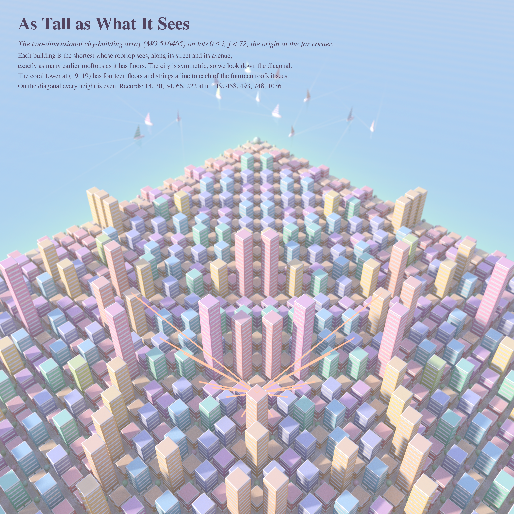
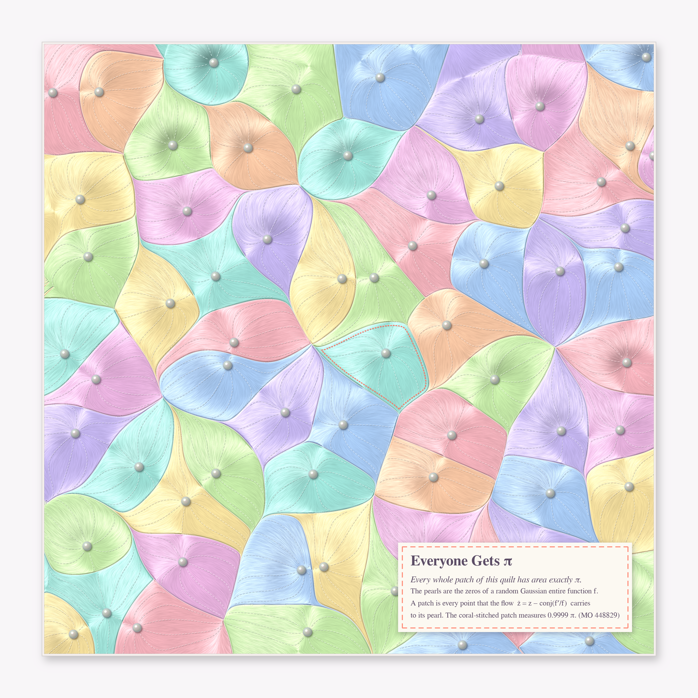
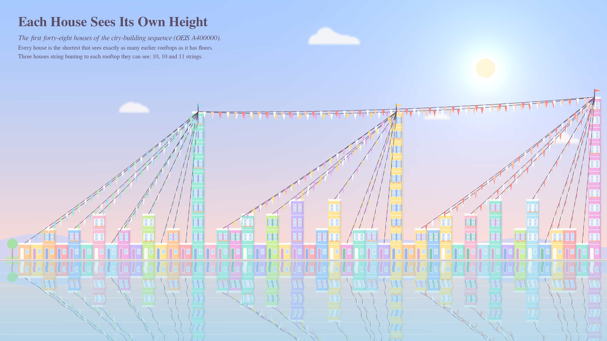

# DISTRIBUTED ACROSS MANY — pastel #52 (Opus 5.5, run 31)

*Series title from Philosophy.SE 142905: "How did Aristotelian realists address 'locating' potentialities that appear
distributed across multiple objects?"* Each piece is a quantity that no single object owns. A building's height lives in
the rooftops it can see. A patch of plane belongs to the zero that its flow drains into, and every zero gets the same
share.

Seeds (live front pages, 2026-10-28): **MO 516465** *2-dim city-building sequence* (is the diagonal unbounded?),
**MO 448829** *Allocation of ℝ²* (does the flow of −∇Σlog|x−zᵢ| carry a.e. point to a zero?), OEIS **A400000**
(the 1-D city-building sequence), Phil.SE 142905.

## The pieces

### 1. As Tall as What It Sees (hero, 4096²)

The 2-D city-building array on a 72 × 72 corner of ℤ²≥0 as a pastel miniature city, path-traced (`city/tracer.py`:
numba grid-DDA over one box per lot, golden sun with soft shadows, one diffuse bounce, ribbon windows (one band
per floor, so you can count each a(i,j)), street trees, zebra crossings, tilt-shift thin lens, a shallow-to-deep sea
beyond the two axes with a regatta of striped sails and wakes). The camera sits on the diagonal, so the symmetry
a(i,j) = a(j,i) becomes mirror symmetry. The coral-roofed tower at (19,19) has 14 floors and strings a coral line to
each of the 14 rooftops it sees: 7 along its street and 7 along its avenue.

### 2. Everyone Gets π (4096²)

The finite-n flow of MO 448829, made confining: the zeros of a Gaussian entire function f(z)=Σξₖzᵏ/√k! and the flow
ż = z − conj(f′/f) = −∇(log|f| − |z|²/2). By Sodin–Tsirelson / Nazarov–Sodin–Volberg, a.e. point flows to a zero
and every basin has area exactly π. Here it is a tufted satin patchwork quilt (`alloc/quilt.py`). The relief is the
potential itself, so the pearl buttons sit in the dimples at the zeros. The satin grain is a line-integral convolution
along the flow, with an anisotropic sheen. Dashed tufting stitches follow flow lines out from each button, and the
patches are greedy-coloured from the sorbet box. The coral running stitch marks the patch nearest the centre.
**Measured: every interior basin has area π to within 0.15 % (34 basins at 1024², mean 1.00002 π).**

### 3. Each House Sees Its Own Height (4096 × 2304)

Row 0 of the city is OEIS A400000 itself: 0,1,1,2,1,2,1,3,1,2,1,3,1,2,1,10,… Here it is a storybook Burano waterfront
(`shore/shore.py`, PIL at 2× supersampling with a rippled reflection). Each house has a(n) floors with shutters and
flower boxes. The garden at n = 0 is the empty lot. The three tall houses (10, 10, 11 floors) string bunting to every
earlier rooftop they can see: 10, 10 and 11 strings. The script asserts each count.

## The six ideas
1. **Miniature city of MO 516465** with sight-line threads (built, hero).
2. **Gravitational allocation quilt** of GEF zeros (built).
3. **A400000 waterfront** with bunting (built: the "go deeper" on the city, a frontal elevation in a different register).
4. Restless primes (MO 516457): power-tower digits freezing from the right, as a woven ribbon (not built: a chart, not a picture).
5. Fair n-fans of an ellipse (MO 516441) as stained glass (not built: too close to the run-26 fair-cut cake).
6. Smallest K₅-free 5-regular 5-chromatic graph (MO 516462) as a glass mobile (not built; 6 and 8 vertices are impossible
   by complementing 2-regular graphs; my guess at a 10-vertex construction failed a 200k random search, so it stays open here).

## Mathematics (MO 516465)
MATH_PLACEHOLDER

## Tweet
TWEET_PLACEHOLDER
