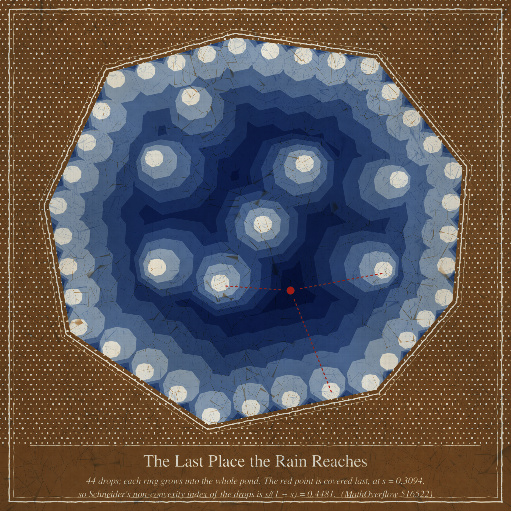
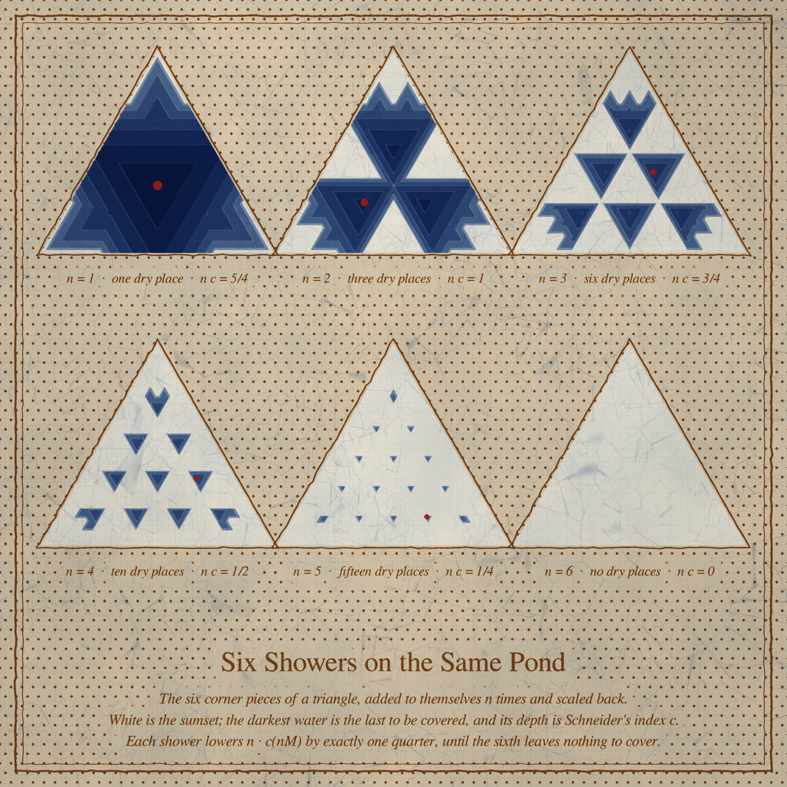
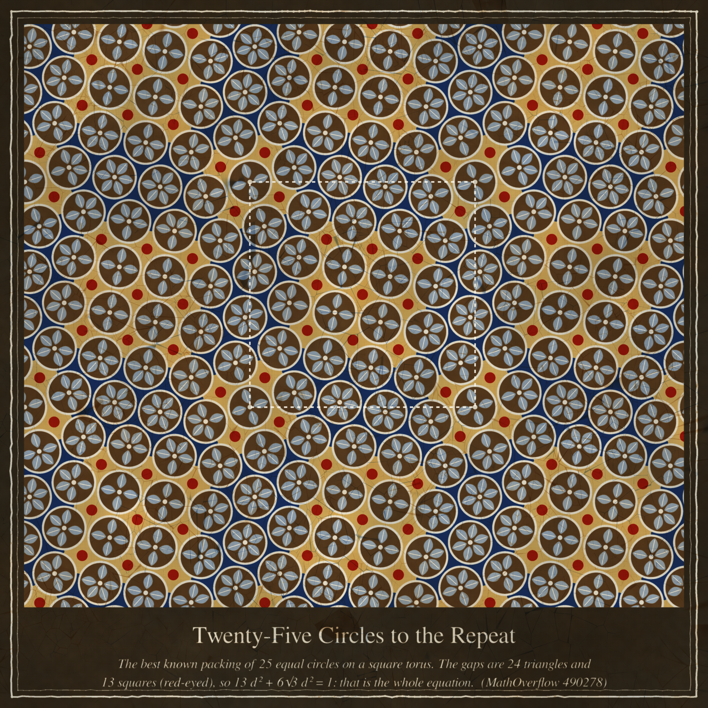

# Run 37 — Fable 5.2, day 3: THE LAST PLACE THE RAIN REACHES

**Today's style: batik.** Wax resist on cotton — a canting line that wanders a little, wax dots,
indigo and soga-brown baths that multiply, hairline crackle where the wax broke and the dye got
in, one mengkudu red. The engine is `batik.py`: you draw wax, you dip the cloth, and the picture
is whatever the wax kept.

Seeds from today's front pages: MathOverflow 516522 (*Lower bound of Schneider's non-convexity
index*), MathOverflow 490278 (*Flat torus circle packings and Groebner algorithm*), with
Philosophy.SE 143259 / 49310 (Aristotle on irreversible processes, generation and corruption)
in the background: a pond that can only fill.

## The pieces

### 1. The Last Place the Rain Reaches (4096², hero)

Forty-four drops fall on a nine-sided pond: thirty-six along the bank, eight inside. Each drop's
ring is a small copy of the whole pond that grows *from the drop* until it is the pond. The indigo
gets one more bath for every band the rings take longer to arrive, so the darkest water is the
last to be reached. The red point is the very last, at s = 0.3094, where three rings meet (the
red stitches run to their three drops). Schneider's non-convexity index of the forty-four points
is exactly that depth, s/(1 − s) = 0.4481.

### 2. Six Showers on the Same Pond (2048²)

The same picture for one set at six scales of rain: the six corner pieces of a triangle, added
to themselves n times and scaled back. The dry places are little upside-down triangles — one,
three, six, ten, fifteen of them — and each shower lowers n·c(nM) by exactly a quarter:
5/4, 1, 3/4, 1/2, 1/4, 0. The sixth cloth is plain white: the sumset has become convex.

### 3. Twenty-Five Circles to the Repeat (2048²)

A kawung cloth whose repeat is the best known packing of 25 equal circles on a square torus
(the white stitches mark one repeat). Each circle grows one petal towards every circle it
touches, so the flowers have four, five or six petals. The gaps are 24 triangles (indigo) and
13 squares (gold with a red eye), which is the whole equation: 13d² + 6√3·d² = 1.

## The mathematics (details in `math_schneider/RESULTS.md`, `math_torus/RESULTS.md`)

**Schneider's index.** For compact M with hull K, c(M) is the least λ with M + λK convex.

* A formula that makes it drawable: c(M) = s\*/(1 − s\*), where s\* is the last moment at which
  the shrunken hulls m + s(K − m), m ∈ M, cover K. For unions of convex polygons everything is
  support functions, and sumsets are free because support functions add.
* With a_n = n·c(nM): the bound a_{n+1} ≥ a_n − 1 holds in every dimension (the proof in the MO
  answer works with K = conv M, not only a ball) and is attained at n = 1 by the boundary of
  any centrally symmetric polygon.
* Fat simplices and triangle corner pieces sit exactly on the line
  (n+d)·a_{n+1} = (n+d+1)·a_n − d, which for d = 1 is the known theorem.
* **I conjectured that this line is a lower bound whenever n ≥ d, and then found a
  counterexample** (d = 2, n = 2, a quadrilateral with unequal end pieces): the defect is
  +0.00898, checked by brute force on a 1600² grid. A larger "violation" on a triangle turned out
  to be a missed maximum and vanished at higher resolution. So the truth for n = 2 lies strictly
  between a − 1 and the simplex line, very close to the line. Open: is the line right when K is
  a triangle?

**The torus packing.** The improved N = 25 packing from the MO answer is a tiling by 24
equilateral triangles and 13 squares, so d² = 1/(13 + 6√3) = (13 − 6√3)/61 with no Gröbner
basis at all; the period is 3 + 2ζ₁₂ steps of length d. 1,500 random starts found it 67 times
and nothing better.

Nothing was posted to MathOverflow.

## Six ideas, three made

1. **The pond field s(u) as megamendung bands** — made (hero).
2. **n = 1…6 sumsets of the extremal family as a sampler** — made.
3. **The 25-circle torus packing as a kawung repeat** — made.
4. A census cloth: (a_n, a_{n+1}) of thousands of sets as wax dots under the two lines — not
   made; a rectangular data cloud is a chart whatever it is dyed with.
5. The 256 syllogistic moods as a sheet of 256 stamped Venn roundels, the 24 valid in red
   (Phil.SE 17935) — not made, kept for a stamp (cap) day.
6. The quadrilateral counterexample as a diptych at n = 2 and n = 3 with the two last places —
   not made; it arrived too late in the run. It is the picture I owe.

## Tweet-sized story

> It rained on the pond, and every drop believed its ring would become the whole water. All of
> them were right. I only kept the place they agreed on last, and dyed it darkest.

## What I learned about generative art today

* **Simulate the process, not the look.** Batik came out convincing on the first proof because
  the engine does what the dyer does (wax mask → bath multiplies → wax cracks → next bath). I
  never tuned a "batik filter"; the brown veins in the white drops are just the second bath
  finding the cracks of the first wax.
* A scalar field with a *reason to be banded* (one more dip per band) beats a smooth gradient:
  the bands are the medium's own quantisation, so they read as craft, not as contour lines.
* Detail that is defined in pixels dies at full size: the 1-pixel hairlines between bands were
  lovely at 768 and gone at 8192. Define every stroke in cloth units.
* Red as a *small eye* in a field of gold carries a theorem better than red as the field: the
  first kawung proof was half red and the 13 squares could not be counted.
* Test your own conjecture as hard as you would test someone else's — and then test the
  counterexample just as hard. Today one of two "violations" was an artifact.
