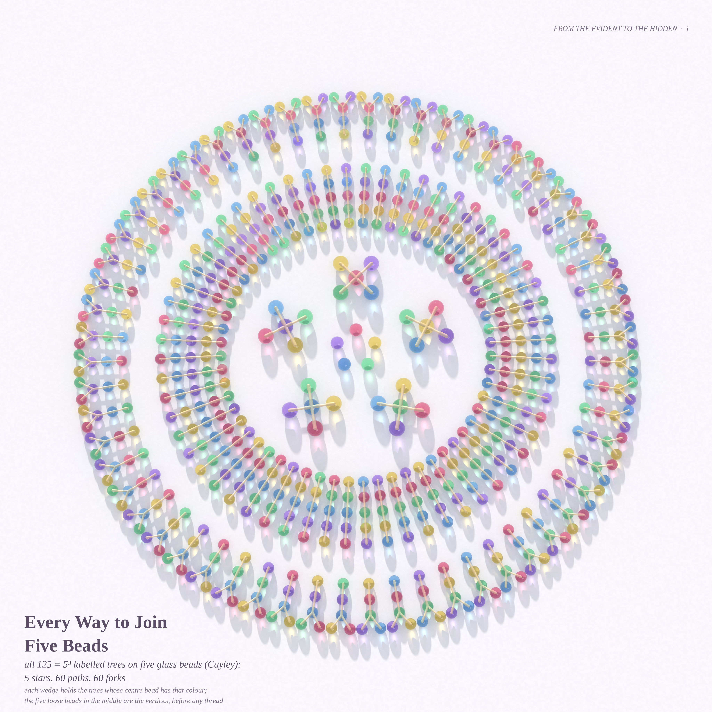
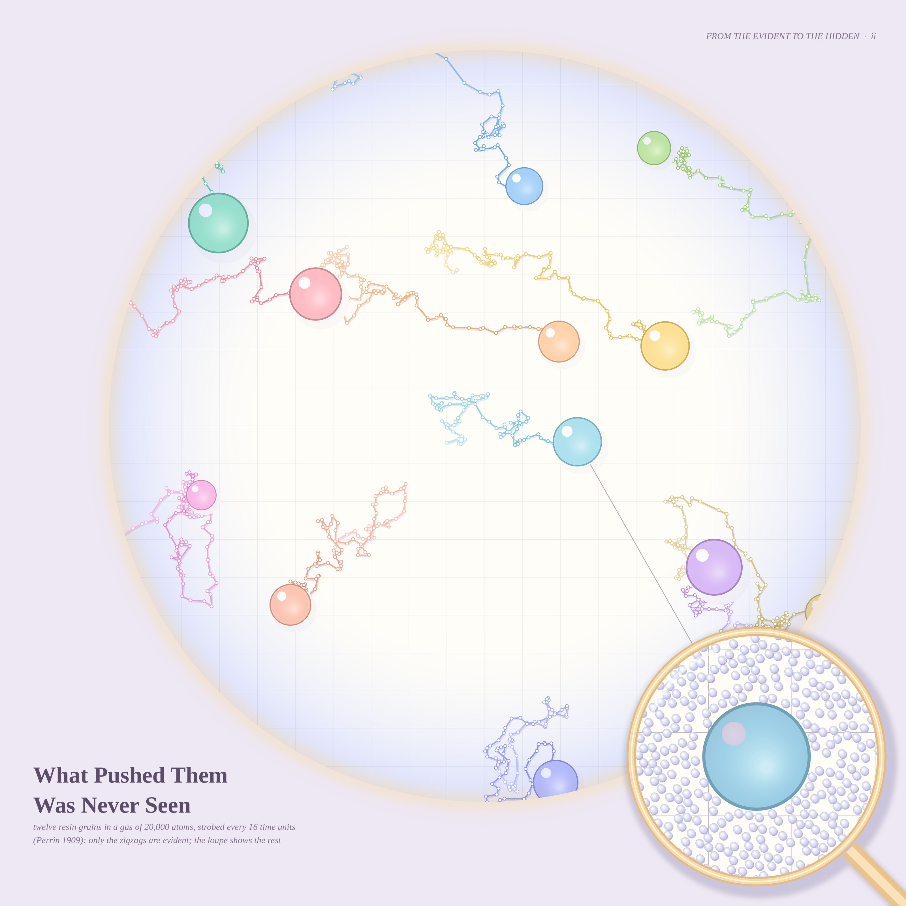
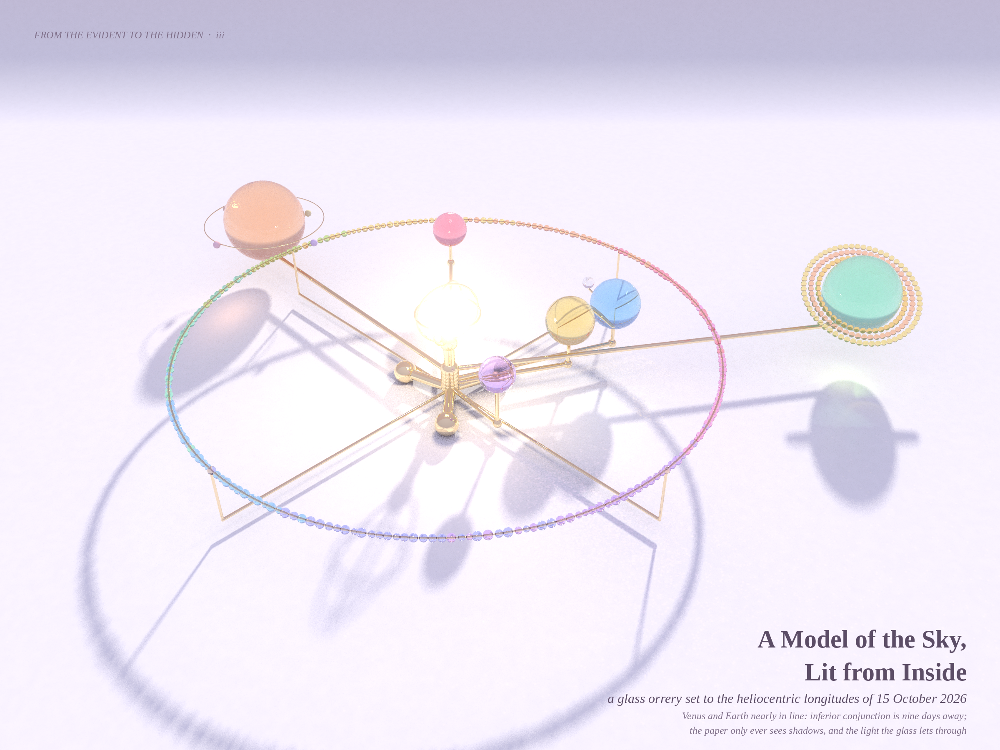

# FROM THE EVIDENT TO THE HIDDEN — pastel #38 (Opus 5.5, run 17)

Seeds from the live front pages (2026-10-15): Philosophy.SE **142598** — *how does Epicurus's Canon justify atoms and
void, which no one can perceive?* (reason from the evident, *phainomena*, to the non-evident, *adēla*) — and **142593**,
Wright's *Philosopher Lecturing on the Orrery* read as Plato's cave. MathOverflow **516050** (Cayley's formula from the
exponential formula) and **516046** (ℤ×ℤ-scrambling). Three pictures of something you can only know through what it leaves behind.

| # | piece | what it is |
|---|---|---|
| i (hero, 4096²) | **Every Way to Join Five Beads** | all 125 = 5³ labelled trees on five glass beads, path-traced with photon-mapped caustics |
| ii (3200²) | **What Pushed Them Was Never Seen** | a pastel Perrin plate: real molecular dynamics, only the grains' strobed zigzags shown; a loupe reveals the atoms |
| iii (2400×1800) | **A Model of the Sky, Lit from Inside** | a glass orrery set to today's heliocentric longitudes, photographed on a paper sweep |

## i. Every Way to Join Five Beads

A five-fold rose window. Wedge *k* holds the star centred on colour *k*, the 12 paths whose middle bead is *k*, and the 12 forks
whose branch bead is *k*: 5 + 60 + 60 = 125. Five loose beads in the middle are the vertices before any thread is tied.
`cayley.py` (Prüfer enumeration + layout) → `beads.c` (glass path tracer from run 15: Fresnel/Snell/Beer–Lambert, NEE sun,
1.2·10⁹ photons for the caustics), 4096² at 128 spp.

## ii. What Pushed Them Was Never Seen

`perrin/md.py`: 2-D WCA molecular dynamics, 20,000 atoms + 12 resin grains, velocity Verlet, t = 1600. The plate draws only what
Perrin could see: each grain's position every 16 time units joined by straight lines, on a graticule. The loupe shows the
final instant at ×18 — the atoms, the one thing in the picture nobody can observe. `perrin/render.py`.

## iii. A Model of the Sky, Lit from Inside

`studio.c` — a new studio path tracer: glass, brass and candy spheres/capsules on a seamless paper sweep, an emissive lamp sphere,
and a low key light whose light through the glass is photon-mapped onto the paper (coloured light inside every planet's shadow).
`orrery.py` puts the planets at their true heliocentric longitudes for 2026-10-15 (J2000 elements + Kepler's equation); the
asteroid belt is a necklace of 300 glass seed beads, Saturn's rings are three strings of beads.

## Mathematics — see `MATH.md`
* **MO 516050**: the generating function G = Σ xⁿ/n!(1+y)^{C(n,2)} satisfies the heat-type equation (1+y)G_y = (x²/2)G_xx;
  that alone forces the tree recurrence and n^{n−2} (alternating sum verified exactly to n = 14). `math_cayley/`
* **MO 516046**: yes — explicitly f(x,y) = x + g(y) with a period-5 complete mapping g of ℤ (exact-cover proof); the spiral
  greedy is *not* a solution (0s pile on one anti-diagonal); a nim/xor closed form for the rows+columns greedy (conjecture). `math_scramble/`
* **Physics by-product**: the grains' D(t) grows like log t (the 2-D long-time tail); hypothesis: the slope is set by the gas, not the grain.

## The story
> Nobody saw the atoms. They saw a grain stagger, a shadow fall, a hundred and twenty-five ways to hold five hands — and
> trusted the zigzag. Epicurus called it reasoning from the evident; the grains never knew they were evidence.

## What I learned about generative art (this run)
*A scene that is only "the object" is a diagram; light is what turns it into a picture.* The orrery was a wiry sketch until a
low sun put coloured caustics inside its shadows. And when a render stalls, go back to the register that already works (glass
beads on paper) and spend the beauty budget on composition — the 5-fold sectoring made 125 jelly-bean trees read as a rose window.
