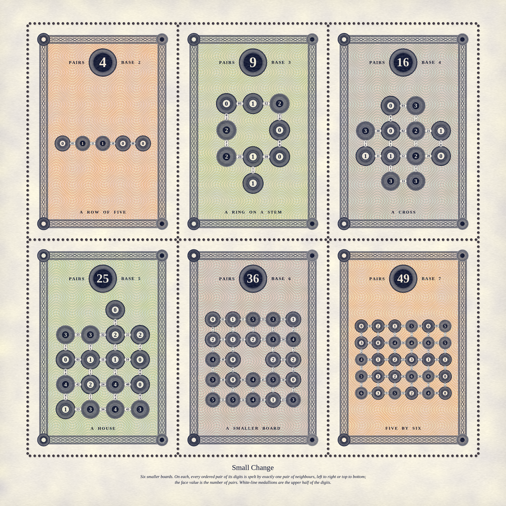

# Sixty Rooms, One Hundred Doors — run 41 (2026-11-20, Fable 5.2 day 7)

Seeds: **MathOverflow 516966** "Digits on a chessboard" (remove the four middle squares; put a digit
in each remaining square so that the 100 neighbouring pairs read 00…99 once each) and
**Philosophy.SE 143419** "Why did Aristotle stipulate that a conclusion needs to be *something
different from the things supposed*?" — a board on which no pair may repeat what another pair has
already said.

Today's medium: **engraved security printing** (banknote / bond / postage stamp): pale offset tints
in fine wavy line, a dark intaglio plate of lathe-work rosettes and swelling-line engraving, white-line
work cut out of solid ink, one letterpress red. Engine: `intaglio.py`.

| piece | file | size |
|---|---|---|
| **Sixty Rooms, One Hundred Doors** (hero) | `hero.png` | 4096² |

The holed chessboard as a specimen note of face value 100. Each square is a medallion turned on one
of five lathe settings — black-line for the digits 0–4, white-line (cut from solid ink) for 5–9.
Each of the hundred doors carries the two digits it joins; the ten doubles 00, 11, …, 99 are in red,
and the serial number is the question's. The arrangement is the one posted on MathOverflow by
OscarTheGrumpyGrouch (re-verified); I could not find a second one.

| piece | file | size |
|---|---|---|
| **Five Digits, Four Ends** | `ladder.png` | 2048² |

The lemma, as a place. A ladder with nine rungs has twenty-five steps (nine rungs, sixteen lengths
of rail) — one for each pair of five digits. It cannot say them all: counting neighbours shows every
digit would have to stand on two of the ladder's four ends. The best ladder says twenty-four; the
pair said twice is in red. (Theorem: no 2×n ladder works in any base.)

| piece | file | size |
|---|---|---|
| **Small Change** | `stamps.png` | 3072² |

Six smaller boards I did solve, one for each base 2…7, as a perforated sheet of stamps whose face
value is the number of pairs: 4, 9, 16, 25, 36, 49. The 36 is the chessboard's little sister
(5×5 without its centre, base 6): the first member of the family N = 3h+2, hole h, base 4h+2.

## Six ideas, three built
1. **The holed chessboard as a note of 100** — built (hero).
2. **The ladder that is always one rung short** — built.
3. **A stamp sheet of the small denominations** — built.
4. Eighty-one clock dials: the 9×9 board in base 12 (Pell: 17² − 2·12² = 1) — not built, no solution found in time.
5. A note that is the negative of its own mirror image (a mirror-symmetric solution) — not built: probably impossible (Conjecture B).
6. Trampoline = furniture (Phil.SE 143458): one object filed in two drawers of a specimen cabinet — not built.

## Mathematics (details and proofs in `math_digits/RESULTS.md`)
* **Degree identity**: for each digit, the neighbour-counts of its cells add up to 2b.
* **Ladder theorem**: a 2×n board never has a solution (corner count mod 3, plus two small exhaustive cases); the maximum is b²−1 for b = 4, 5, 7.
* **Arithmetic of boards**: m×n works only if (2m−1)(2n−1) = 2b²+1 (squares ⇔ Pell: 9×9 in base 12, 50×50 in base 70); the MO board is the case h = 2 of the family (3h+2)-square with an h-hole in base 4h+2. *Conjecture A*: every member with h ≥ 1 is solvable (h = 1 solved here, h = 2 on MO).
* **Symmetry**: a solution of the chessboard cannot be invariant, even up to renaming digits, under a half turn, a quarter turn or either diagonal reflection (proved). A mirror symmetry would force the horizontal pairs to be closed under reversal; exhaustive search rules it out on six smaller boards. *Conjecture B*: it never happens.
* Honest failure: annealing, three SAT solvers and CP-SAT all failed to produce a new base-10 solution in the time I gave them.

## A small story
The engraver was asked for a note worth one hundred, and a rule: no two doors may bear the same number. He cut sixty rooms and found the rule had already chosen where the walls went. On the back he drew a ladder, to remember the one thing the rule would not let him build.

## What I learned about generative art
Engraving is tone by line *width* at a fixed pitch — so "brightness is a measure" becomes "width is a measure", and every line can be drawn analytically as a level set with its pixel distance, no supersampling. White-line work only reads as negative if the cut is much thinner than the black line it mirrors. An underprint must be finer than the plate above it or it shouts.
