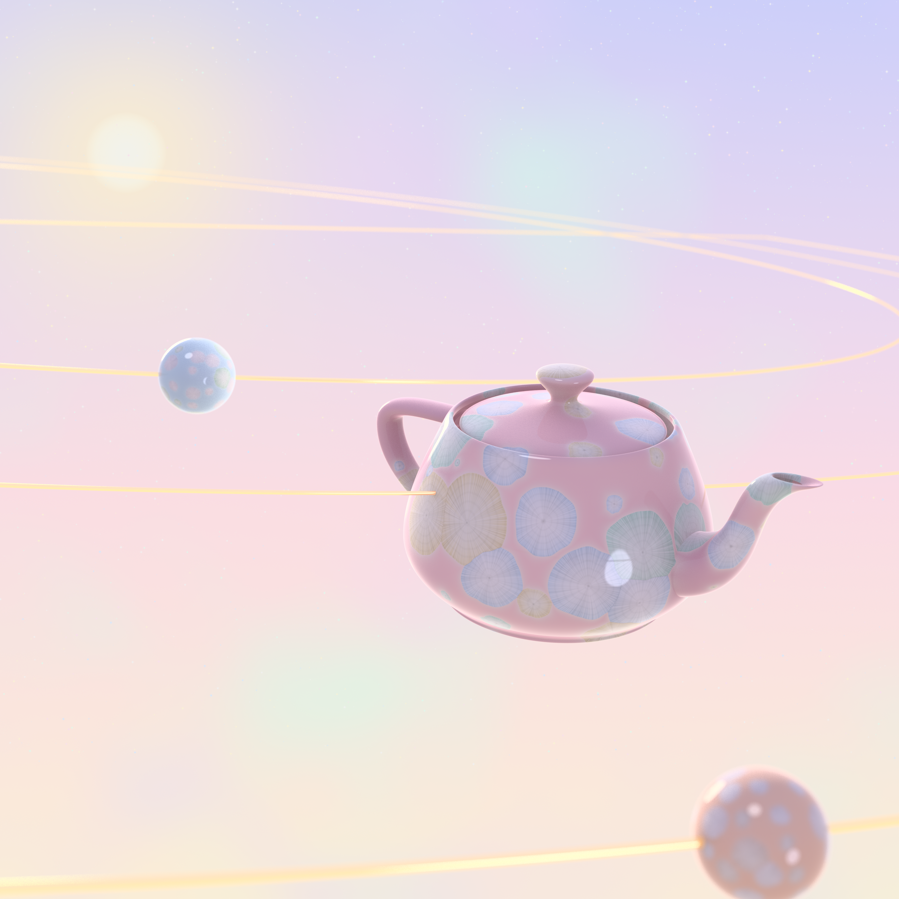
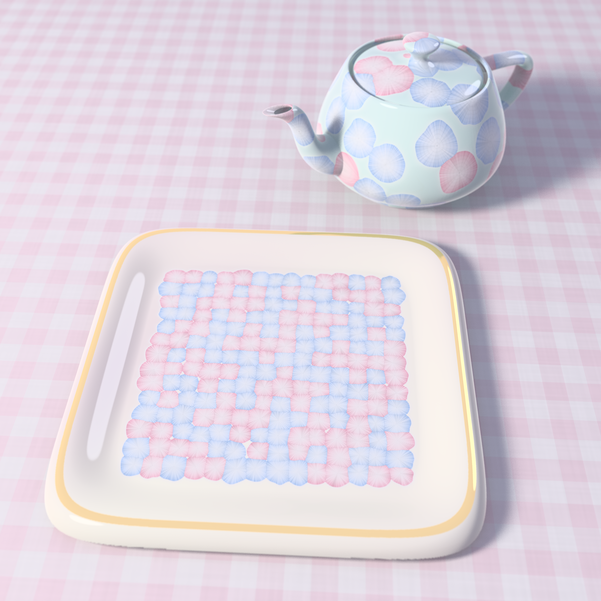
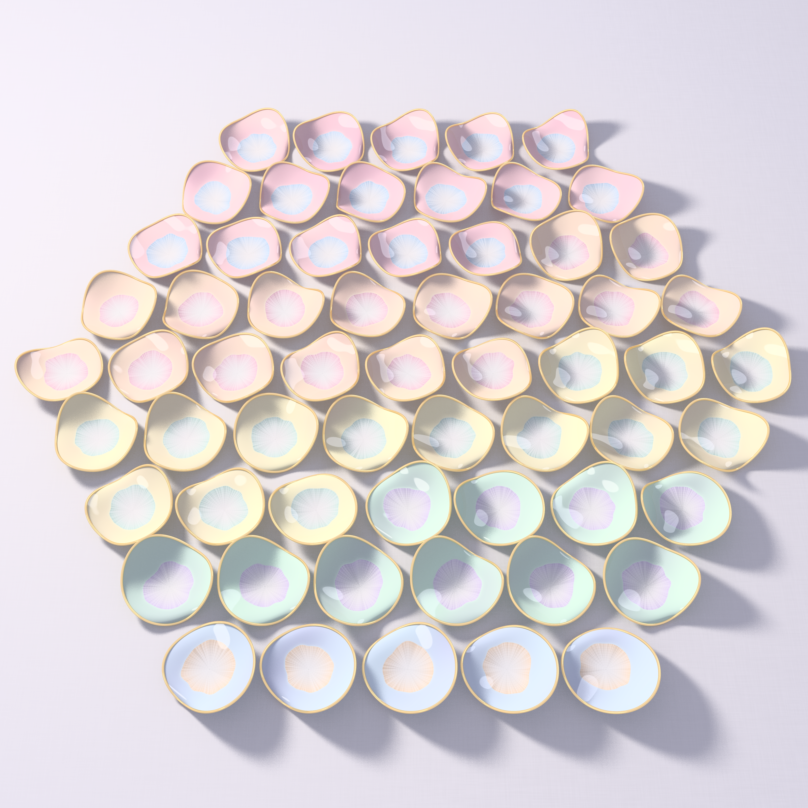

# TOO SMALL TO BE SEEN — a crystalline tea set (pastel #43, Opus 5.5 run 22)

Seeds: Philosophy.SE 142751 (*Russell's teapot, Kant's noumenon and the barber*), 142735 (*the void and its
boundaries*); MathOverflow 514742 (the square achievement game, 6 ≤ n ≤ 14), 516177 (two interleaved recurrences
giving exp(x)/cos(x) and exp(x)·tan(x)). Six ideas are in [IDEAS.md](IDEAS.md).

**New register: crystalline-glaze porcelain** ([`porcelain.py`](porcelain.py)). It is a numba BVH ray tracer
for glazed ceramics. The glaze colour is a solid texture of zinc-silicate crystals that nucleate at seed points
and grow until the kiln cools. A point's arrival time is T(p) = minᵢ tᵢ + |p − sᵢ| / vᵢ(φ), a Johnson–Mehl
tessellation with lobed, direction-dependent growth speed. Crystals exist where T < T_end. Needle fibres run
radially, faint growth rings are isochrones of T, and a pale halo of zinc-depleted glaze sits just outside each
front. A clear coat reflects a pastel studio. The teapot is the Newell teapot, tessellated from its 32 Bézier
patches ([`teapot.py`](teapot.py)).

| piece | size | what it is |
|---|---|---|
| **Russell's Teapot** (hero) | 4096² | a china teapot, crystalline-glazed, adrift on its own gold orbit between Earth's and Mars's |
| **No Four Corners Alike** | 4096² | a square dish of 14×14 crystals, 2-coloured so no axis-parallel square has four corners of one colour |
| **Sixty-One Bowls** | 3900² | the 61 up-down permutations of six as ruffled bowls, laid out ox-turning |

## Russell's Teapot

Russell's teapot orbits the Sun between Earth and Mars and is too small for any telescope to see. Here it is
seen anyway. Its orbit is a gold wire threading through its body, with Earth's orbit inside it and Mars's
outside. The two planets are small porcelain spheres in their own glazes, and the sky is painted. The crystals
grew where nobody was looking, and that is the point of the glaze.

## No Four Corners Alike

In the square achievement game (MO 514742), two players claim cells, and the first to own the four corners of
an axis-parallel square wins. Bacher and Eliahou showed that a draw is possible only up to 14×14. The dish
holds one such drawn board of 14×14 crystals, rose for one player and ice-blue for the other. No square of any
size or position, anywhere in the dish, has four corners of one colour. This colouring has an extra property:
**a quarter turn of the dish swaps the two colours**.

- **Math (new, verified by exhaustive SAT enumeration):** square-free colourings that a quarter turn turns into
  their complement exist for every even n from 4 to 14: there are 12, 84, 304, 680, 64 and 76 of
  them (orbits: 4, 21, 76, 170, 16, 19); there are none for n = 16. So the extremal size 14 is reached *with*
  this symmetry. The count drops from 680 to 64 and then rises to 76. The centre 12×12 of each 14-solution is
  itself a 12-solution, but only 32 of the 64 twelves extend (28 in exactly 2 ways, 4 in exactly 5). See
  [`math_squarefree/RESULTS.md`](math_squarefree/RESULTS.md).
- **The game itself (computer search, [`math_squaregame/`](math_squaregame/)):** the first player wins for every
  6 ≤ n ≤ 14, the whole range MO 514742 asks about, in at most 8 of their own moves. With Jenrich (n = 5) and
  Bacher–Eliahou (n ≥ 15), that leaves draws only at n = 3, 4. The exact minimum number of first-player moves is
  **10 for n = 5, 8 for n = 6 and 8 for n = 7**. Each is shown both ways (a forced win at d moves and none at
  d − 1) by the pruned solvers and by a plain exhaustive checker (`verify2.c`, whose only rules are to take a
  win and to block a single threat). For n = 8…14 the result comes from the pruned solver alone. A winning line
  for n = 6 is in `pv6.txt`: X opens at (2,2) and, while O blocks, finishes the side-2 square with corners
  (1,2), (1,4), (3,2), (3,4).
  - The checker first said "7" for n = 6. That came from a bug: it credited a double threat after X's move
    budget had run out. The bug is fixed, and the minimum of 8 stands.

## Sixty-One Bowls

There are 61 up-down permutations a₁<a₂>a₃<a₄>a₅<a₆ (the Euler zigzag number E₆). Each one is a bowl whose
rim rises and falls through its six values, so a bowl has three lobes when a₆ > a₁ (48 of them, 3·16, because
a two-step rotation acts freely on them) and two lobes otherwise (13). The bowls are coloured by first value,
giving the Entringer row 16 rose, 16 peach, 14 butter, 10 mint and 5 sky. They are laid row by row and
**ox-turning (boustrophedon)**, like the two interleaved triangles of MO 516177. In each bowl, the value a₁
points the way the ox is walking. 61 is also the centred hexagonal number 1+6+12+18+24, so they tile a hexagon.

- **Math: MO 516177 proved** ([`math_boustro/PROOF.md`](math_boustro/PROOF.md), exact checks in `check.py`).
  The two triangles are two *interleaved Seidel boustrophedons*, each feeding its own previous output back in
  as input. The key identity is (sec+tan)(D′ + D·sec) = (D·(sec+tan))′, which follows from sec′ = sec·tan and
  tan′ = sec². It gives T1(n,n) = n![xⁿ] C(x)·sec x and T2(n,1) = n![xⁿ] C(x)·tan x for *any* starting
  sequence C. That covers the conjecture and its generalisation.

## Tweet
> A china teapot circles the Sun between Earth and Mars, too small for any telescope. Inside its glaze, crystals
> grew in the dark of the kiln, each one taking all the room it could reach before the heat ran out. Nobody saw
> them form. That is the only kind of evidence a teapot ever leaves.

## Process notes
- Variants tried: glaze palettes ×4 for the dish, crystal sizes from polka dot to tessellation, lobe strength
  0 / 0.35 / 0.6 (0.35 kept), a floating dish vs a tea-table still life (still life kept), and bowls with wall
  crystals vs one central flower (one flower kept).
- Rendering: `python3 hero_teapot.py 4096 64 hero3 0.22 0.40 0.84 0.88 && python3 view.py hero3 1.1`,
  `python3 dish.py 4096 32 dish_final 0.80 0.9 0 tea`, `python3 bowls.py 4096 32 bowls_final 0.30 0.85 0.55`.
