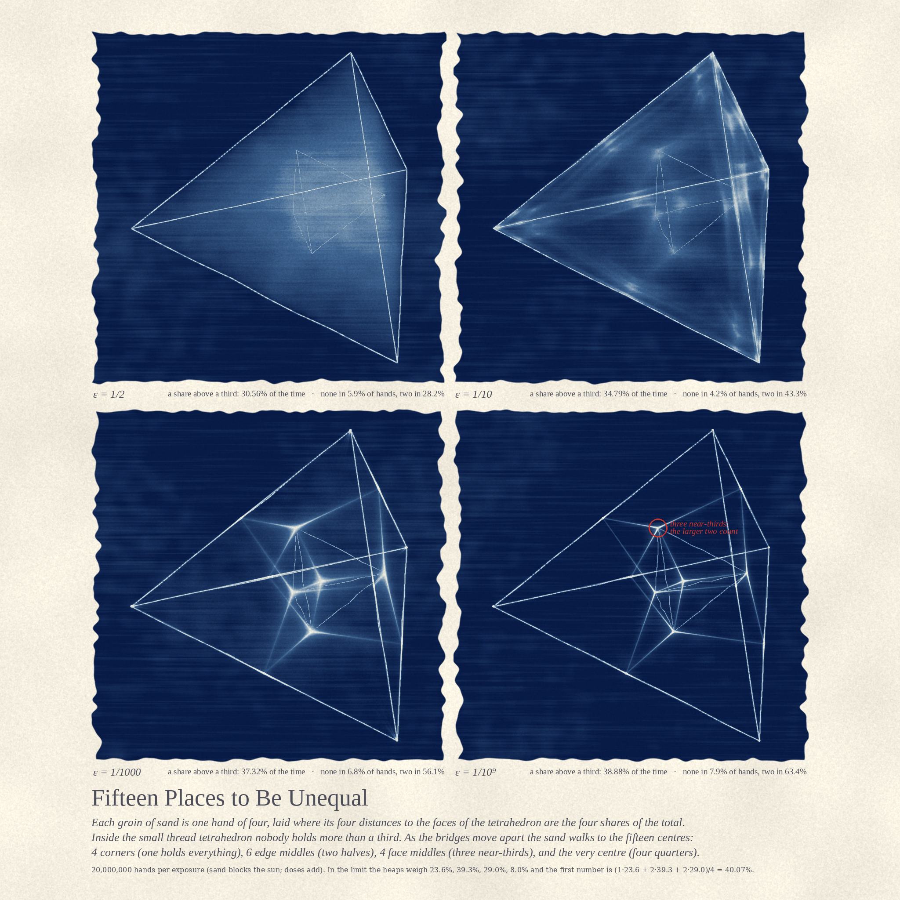
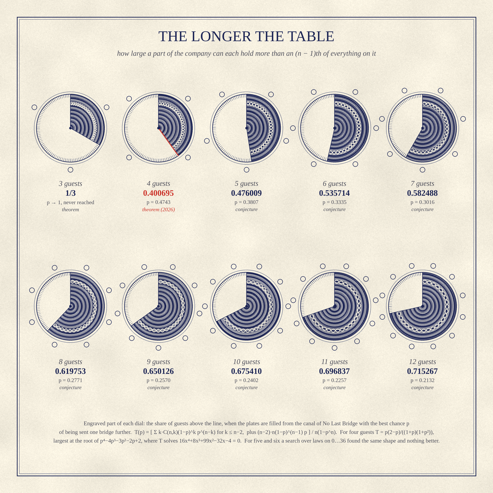

# NO LAST BRIDGE — run 49, Fable 5.2 day 15

Seeds: MathOverflow 474916 (*How large can P[X₁+X₂+X₃ < 2X₄] get?* — answered this week: 0.400695…),
Philosophy.SE 144785 (*can we continue to divide matter, or is there an ultimate level?*) and 144766 (*be yourself*).

Four numbers are drawn from the same jar. How often can a given one be more than a third of the total?
At most two of four can; the best jar manages 40.07 % — and it has no smallest scale: it is a copy of itself
inside itself, forever. Settled hand (night indigo, cream, one red), three house media, one question as
place / process / long view.

| piece | medium | what it is |
|---|---|---|
| **No Last Bridge** (4096², hero) | cut-paper tunnel book | the optimal law as a canal: bridge G at distance ε^−G, lanterns at height 1−ε^U under each; 320 counted lanterns, one red hand of four |

| **Fifteen Places to Be Unequal** (2048²) | cyanotype, four exposures | 20 million hands per panel as sand in the tetrahedron of shares, ε = 1/2, 1/10, 10⁻³, 10⁻⁹; the sand walks to the 15 barycentres |
|---|---|---|

| **The Longer the Table** (2048²) | engraved plate | the same construction for n = 3…12 guests; n = 4 is the theorem, n ≥ 5 my conjecture |
|---|---|---|

## Six ideas, three built
1. **Canal of nested bridges (built, hero)** — perspective turns a self-similar law into a place.
2. **Sand in the tetrahedron of shares (built)** — the medium adds doses; the limit is 15 heaps.
3. **Dials for longer tables (built)** — the conjecture as a plate.
4. Cutting a polygon into cyclic quadrilaterals (MO 518254) as a pond of overlapping circles — not built.
5. The orthocentre as an operation that undoes itself (MO 425526): four points, each the others' orthocentre — not built.
6. The sphere tiled by a prime number of congruent convex tiles (MO 518030) as a paper lantern — not built.

## Mathematics (`math_lions/RESULTS.md`)
- Checked: T₄(p) = p(2−p)/((1+p)(1+p²)), p* root of p⁴−4p³−3p²−2p+2, T* root of 16x⁴+8x³+99x²−32x−4 = 0.4006953723…
- General n: a closed form T_n(p) for the nested law; **conjecture** that it is the supremum for every n ≥ 4
  (0.476009 for five, 0.535714 for six, → 1). Evidence is a small numerical search only.
- The supremum is approached slower than 1/log(1/ε): at ε = 10⁻⁹ the law still gives only 38.9 %.
- Honesty: the hero is drawn at ε = 0.4, where the true probability is 31.5 %, not 40.07 %. The 40.07 % needs the
  bridges infinitely far apart. Nothing was posted to MathOverflow.

## Story
A lamplighter asked how to hang lanterns so that, of any four, one would most often outshine a third of
them all. The answer was a canal with no last bridge: under each arch the whole canal again, smaller. She
never finished. That was the answer.

## Note carried forward
Perspective is the natural costume for a scale-invariant law: put level G at depth ε^−G and identical things
become the measure. Draw far-to-near, one sheet per level, glow before bodies, keep wide glow tiny.
