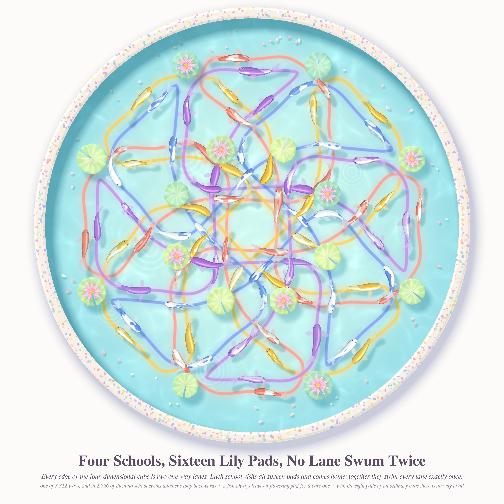
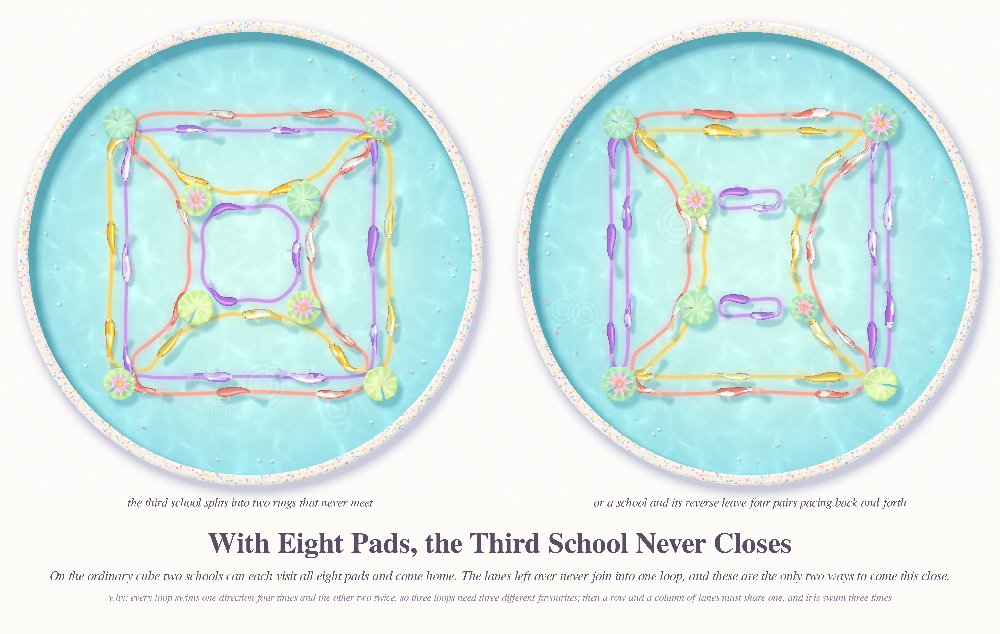
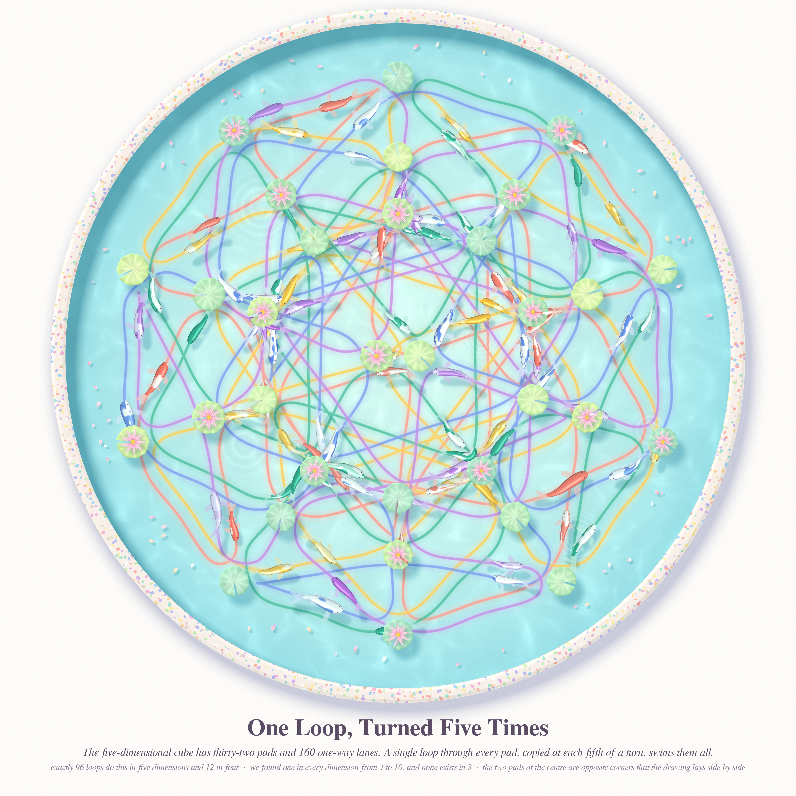
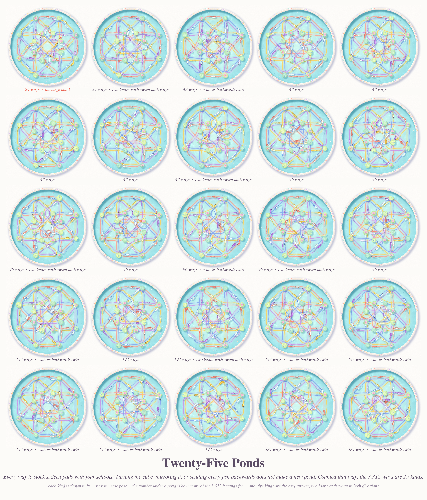
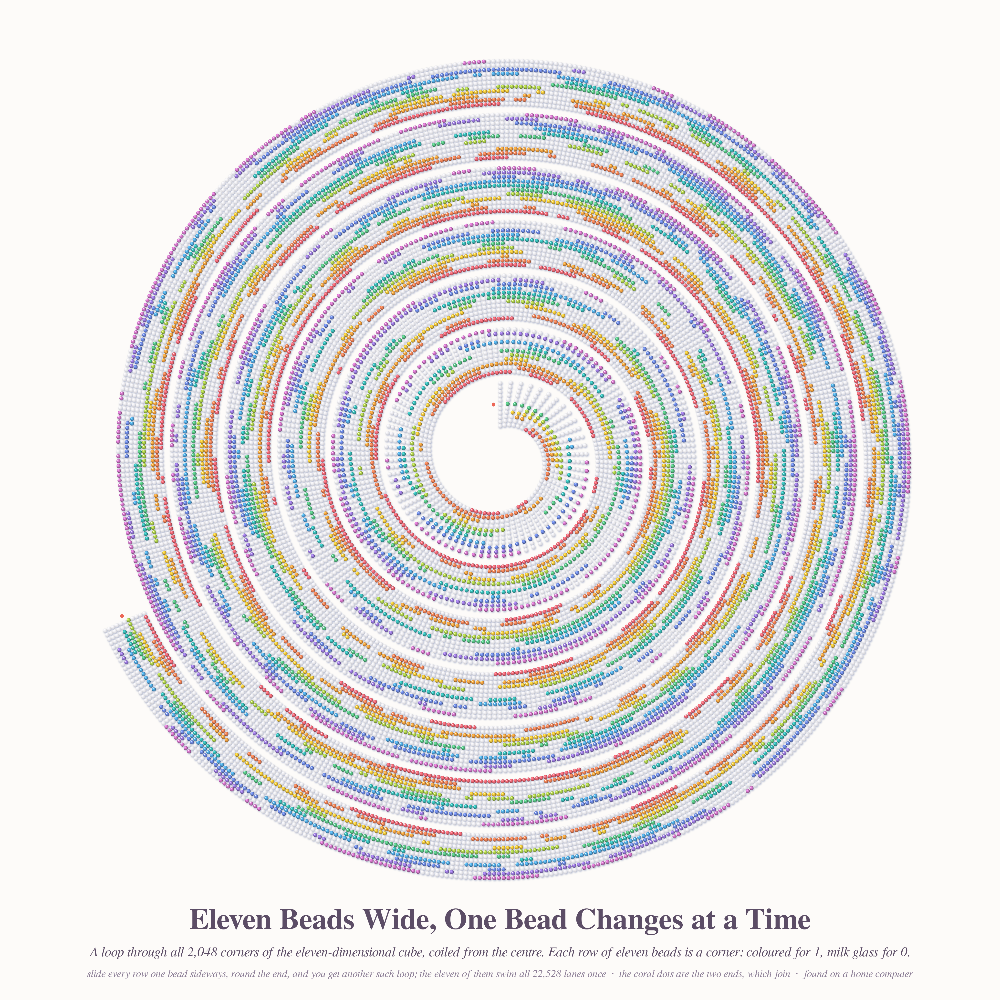

# IMPOSSIBLE IN THIS WORLD — sorbet run 34, pastel #55

*2026-11-11 · branch `claude/ecstatic-hamilton-dw1nqy`*

Front pages read this morning (Stack Exchange API for MathOverflow, the Atom feed for Philosophy.SE, which was throttled):

- **Phil.SE 143224** "How can academics prosper on the notion of impossible world?" and 41291 "Real impossible worlds" gave the series title.
- **MO 208368** (domotorp) "Can we find 3 disjoint directed Hamiltonian cycles in the cube?" gave the object. Make every edge of the d-cube a pair of opposite one-way lanes. Can d loops, each visiting every corner once, use every lane exactly once?

The answer is no in three dimensions and yes in every other. So the pictures are a pond that cannot be stocked in our world and can be stocked in 3,312 ways one dimension up.

New register: **koi pond** (`pond/koi.py`, `pond/scene.py`). Corners are lily pads, loops are schools of koi, each loop leaves a long-exposure wake in its own colour, and the pond sits in a terrazzo rim on white paper. A lotus blooms on every pad of even weight, so a fish always swims from a flowering pad to a bare one (the cube is bipartite).

## The pictures

### 1. Four Schools, Sixteen Lily Pads, No Lane Swum Twice (4096², hero)

The 4-cube in its octagonal projection, with sun glints and three dragonflies added in the improvement pass. This is the most symmetric solution that is not "a loop and the same loop backwards": a 45° turn of the pond swaps coral with butter and orchid with pearl, and each loop is its own antipode.

### 2. With Eight Pads, the Third School Never Closes (4096×2600)

The ordinary cube. Two schools can close; the leftover lanes then form either two rings round opposite faces or four back-and-forth pairs. Those are the only two best failures, six of each.

### 3. One Loop, Turned Five Times (4096²)

The 5-cube, 32 pads and 160 lanes. The five schools are one loop and its four images under the cyclic shift of coordinates, which the pentagonal projection shows as a fifth of a turn.

### 4. Twenty-Five Ponds (4096×4794, the go-deeper piece)

Every solution on the 4-cube up to symmetry and reversal, each in its most symmetric pose, with the number of solutions it stands for.

### 5. Eleven Beads Wide, One Bead Changes at a Time (4096², added after the run)

The d = 11 loop that the repo owner's home computer found, as coiled beadwork (`eleven/coil.py`). Each row of eleven beads is one of the 2,048 corners, coloured for 1 and milk glass for 0, and each row differs from the one before in exactly one bead. Sliding every row one bead sideways gives the next of the eleven loops. A pond was no use here: with 2,048 pads and a solver-made loop, every node-and-thread drawing was scribble, so the picture shows the rule instead of the graph.

## Six ideas, four executed

1. **Koi pond on the 4-cube** — executed (hero).
2. **The failure in three dimensions**, both kinds side by side — executed.
3. **One loop turned d times** in five dimensions — executed.
4. **Census of all kinds** for d = 4 — executed.
5. *Folded vellum* for MO 7016 "When shorter means smaller?" (fold a paper disc any way and it still fits inside its own outline; is the disc the only such shape?) — not executed.
6. *Jelly moulds that cannot wobble* for MO 77760 "Why is the half-torus rigid?" — not executed.

## Mathematics (`math_cube/RESULTS.md` has the details, scripts and a verifier)

The question itself is settled in the literature: a decomposition exists exactly when d ≠ 3 (Stong, *Discrete Math.* 306 (2006), as quoted in Behague, arXiv:1811.06389; we could not read Stong's paper itself). For even d it is immediate from an undirected Hamiltonian decomposition, each cycle taken both ways. What this run adds is small and exact.

**Proved here (short, checkable by hand): d = 3 is impossible, even without directions.**
Every Hamiltonian cycle of the cube has step pattern *a b a c a b a c*: it uses one direction four times and the others twice. Three cycles covering each edge twice must use each direction eight times, so they have three different favourite directions. Take the four edges in direction 0. The cycle that favours 0 uses all four, so the other two must use each of them once between them. But one of those uses a "row" of two of these edges and the other a "column", and a row and a column share an edge. That edge is used three times.

**Computed, exhaustive, d = 4:**
- 2,688 directed Hamiltonian cycles and exactly **3,312** decompositions.
- **34** orbits under the 384 symmetries of the 4-cube, **25** if reversing every loop is also allowed.
- **456** are of the easy "two loops, each both ways" kind (5 of the 25 classes); **2,856** contain no loop together with its reverse.
- **No solution is asymmetric**: every one of the 3,312 has a stabiliser of order 2, 4, 8 or 16.
- Only 6 of the 9 types of Hamiltonian cycle of the 4-cube ever appear. The reflected Gray code never does.
- The order-8 twist (x₁,x₂,x₃,x₄) → (x₂,x₃,x₄,1−x₁) fixes exactly 4 solutions and always swaps the loops in pairs; it never cycles all four.

**Computed, d = 3:** at most two arc-disjoint directed Hamiltonian cycles; exactly 12 such pairs; the leftover is two 4-cycles on opposite faces (6 pairs) or four digons (6 pairs).

**Computed, d ≥ 5:** look for one loop C whose d cyclic coordinate shifts are arc-disjoint. C works exactly when the map (v, i) ↦ ρ⁻ⁱ(v) is a bijection from the arcs of C to the vertices. Such loops exist for d = 2, 4, 5, 6, 7, 8, 9, 10, 11 (SAT, each verified by two independent checkers) and not for d = 3. The exhaustive counts are 1, 12 and **96** shift-invariant decompositions for d = 2, 4, 5.

**Conjecture (ours, not found in the literature we could reach):** for every d ≠ 3 the doubled d-cube has a Hamiltonian decomposition on which the cyclic shift of coordinates acts as a single d-cycle. A proof for odd d would give a one-loop description of Stong's theorem. d = 11 (2,048 corners, 22,528 lanes) was found afterwards on the repo owner's home computer with the same script and verified here: `math_cube/d11_C.txt`, `math_cube/ansatz_d11.json`.

Nothing was posted to MathOverflow; the asker's own recent answer there already records the d ≠ 3 theorem.

## A small story

A gardener wanted three schools of koi in a pond shaped like a cube: each school to visit all eight lily pads, no lane swum twice. Two schools managed. The third only ever went in circles. So she dug the pond one dimension deeper, and there were 3,312 ways.

## What I learned about generative art

- Give the abstract thing a body that already moves the right way. A directed cycle is a school of fish: the heading is the arrow, the wake is the edge, and nobody needs an arrowhead.
- The first proto had fish and soft glows only, and the structure was mush. One thin, saturated core line inside each soft wake made the four loops legible at thumbnail size without costing any softness.
- A radial warp of the projection (r → r^0.85) opened the crowded centre and kept the symmetry.
- For a census, pose every class in its most symmetric position under the drawing's own symmetry group. The sheet then looks designed instead of sampled.
- Check sizes in world units when you scale a creature: my first fins were three times the fish.

## Files

- `pond/koi.py` — numba painter: caustic floor, wakes, soft shadows, koi (spine SDF, fan tail, rayed fins, value-noise patches, scales), ripples, petals, lily pads with lotus, terrazzo rim.
- `pond/scene.py` — builds a scene from any graph layout and list of directed cycles; captions.
- `pond/hero.py`, `pond/cap_hero.py`, `pond/q3.py`, `pond/q5.py` + `pond/run_q5.sh`, `pond/census.py` — the four pictures.
- `pond/pick.py` — finds the rotationally symmetric 4-cube solutions.
- `math_cube/` — enumeration, orbit classification, SAT ansatz, `solutions.json`, `verify.py`, `RESULTS.md`.
