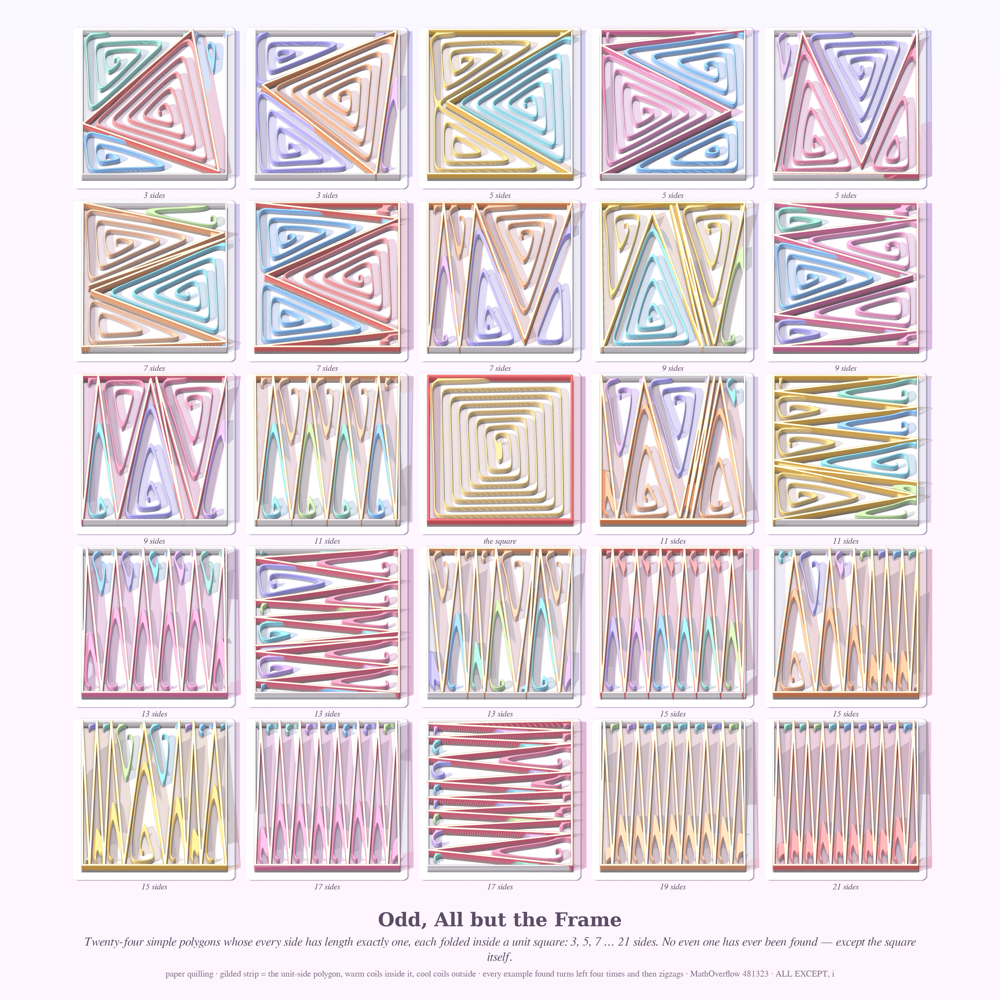
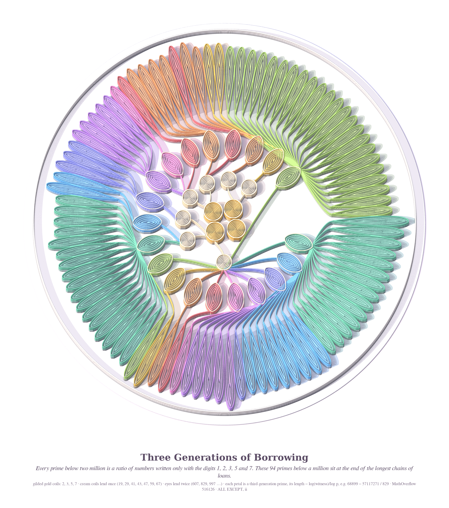
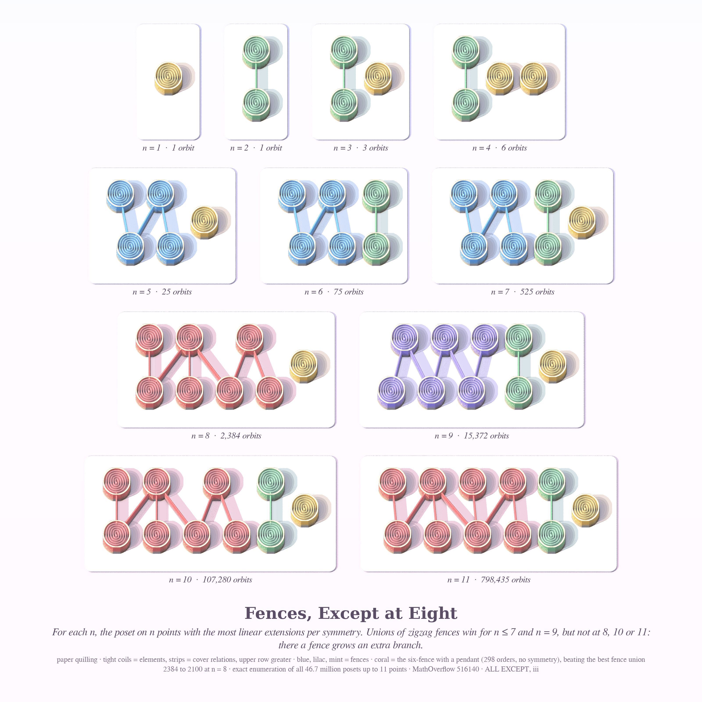

# ALL EXCEPT — pastel #41 (Opus 5.5, run 20, 2026-10-18)

A triptych in a new register: **paper quilling**. Paper strips are glued on edge onto white cards and rolled into coils, then photographed at a slant under a low sun. The strips are translucent, so each shadow is a pool of coloured light.

The series title comes from Philosophy.SE 142705, *Expressing "all except" in logic*. Each piece is a theorem, or near-theorem, of the form "every one, except…". Seeds from MathOverflow: 481323, 516126, 516140.

| piece | size | object |
|---|---|---|
| **Odd, All but the Frame** (hero) | 4096² | 24 unit-side polygons inside unit squares, plus the square itself |
| **Three Generations of Borrowing** | 3200×3620 | the capture tree of the primes from the digits {1,2,3,5,7} |
| **Fences, Except at Eight** | 3200² | the orbit-maximising posets for n = 1…11 |

## Odd, All but the Frame

Every tile is a unit square holding a simple polygon whose sides all have length exactly 1 (MO 481323). They have 3, 5, 7 … 21 sides.
- The gilded strip is the polygon.
- Warm coils fill the inside of the polygon and cool coils fill the pockets outside it.
- The centre tile is the exception: the square's own boundary, in coral, filled with one butter coil.

There are 120 verified polygons; this sheet picks 24 of them. Every side is within 4e-10 of 1, nothing crosses, and every vertex is inside the box.

## Three Generations of Borrowing

MO 516126 asks whether the numbers written only with the digits 1, 2, 3, 5, 7 generate all positive rationals under multiplication and division. A prime is "captured" when some such number factors as that prime times primes already captured. For example, 19 is captured by 57 = 3·19.

The flower shows the primes below 10⁶ that need the longest chain of loans:
- **Centre:** gilded 2, 3, 5, 7.
- **Cream coils:** 7 first-generation lenders (19, 29, 41, 43, 47, 59, 67).
- **Eyes:** 20 second-generation lenders (607, 829, 997 …).
- **Petals:** the 94 third-generation primes. Each petal's length is log(witness)/log p, so the ragged rim shows how much each prime had to borrow.

## Fences, Except at Eight

MO 516140 defines f(P) = e(P)/#Aut(P), the number of linear extensions per automorphism, and asks whether the posets that maximise it are disjoint unions of fences.
- Each card shows the optimal poset for one n.
- Tight coils are elements and strips are cover relations.
- Fences are blue, lilac and mint. The coral component is a fence that has grown an extra branch.
- Fence unions win for n ≤ 7 and n = 9. **They lose at 8, 10 and 11**, which answers the question's "in particular" with no.

## Mathematics (details: `math_*/NOTES.md`)
- **MO 516140, answered negatively.** g(n) was computed exactly for n ≤ 11 by enumerating all 46.7 M posets (nauty `genposetg` plus a C plug-in that computes e by DP over down-sets and Aut by backtracking).
  - g = 1, 1, 3, 6, 25, 75, 525, **2384**, 15372, **107280**, **798435**.
  - At n = 8 the winner is Q7 ⊔ point, where Q7 is the 6-fence with one pendant minimal element. It has e = 298 and no symmetries, and gives f = 2384 against 2100 for the best fence union. I checked this by brute force over all 8! orderings.
  - Fence unions also lose for n = 12 and every n from 14 to 40, by explicit posets; the ratio grows to about 3× at n = 40.
  - The best fence unions never use odd fences. They are 1 + 2 + 4 + 6 + … with distinct even sizes, because each extra part gains about 4/π.
  - *Conjecture:* fence unions are optimal exactly for n ∈ {1…7, 9, 13}.
- **MO 516126.**
  - Every prime ≤ 2·10⁶ is in G, using the elements of S up to 11 digits.
  - The capture depth is at most 3 below 10⁶. The first depth-3 prime is 68899 = 57117271/829, with 829 = 15751/19 and 19 = 57/3.
  - The hard primes sit just below c·10ᵏ (49999, 199999, 799999), because their small multiples are runs of 9s and 0s.
  - For D = {2,5}, every prime < 34883 is in G, but the chains go 20 generations deep.
  - **New, proved: D = {4,5} does not generate Q⁺.** Let χ be the Legendre symbol mod 5 of the 5-free part. A number ending in 4 is ≡ 4 mod 5, a square. A number ending in 5 is 5(2a+1) with a ≡ 0 or 4 mod 5, so the cofactor is ≡ 1 or 4 mod 5, also a square. So χ = 1 on all of S, and G has index ≥ 2.
  - *Heuristic:* the typical witness is about p^{log 10/log 5}.
- **MO 481323.**
  - Of 4,855 valid odd polygons found, every one has the same turn pattern: four convex corners, then convex/reflex alternating. So each has (n−3)/2 reflex vertices.
  - Even searches for n = 4, 6, 8, 10, 12 stalled at violations of about 10⁻³; that is only weak evidence.
  - Proof idea: corners two apart are at most √2 apart, so consecutive edges satisfy u_k·u_{k+1} ≤ 0. Flip every other edge. The flipped sequence then turns by a whole number of half-turns, and every valid example turns by exactly ±½. *Conjecture:* it always does, which would rule out every even n except the square.

## Engines (new this run)
- `quill/quill.py`
  - Numba height-field ray-marcher with an oblique orthographic camera and jittered supersampling.
  - Shadow rays turn coloured as they pass through paper walls (translucent strips), and faces lit from behind glow.
  - Optional gild map: a metallic warm sheen on the tops of walls only.
- `quill/quill.coil()`: fills any region with a spiral that follows its distance contours. Because u = d/pitch + θ/2π is continuous, the turns trace a real quilled coil, with the hook at the centre for free.
- Scenes:
  - `sampler.py` + `hero.py`: tile cards.
  - `mandala_scene.py`: radial capture tree with teardrop petals.
  - `posets_scene.py`: Hasse diagrams as coils and strips.
  - `compose.py`: captions.
- `terrazzo/`: polished terrazzo chips, tried for the digits piece and **dropped**. Small, sparse chips read as confetti.

## Tweet
> In the paper drawer, every ruler folded to an odd count — three, five, twenty-one — and the square sat in the middle pretending it hadn't been asked. Next door the primes borrowed from 1, 2, 3, 5, 7 for three generations, and the fences won every year but eight.
