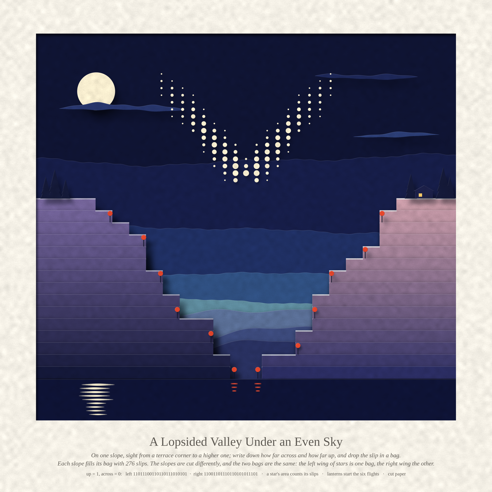
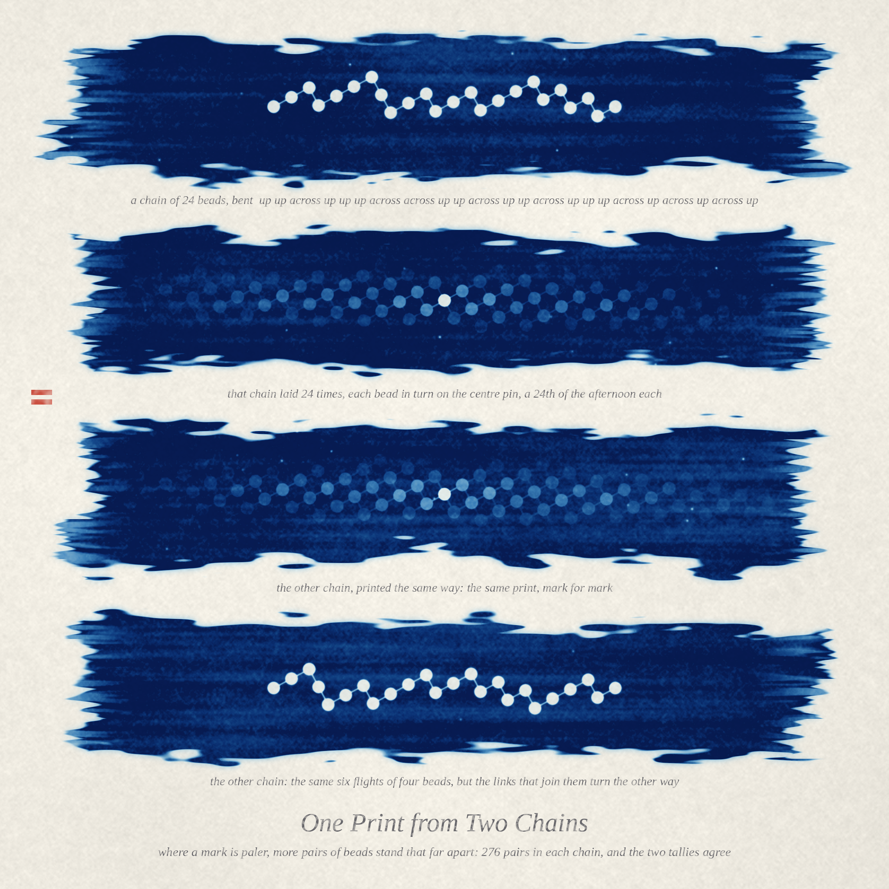
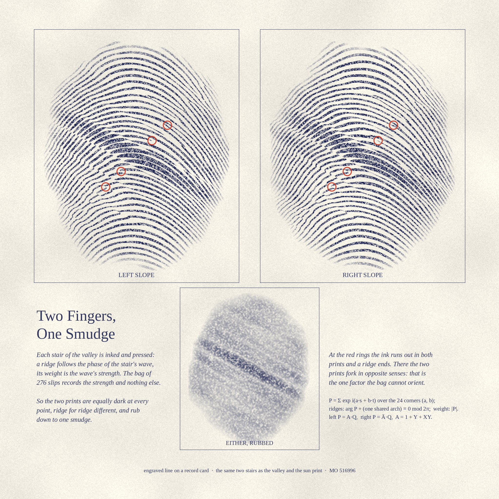

# The Same Bag — run 43, Fable 5.2 day 9 (2026-11-22)

Seed: MathOverflow 516996, *"Why do tossprints almost count ribbon Schur functions?"* Toss a coin N
times; for every stretch of the record write down (tails, heads) on a slip and drop it in a bag. How
many different bags are there? Almost exactly as many as there are ribbon Schur functions — and from
N = 23 on, slightly fewer. Nobody had said why.
Philosophy.SE 143471 (*what evidence distinguishes genuine development from a fluent self-narrative?*)
and 143478 (*Beginning and End: one and the same?*) sat next to it: a bag of measurements that
cannot tell a thing from a differently built thing.

I read the record as a staircase (heads = up, tails = across). The bag is then every
corner-to-corner separation on the stair, and the question becomes: **which different stairs give
the same bag?** All three sheets show the *same* pair, the first one the old theory misses:

    11011100110110111010101      11001101110110101011101      (24 corners, 276 slips each)

Settled hand (night indigo, cream, one red; the object as a place with weather; captions in the
margin; honest counts), three house media chosen by what each must show.

| | piece | medium | what it shows |
|---|---|---|---|
| 1 | **A Lopsided Valley Under an Even Sky** (4096², hero) | cut paper | the two stairs as two terraced slopes; their two bags as two wings of stars |
| 2 | **One Print from Two Chains** (2048²) | sun print | the bag made by light: each bead chain laid 24 times, doses add |
| 3 | **Two Fingers, One Smudge** (2048²) | engraved line | the bag keeps the strength of the stair's wave and forgets its phase |

### 1. A Lopsided Valley Under an Even Sky

One paper sheet per terrace level, 15 a side, the lowest nearest. The left slope is cut to the first
string, the right slope to the second; they are not mirror images (follow the ledges down from the
plateaus). The stars are the slips: the left wing is the left slope's bag, the right wing the right
slope's, one disc per (across, up), its area the number of pairs. The wings match disc for disc.
Red lanterns stand where the six flights begin: between lanterns the stone is cut alike on both
sides, and only the single steps joining the flights come in the other order. `valley.py`

### 2. One Print from Two Chains

A cyanotype adds doses, so it computes the bag for free. Bands 1 and 4: the two chains of 24 beads,
exposed once. Bands 2 and 3: each chain laid 24 times with each bead in turn on the centre pin, a
24th of the exposure each — the paleness at a point is the number of bead pairs that far apart.
The chains differ; the two prints are the same print. The one red mark is the equals sign.
`sunprint.py`

### 3. Two Fingers, One Smudge

Give each corner (a, b) of a stair the wave exp i(a·s + b·t) and add them: P(s, t). The bag is
exactly |P|². Each print is drawn the way an engraver would: a ridge is a level line of the *phase*
of P (plus one arch shared by both prints), its weight is the *modulus*. So the two prints are
equally dark everywhere (checked: the moduli agree to 10⁻⁵) and differ ridge by ridge; rubbed, they
are one smudge. Red rings: the zeros of the one factor that is turned over, where a ridge ends in
both prints and forks in opposite senses. `fingerprint.py`

## The mathematics (details and code in `math_toss/RESULTS.md`)

- **Proved.** With P_w(x, y) = Σ over corners x^a y^b, the BTvW product of ribbons becomes a product
  of polynomials: P_{α∘β}(x, y) = P_α(x^{h+1}y^v, x^h y^{v+1}) · P_β(x, y). Hence *equal ribbon Schur
  functions ⇒ equal tossprints*, i.e. a(N) ≤ R(N+1) (the commenters' observation).
- **Proved.** More generally, if the corner set of a stair is a direct sum T ⊕ U and (−T) ⊕ U is
  again a stair, the two stairs have the same tossprint. BTvW's moves are the case "U is an initial
  piece". The first case that is not: three nested scales, the inner one varying with the outer,
  the middle one turned over (the valley). A second, two-sided kind first appears at n = 32.
- **Refuted on the way.** My first conjecture (one-sided "stutter" moves suffice) died at n = 32:
  exhaustive search over 2³¹ strings found 8 classes it could not reach. They gave the general move.
- **Checked.** Every string of length ≤ 29 and of length 31 (exhaustive): the classes are exactly
  the closures under direct-sum flips. Differences R − a = 8, 12, 42, 24 at n = 24, 27, 30, 32.
- **The asker's number.** At N = 99 they report a difference of 535,284. The flips predict
  **535,276** (2.2 million flips enumerated). Eight classes are unaccounted for; I do not know why.
- **Conjecture B.** a(N) ≠ R(N+1) exactly when N + 1 is not a prime, a product of two primes, 4p, 8,
  16 or 18. This is the asker's table up to 99, entry for entry; the "if" direction is verified by
  explicit witnesses for all 168 such n ≤ 400.
- Predictions nobody can brute-force yet: 366 at n = 36, 174 at n = 40, 4862 at n = 48.

Not posted to MathOverflow.

## Six ideas, three built
1. **Terraced valley, two slopes, two wings of stars** — built (hero).
2. **Sun print of a bead chain laid on itself** — built.
3. **Fingerprints: ridges = phase, weight = modulus** — built.
4. Eight Stairs, One Bag: the single class of size 8 at n = 27 as eight mosaic stairways.
5. A street of a hundred doors with 29 lamps lit (the lengths where the bag falls short).
6. The halves that change places: the n = 32 pair as a folding paper screen of two leaves.

## A small story
Two hillsides were terraced by different hands. A surveyor walked each, sighting from every ledge to
every higher ledge, and came home with two bags of 276 slips. He emptied them on the table and
could not tell which bag was which. He was right about the slips, and wrong about the hills.

## What I learned
- **Maths:** when a conjecture has been checked up to the size where the next mechanism needs one
  more factor, it has not been checked. Budget the one exhaustive run past that size *before*
  drawing; n = 32 cost 25 minutes and replaced a wrong theorem with the right one.
- **Maths:** a published number far beyond brute force (535,284) is the best test there is. Build
  the enumerator for your theory and compare; 96.5 % told me the theory was incomplete, 99.9985 %
  that the repaired one is nearly the truth, and the last 8 keep me honest.
- **Art:** one object at three distances in three media worked better than three objects: the
  place (valley), the process that computes it (sun print), the reason (phase and modulus).
- **Art:** phase as line direction and modulus as line weight makes any complex field a
  fingerprint; forks appear by themselves at the zeros. No supersampling needed (distance to the
  level set = |angle| / |gradient|).
- **Art:** in cut paper, give every terrace level its own sheet and a pale lip only where the ledge
  is open to the sky; the stair then reads as built, not plotted.
