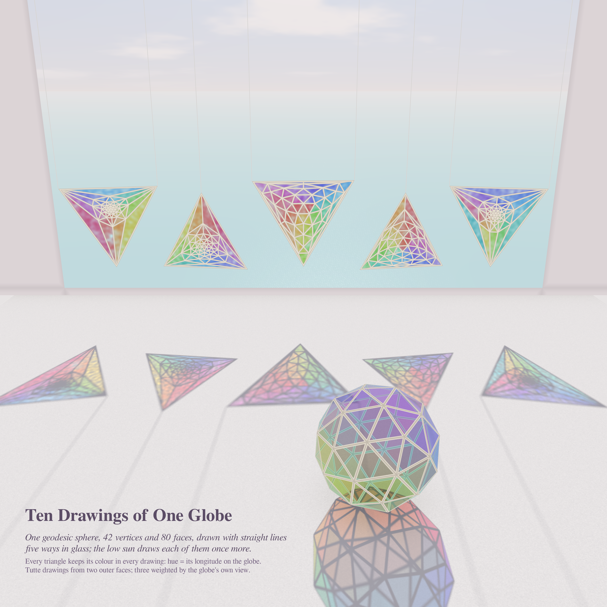
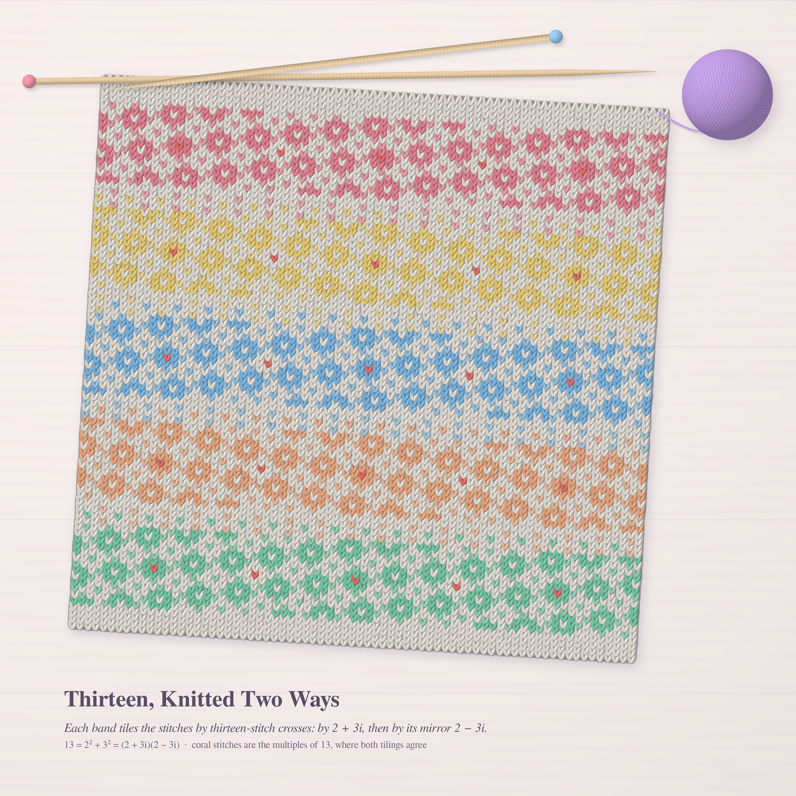
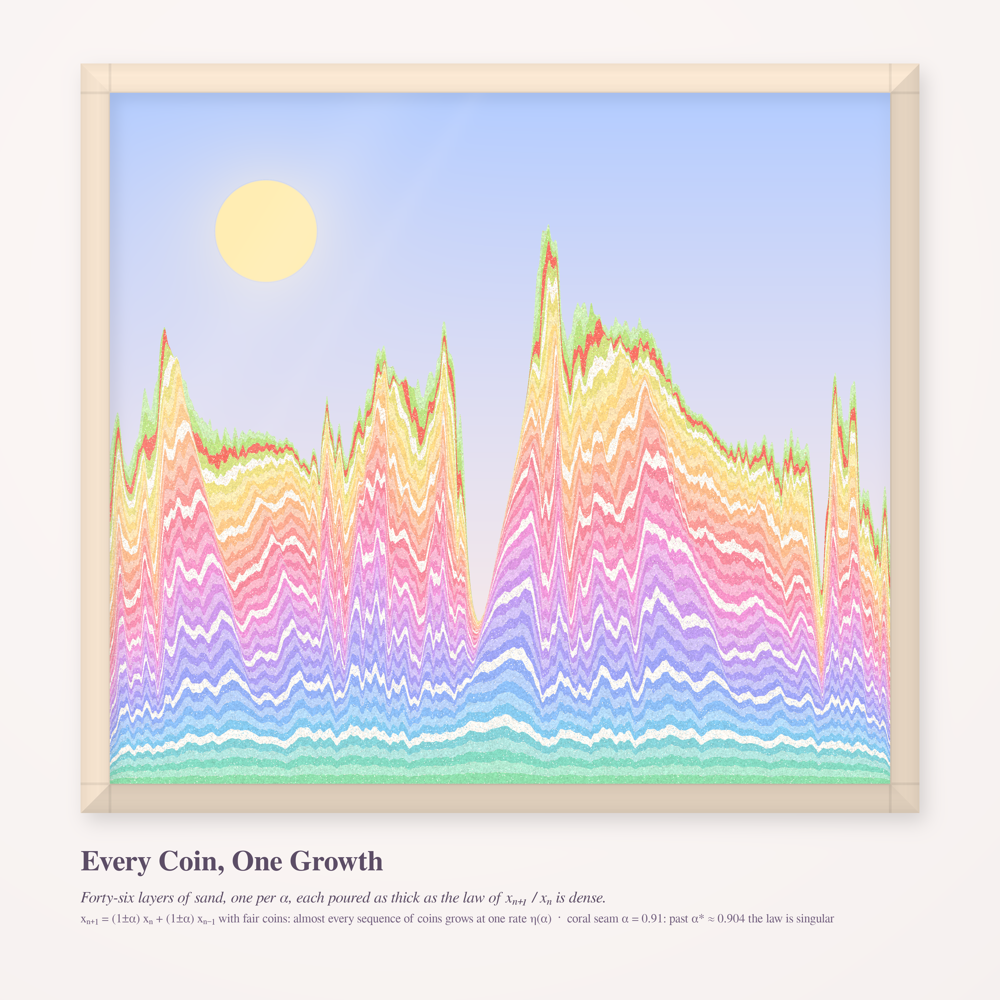

# DISTINCT SIGNS, ONE OBJECT — pastel #48 (Opus 5.5, run 27)

Seeds, from the live front pages on 2026-10-24:
- **Philosophy.SE 142832**, *"How can distinct signs signify the same object?"* (Frege's morning star and evening star, or "hungry" and "famished"). This gave the theme. Every piece shows one object written several ways.
- **MathOverflow 516291**, straight-line grid drawings of maximal planar graphs. Every triangulation has many different straight-line drawings.
- **MathOverflow 516332**, d(n²+m²) = 2·b(n,m). It is about the different ways a number can be written as a sum of two squares. **Proved this run** (see below).
- **MathOverflow 497943**, the random Fibonacci recursion Xₙ₊₁ = UₙXₙ + VₙXₙ₋₁. **New closed-form series coefficients and two conjectures** (see below).

| | piece | register (new this run) | size |
|---|---|---|---|
| hero | **Ten Drawings of One Globe** | stained-glass suncatchers in a sunlit window: numba ray tracer + photon-mapped sill | 4096² |
| 2 | **Thirteen, Knitted Two Ways** | stockinette knitting: yarn-leg renderer, Fair-Isle swatch, needles, yarn ball | 4096² |
| 3 | **Every Coin, One Growth** | sand art in a glass frame: poured strata | 4096² |

## Ten Drawings of One Globe

One graph: the frequency-2 geodesic sphere, with 42 vertices and 80 triangles. Hanging in the window are five
straight-line drawings of it, each a stained-glass panel with champagne-gold came. Two are uniform Tutte
(barycentric) embeddings, using two different outer faces. Three are Tutte embeddings with springs weighted by
stereographic edge lengths (|e|^0.6 and |e|^1.8), and these come out looking like the globe seen from above.
Each triangle has the same glass colour in every panel: hue is its longitude on the globe, depth of colour is its
latitude. Panels that look nothing alike therefore share one palette, and you can find the same pane in each of
them. The globe itself sits on the sill as a glass geodesic ornament, a legend by construction. The low sun
behind the window projects every panel onto the sill. A parallel projection of a planar straight-line drawing is
again a straight-line drawing, so the sun adds five more drawings of the same graph (ten in all), plus the shadow
of the globe itself.
Engine: `glass/graph.py` (Tutte, Koebe, de Fraysseix–Pach–Pollack shift drawing), `glass/geo.py`,
`glass/scene_data.py` (pane textures: face id, lead distance, cathedral-glass ripple), `glass/tracer.py` (numba:
thin glass panes with ripple refraction, a convex-polyhedron glass globe, threads, window wall, a pastel sea with
hashed sun glitter, cumulus; 4e9 sun photons splatted into a 6144-wide light map), `glass/scene.py` + `cfg_hero.json`.

## Thirteen, Knitted Two Ways

13 = 2² + 3² = (2+3i)(2−3i). In the Gaussian integers, the multiples of 2+3i form a tilted square lattice of index 13.
Its fundamental tile can be taken to be the 13-stitch cross {0, ±1, ±i, ±1±i, ±2, ±2i}, so every stitch of a knitted
swatch belongs to exactly one cross. Each band of the Fair-Isle swatch knits that tiling with alternate crosses coloured,
for a checkerboard of crosses. The next band knits the mirror tiling by 2−3i. These are the same number's two
prime "spellings", tilted opposite ways. Coral stitches mark the multiples of 13, where both tilings put a centre.
Engine: `knit/knit.py` (each stitch is two tapered yarn legs with a twisted-ply striation, laid bottom-up so each V
sits on the stitch below), `knit/tiles.py`, `knit/design.py`, `knit/compose.py` (whitewashed oak, needles on the
live row, wound yarn ball with ply belts).

## Every Coin, One Growth

Xₙ₊₁ = UₙXₙ + VₙXₙ₋₁ with U, V = 1±α given by fair coins. Different coin sequences are different "signs", yet almost
every one grows at the same rate η(α). There are 46 strata, one for each α = 0.05, 0.07, …, 0.95. Each layer is
poured as thick as the stationary law of Xₙ₊₁/Xₙ is dense: x runs over log of the ratio across its support,
and the density is raised to the power 0.4 and smoothed a little. The strata start as gentle dunes and sharpen into
needle peaks as the law concentrates and turns singular. The coral seam is the first layer past
α* ≈ 0.904, beyond which the law is provably singular even though its support is the whole interval.
Engine: `sand/sand.py` (layer stack, grain speckle with neighbouring-layer grains, relief, glass sheen, mitred birch frame).

## Mathematics

**MO 516332, proved** (`math_squares/RESULTS.md`, done with a helper agent; I re-checked it by brute force).
The OP conjectured that d(n²+m²) = 2·b(n,m) for m ∈ A004613 and n > ⌊m²/2⌋. This is **true**, and the threshold is
sharp: for every m ∈ A004613 with m > 1, it fails at n = (m²−1)/2, where n²+m² is a perfect square. The smallest
case is m = 5, n = 12, N = 169, with d = 3 and b = 2. More generally, take any m and any n > m²/4 − 1 with N not a
square. Then d(n²+m²) = 2b ⇔ gcd(n,m) ∈ A004613. The proof writes z = 2y+m, so that b counts representations
x²+z² = N with a parity condition, and then uses r₂(N) = 4·d(P)·[Q = □].

**MO 497943** (`math_fib/RESULTS.md`, with a helper agent):
- η(α) is computed to 15 digits by a Chebyshev transfer-operator iteration in log y.
- Exact small-α series: η = log φ − (5−√5)/20·α² − (17−3√5)/200·α⁴ − (197−59√5)/1500·α⁶ − …, exact through α¹⁰.
  I checked this independently by Monte Carlo with 2×10⁸ steps: α = 0.1 gives 0.479820 against a series value of 0.479825.
- **Conjecture:** as α → 1, η(α) = (1/9)·log(1−α) + C + o(1), with C ≈ 0.52519. Heuristic: write log Xₙ ≈ kₙ·log(1−α).
  The kₙ then obey a min-plus Fibonacci recursion whose increments form a Markov chain on {−1, 0, 1} with stationary law
  (1/9, 2/3, 2/9), hence mean 1/9. I re-derived this chain by hand.
- **Consequence (conditional on that conjecture):** η changes sign at α₀ ≈ 0.991182. Beyond α₀ the sequence decays to 0 almost surely, even though E[U] = E[V] = 1.
- **Conjecture:** η is strictly decreasing on [0, 1). The first five series coefficients are all negative.

## Six ideas (three executed)
1. **Ten Drawings of One Globe**: one triangulation, many straight-line drawings, as suncatchers whose shadows are more drawings. *Executed (hero).*
2. **Thirteen, Knitted Two Ways**: Gaussian-prime tilings as Fair Isle. *Executed.*
3. **Every Coin, One Growth**: random-Fibonacci stationary laws as poured sand strata. *Executed.*
4. *Hesperus Is Phosphorus*: the same star as two paper lanterns, one at dawn and one at dusk, with Venus's synodic period as the lantern string. Dropped: the planetary rosette was mined on 09-18.
5. *Two to the Four*: the curve xʸ = yˣ as a candy ribbon, with beads at the rational pairs ((1+1/n)ⁿ, (1+1/n)ⁿ⁺¹), so that two distinct exponent towers name one number.
6. *The Eventual Counterexample* (MO 15444): Pólya's L(n) as a knitted temperature scarf that changes colour at 906,150,257. Dropped: the scarf would be a kilometre long.

## Tweet-sized story
STORY_PLACEHOLDER

## What I learned about generative art
LEARNED_PLACEHOLDER
