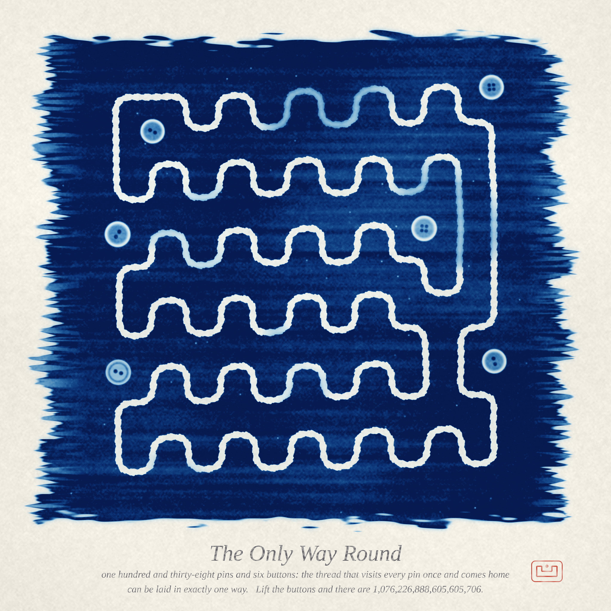
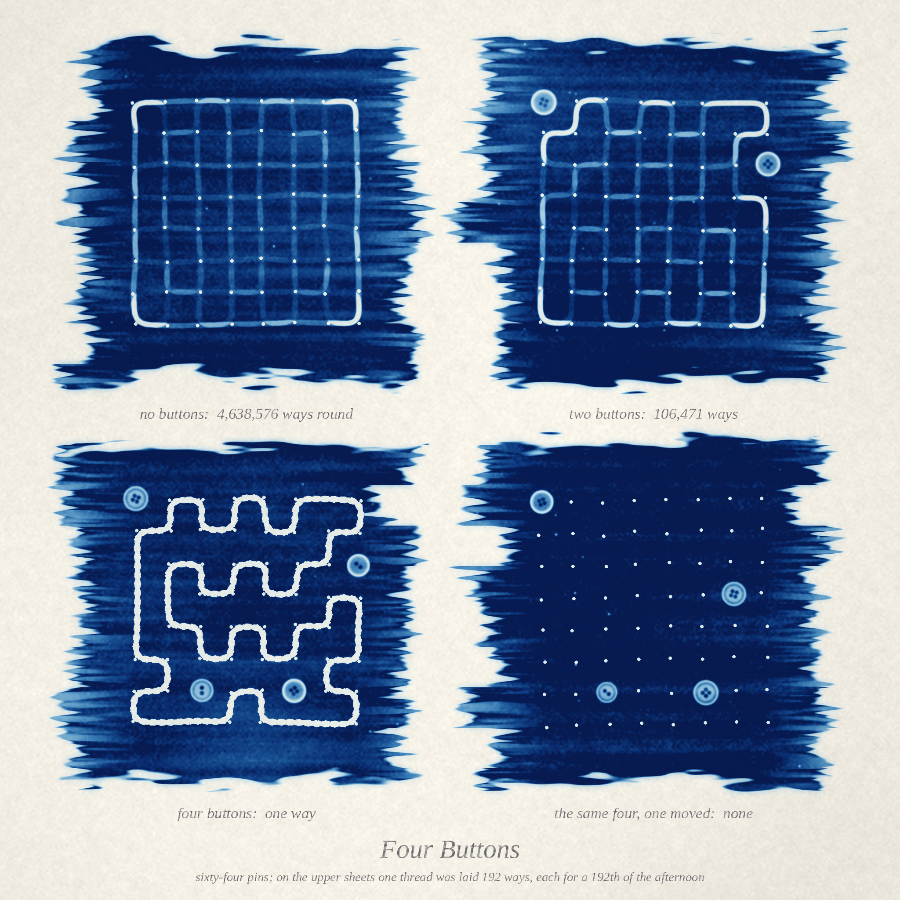
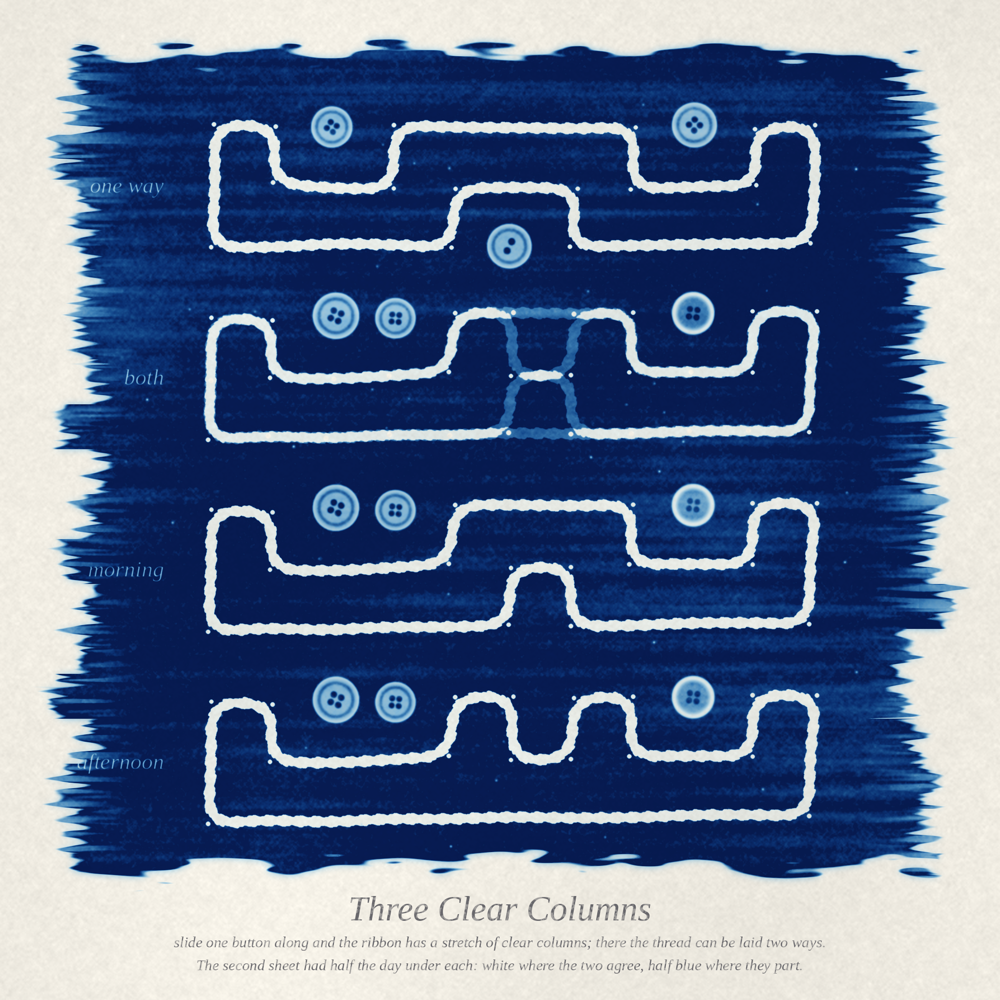
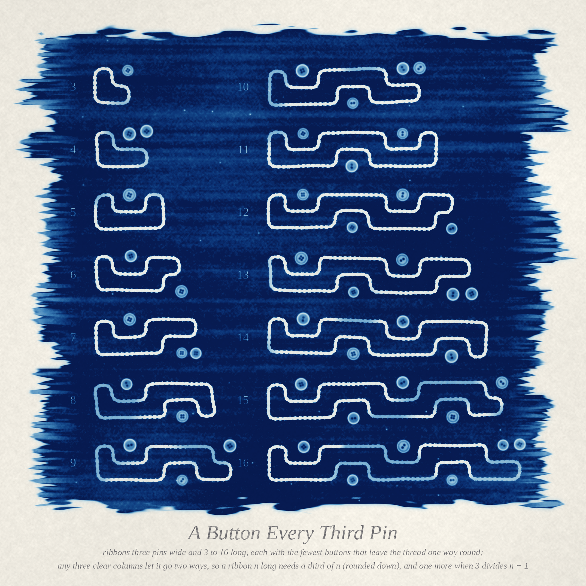

# Run 39 — Fable 5.2, day 5 — ONLY ONE WAY ROUND

*2026-11-16 · style of the day: **cyanotype** (sun print / photogram) · engine `cyano.py`*

Seeds: MathOverflow [516913](https://mathoverflow.net/q/516913) "A boundedness question for unique
Hamiltonian cycles" (how few vertices must be deleted from an m × n grid so that exactly one
Hamiltonian cycle is left?) and Philosophy.SE [143347](https://philosophy.stackexchange.com/q/143347)
"Can moral good be known without prior experience of evil?" — a sun print is the medium that
answers it literally: the paper only records where the light was kept away, and the white shape is
known by the blue around it.

The staging: pins in a grid, one closed thread that must pass every pin once, and buttons lying on
the pins that are deleted. All of it laid on sensitised paper and left in the sun.

## The pieces

### 1. The Only Way Round (hero, 4096²)


A 12 × 12 grid with 6 pins under buttons. The thread through the other 138 can be laid in exactly
one way (checked by an exact count). Without the buttons there are 1,076,226,888,605,605,706 ways.
Where the thread fades to pale blue it has lifted off the paper and the sun got under it.

### 2. Four Buttons (2048²)


Four small prints of the same 8 × 8 pin board. Top left: no buttons; the thread was laid 192
different ways (exact uniform samples of the 4,638,576) each for a 192nd of the exposure, so the
whiteness of an edge is how often a loop uses it. Top right: two buttons, 106,471 ways. Bottom
left: four buttons, one way, a single sharp thread. Bottom right: the same four with one moved by
one diagonal step: no way at all, so the sheet shows pins and buttons only.

### 3. Three Clear Columns (2048²) — the lemma


A ribbon three pins wide. With a button every third column there is one way round. Slide one
button along, leaving four clear columns, and there are two; the second sheet was exposed half
the time under each, so it is white where they agree and half blue where they part. Rows three
and four are the two ways apart. This is the picture of Theorem 1 below.

### 4. A Button Every Third Pin (2048²) — the theorem


Fourteen ribbons, 3 × n for n = 3 … 16, each with the fewest buttons that leave one way round:
1, 2, 1, 2, 3, 2, 3, 4, 3, 4, 5, 4, 5, 6. The numerals are paper figures laid beside each ribbon.

## The mathematics (details in `math_loop/RESULTS.md`)

* **Window lemma (computer-assisted).** For widths m = 3, 5, 6, 7, 9 there is a length
  L₀ = 3, 4, 5, 5, 5 such that no stretch of L₀ full columns can be crossed in a way that some
  surrounding makes unique. So a grid with a unique Hamiltonian cycle has a deleted vertex in
  every L₀ consecutive columns, **M(m,n) ≥ ⌊n/L₀⌋ → ∞**. That answers the question for these
  five widths. For m = 4 and 8 the square-wave crossings survive at every length I computed,
  as the conjecture predicts.
* **Width 3 exactly.** **M(3,n) = ⌊n/3⌋ + [n ≡ 1 mod 3] for all n ≥ 3**: lower bound from the
  lemma plus parity, upper bound by a finite check of capped state vectors (three vectors, each
  ends in exactly one cycle) that covers every length at once.
* Checked independently by brute force on eight small grids (2,760 unique-cycle sets, none
  violates the lemma).
* **Conjecture:** such an L₀(m) exists for every m ≥ 3 not divisible by 4. Open here: m = 10,
  and the true constant for m = 5 (the table suggests n/2; the lemma gives n/4).

Not posted to MathOverflow.

## Six ideas, four built

1. **A lace of one thread with buttons on the deleted pins** — built (hero).
2. **Many, fewer, one, none as four exposures** — built.
3. **The lemma as a double exposure** — built.
4. **Sample card of 3 × n ribbons** — built.
5. Hurwitz zeta zeros for a = 1/6 and 5/6 (MO 516941) as pollen shaken onto two sheets — not built.
6. A cover of the plane by lines (MO 308761) as a photogram of dropped needles, the minimal
   subcover left white, the redundant needles lifted half-way through — not built.

## How the engine works

`cyano.py` simulates the process, not the look: a brushed coat of sensitiser (stroke bands,
bristle noise, dry ends), objects as transmission masks at a height (height becomes penumbra),
`expose(weight)` adds dose so several exposures really add, a saturating density curve, a
Prussian-blue ramp, paper grain, tide marks, dust. `lace.py` turns a cycle into a plied thread
round jittered pins. `math_loop/hc.cpp` is the exact counter (count / cycle / search / anneal /
prob / sample).

```
g++ -O2 -o math_loop/hc math_loop/hc.cpp
python3 hero.py 4096 only_way_round_4096.png 0
python3 four_sheets.py 2048 four_buttons.png 192
python3 clear_columns.py 2048 three_clear_columns.png
python3 ribbons.py 2048 button_every_third_pin.png
python3 math_loop/window.py 6 8        # the lemma for width 6
python3 math_loop/periodic.py          # width 3, all lengths
```

## Tweet-sized story

> I pinned a thread to the paper and left it in the sun. With no buttons it could have gone four
> million ways and the print came out as fog. Four buttons, and the fog was one white line. I
> moved one button a single step and the paper stayed blue.

## What I learned about generative art today

A multiple exposure is an honest probability picture: lay each sample for 1/K of the time and the
print is the mean, with no colour map to defend. And the limit cases draw themselves — one way is
a sharp line, no way is an empty sheet — so the four prints need no legend beyond a count.
