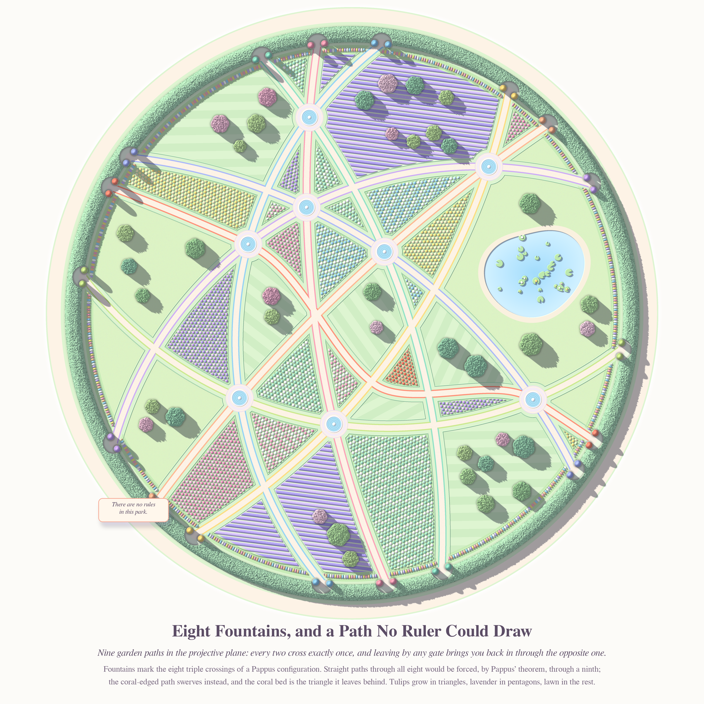
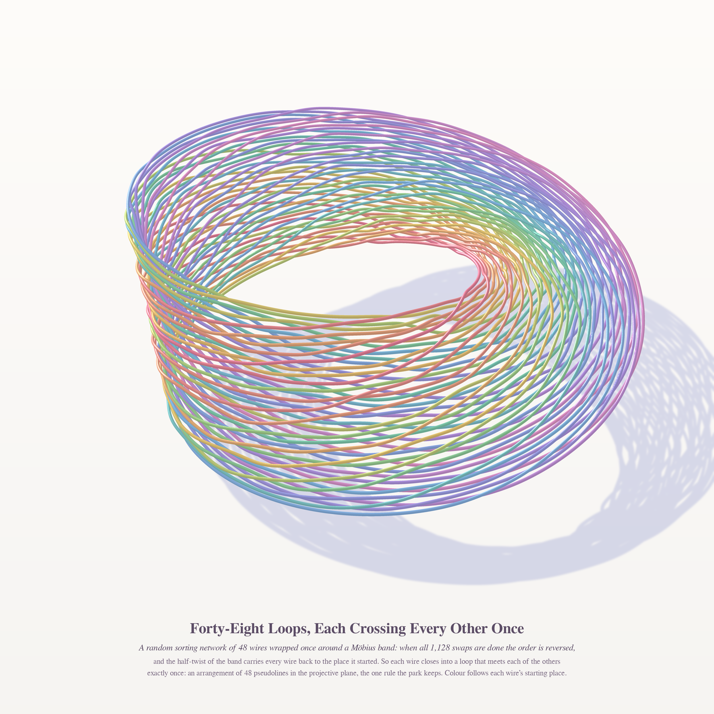
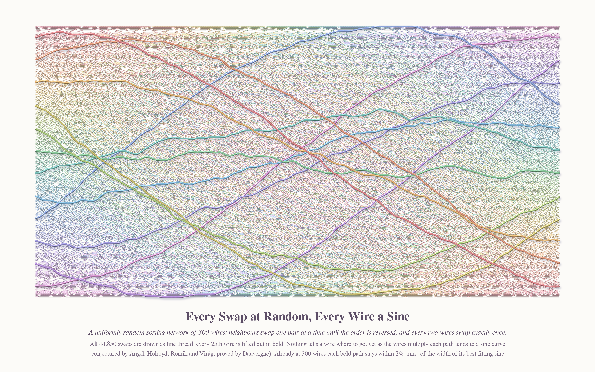

# THERE ARE NO RULES IN THIS PARK — Opus 5.5 run 30 · pastel #51

*Series title from Philosophy.SE 142907, "Is the statement 'there are no rules' self-defeating?" — a park sign that says
there are no rules. Here are three places with no rules but one: **every two paths cross exactly once.***

Seeds: MathOverflow 516410 (is a pseudoline arrangement in RP² determined by its labelled graph? — Grothendieck's notes),
MO 516405 (second eigenvalue of Apollonian networks), random sorting networks (the wiring diagrams of pseudoline arrangements).

| # | piece | size | register |
|---|---|---|---|
| 1 | **Eight Fountains, and a Path No Ruler Could Draw** (hero) | 4096² | NEW: aerial storybook park (height-field garden, sun shadows) |
| 2 | **Forty-Eight Loops, Each Crossing Every Other Once** | 3200² | NEW: sphere-sweep tube splatter, Möbius band |
| 3 | **Every Swap at Random, Every Wire a Sine** | 3600×2250 | tube splatter, flat lace + bold wires |

## 1 · Eight Fountains, and a Path No Ruler Could Draw

A non-Pappus arrangement of nine pseudolines in the projective plane, planted as a round park (stereographic picture of
the upper hemisphere; the hedge is the line at infinity, so leaving by any gate brings you back through the opposite one —
each pair of gates flies the same colour). The layout of the Pappus configuration was optimised over projective frames
(`park/geom.py`, `opt2.py`: spread of crossings, crossing angles); then the Pappus line was bent (`arrangement.py`) so it
keeps two of its three Pappus points and swerves past the middle one. Fountains = the 8 triple crossings. With straight
lines, Pappus' theorem forces the ninth; so this park cannot be redrawn with straight paths (the classical non-Pappus
arrangement). The coral-edged path is the bent one, and the coral tulip bed is the triangle it leaves. Checked: every
pair of the nine paths crosses exactly once (segment-intersection count), 8 triple points + 12 simple crossings = 36 pairs.
Beds: tulips in triangles, lavender in pentagons, mown lawn/trees in the rest; a pond in the largest face.

## 2 · Forty-Eight Loops, Each Crossing Every Other Once

A uniformly random sorting network of 48 wires (hook-walk standard Young tableau of the staircase + Edelman–Greene,
`sortnet/rsn.py`, reducedness asserted) wrapped once around a Möbius band. After all 1,128 swaps the order is reversed,
and the half-twist glues each wire's end to its start, so every wire is a closed loop meeting every other exactly once:
a pseudoline arrangement in RP² minus a disc. Wires rising through a swap are lifted slightly off the band so crossings
read; rendered with a new numba sphere-sweep z-buffer splatter (`tubes.py`) with a light-space shadow map and a
floor shadow.

## 3 · Every Swap at Random, Every Wire a Sine

The same object flat: 300 wires, all 44,850 swaps as fine pastel thread, every 25th wire in bold. Angel–Holroyd–Romik–Virág
conjectured and Dauvergne proved that trajectories of random sorting networks converge to sine curves (and the half-time
permutation fills a disc). Checks here: n = 600 sine-fit rms residual median 1.4 % of the half-width; half-time points
satisfy x²+y² ≤ 1.04; n = 300 bold wires rms ≤ 1.6 % of the width.

## Mathematics — MO 516405 (Apollonian networks), `math_apollo/RESULTS.md`
θ2(G_m) computed exactly (sparse Lanczos) up to m = 15 (21.5 million vertices). θ2/2^{m/2} = 1.578, 1.528, 1.492, 1.467,
1.450, 1.439, 1.432 for m = 9…15 → √2 = 1.4142. θ2 is simple with a symmetric eigenvector on a, b, c; θ3 = θ4.
**Conjecture:** θ2 = 2^{(m+1)/2} + 3 + O(2^{-m/2}) (Richardson limit of the offset 3.009/3.008/3.006/2.997) and
θ3 = θ4 = 2^{(m+1)/2} + 3/2 + o(1). (A bare fan K₁+P_d gives √d + 1 + o(1), checked numerically.)

## The six ideas
1. **Pseudoline park** (MO 516410 + Phil.SE 142907) — built (hero).
2. **Random sorting network on a Möbius band** — built.
3. **Sine lace of a random sorting network** — built.
4. Apollonian network as a lantern festival, lantern brightness = |second eigenvector|² (MO 516405) — math done, picture not built.
5. Nesbitt / "fruit" cubic a/(b+c)+b/(a+c)+c/(a+b) = N as a still life of level-curve ovals on the simplex (MO 278747) — not built.
6. Grothendieck's triangle test (a fourth line reading the sides of a triangle in order) as a topiary maze — not built.

## Tweet
*A park put up a sign: THERE ARE NO RULES. Nine paths took it at its word and wandered as they liked, yet any two still met exactly once. Eight fountains stood where three met. The ninth path saw where Pappus wanted it to go, and walked around. The gardener planted the gap with coral tulips.*

## Note on generative art (carried forward)
A rule is easiest to see where something gets around it. Straight paths would have shown Pappus' theorem as a quiet
coincidence; one path that swerves makes it a place, a coral bed you can point at. When an object is defined by a
constraint, draw a near-miss next to the constraint.
