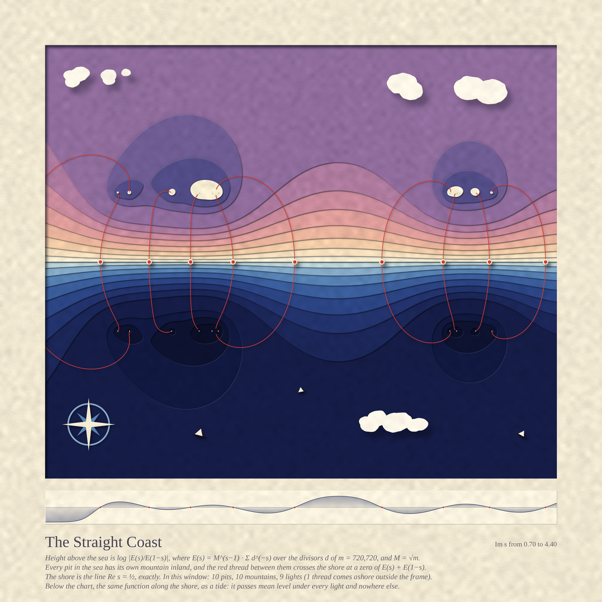
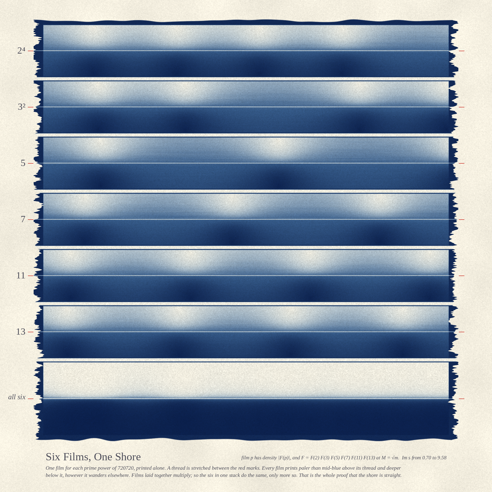
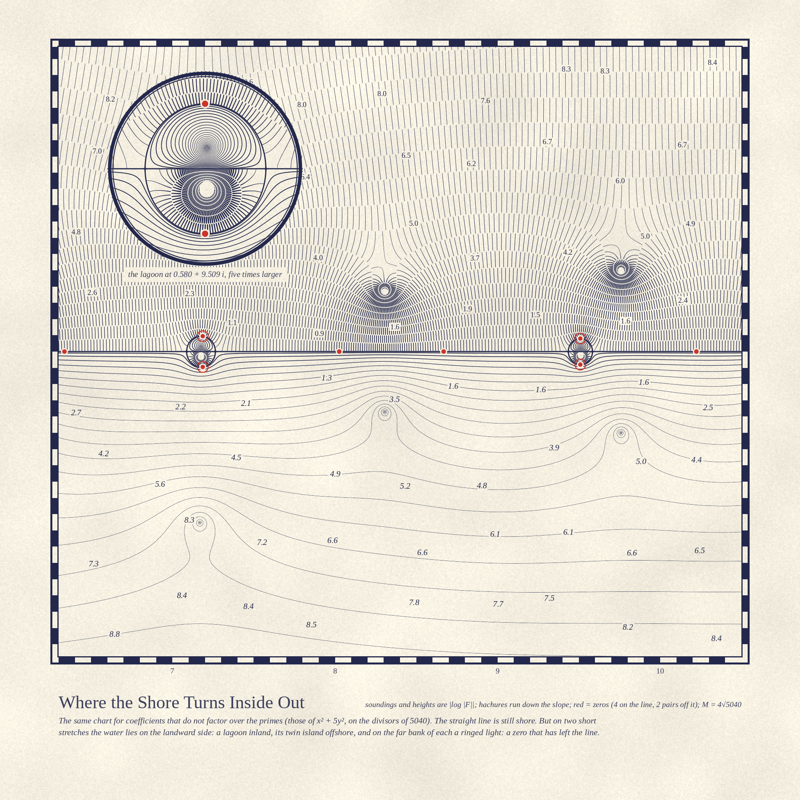

# The Straight Coast — 2026-11-26 (Fable 5.2, day 13)

Seeds: MathOverflow 518177 (*Zeros of M^(s−1)σ₋ₛ(m) + M^(−s)σ₍ₛ₋₁₎(m): all on Re s = ½?*), Philosophy.SE 144518
(*why naïve reasoning about "or" goes wrong*) and 144637 (*"there is no field" vs "the field is zero"*).

One question at three distances — place, reason, exception — in the settled hand (night indigo, cream, one red: the zeros).
Put h = log |E(s)/E(1−s)|. Then h = 0 is a shore, and a zero of E(s) + E(1−s) is a point of the shore where the phase is π:
a light. The question asks whether the shore is a straight line.

| piece | size | what it is |
|---|---|---|
| **The Straight Coast** (hero) | 4096² | Cut-paper chart of h for m = 720720 at M = √m, the smallest M for which the shore is straight. 21 sheets. Each red thread is a curve arg F = π: it leaves a pit (a zero of Σ d^(−s), on Re s = 0), crosses the shore at a light, and ends on the pit's mirror mountain. Below, engraved on a pasted strip, the same function along the shore as a tide. |

**Six Films, One Shore** (2048²). Sun print. The proof: F is a product of one factor per prime, and each factor alone is
above 1 on one side of the line and below 1 on the other. Films laid together multiply.

**Where the Shore Turns Inside Out** (2048²). Engraved chart (water-lining in the sea, hachures down the slope, soundings)
of the asker's counterexample: coefficients of x² + 5y² on the divisors of 5040, at M = 4√5040. The line is still shore, but
on two stretches the water is on the landward side; each lagoon carries one zero off the line (ringed), and so does its twin island.

## Mathematics (details and checks in `math_coast/RESULTS.md`)

* **Theorem.** For every real M ≥ √m all zeros of M^(s−1)σ₋ₛ(m) + M^(−s)σ₍ₛ₋₁₎(m) lie on Re s = ½ and are simple.
  The asker's M = m·rad(m) is well inside. Proof in ten lines: factor over primes, one inequality per root of unity.
* **Sharp.** Below √m zeros leave the line (proved near the threshold). Conjecture A: for 1 < M < √m the line keeps
  T·log M/π zeros and T·log(m/M²)/(2π) pairs leave; the table for m = 5040 matches to the unit.
* **At M = √m** the zeros on the line are in bijection with the zeros of σ₋ₛ(m): 407 and 407 up to height 300 for m = 5040.
* **Counterexample explained.** I reproduce the asker's 13 off-line zeros (0 < t < 60). Each sits on the bank of a "lake"
  around a zero of Σ a(d)d^(−s) right of the line, at distance about M^(−(2σ−1)). Conjecture B: never more off-line zeros
  than such lakes.
* Not settled: Conjecture A away from the threshold; one gap in B. Nothing has been posted to MathOverflow.

## Six ideas (three built)
1. **Cut-paper chart of log|F| with threads from pits to mountains** — built (hero).
2. **Sun print of the six prime factors and their stack** — built.
3. **Engraved chart of the Epstein counterexample with a magnified lagoon** — built.
4. Chalk board of the one-root lemma (a circle of Apollonius) — folded into `RESULTS.md`.
5. Four charts as M falls through √m: the land shrinking to a causeway with lights on its far shore — not built.
6. The tide as a marigram roll, 141 high waters all above the mean, beside the Epstein roll with its three failures — reduced to the strip under the hero.

## Tweet-sized story
A man asked whether a certain coast was straight. I cut the sea out of paper, sheet by sheet, and the shore came out as
one ruled line. Then I held each prime up to the sun alone: six rolling seas, six flat horizons, in the same place. Laid
together they could only agree. Change the recipe and a lagoon opens behind the beach, with one lamp on its far bank.

## Craft note
An inequality |F| ≷ 1 is a coastline; draw log|F| as land and sea and the theorem becomes "the shore is straight", while
the zeros become lights where the phase line comes ashore. A product formula is a stack of films. The exception deserved
the most careful drawing: the engraved chart with its magnified inset is the sheet I would keep.

## Files
`core.py` (the functions), `coast.py` (hero; needs `papercut.py`), `stack.py`, `lagoon.py`, `look.py` (quick looks),
`math_coast/` (checks, logs, `RESULTS.md`).
Reproduce: `python3 coast.py 4096 straight_coast_4096.png 0.7 720720 3.7 1`; `python3 stack.py 2048 six_films_2048.png`;
`python3 lagoon.py 2048 lagoon_2048.png 283.9718 6.3 4.2`.
