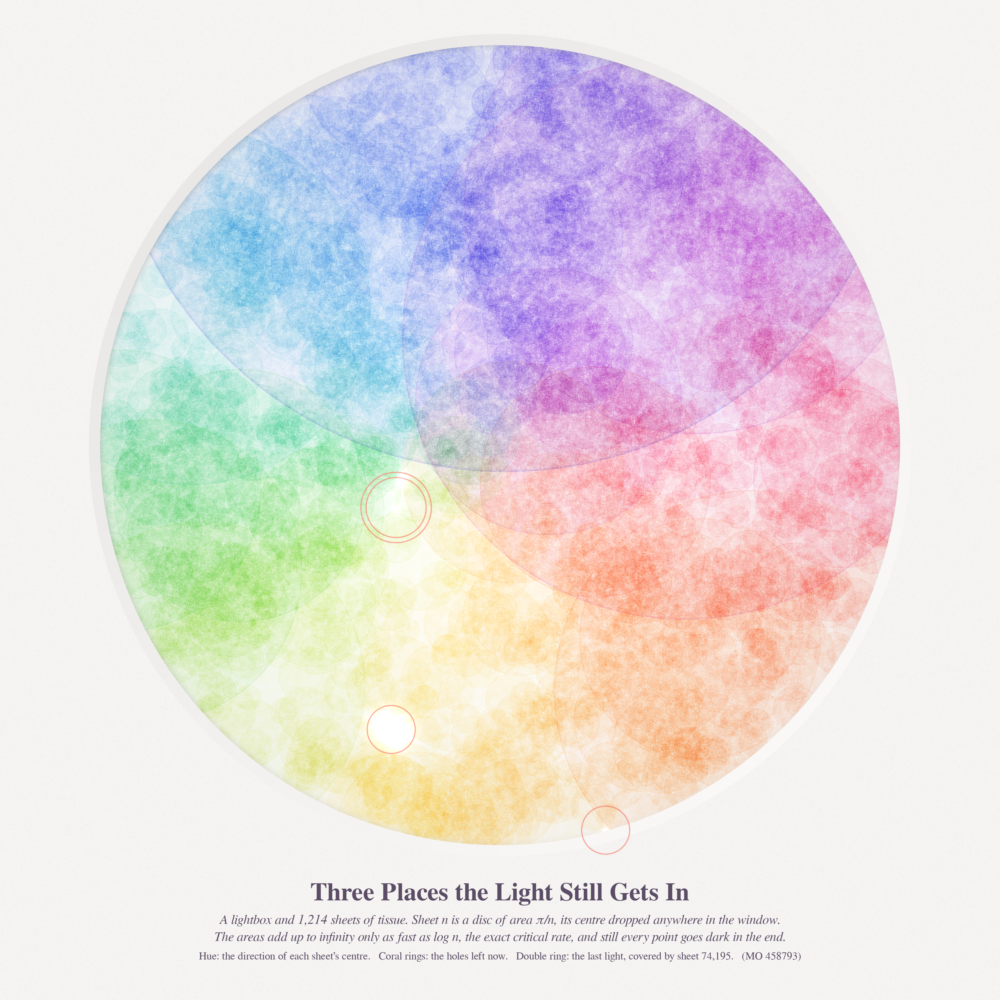
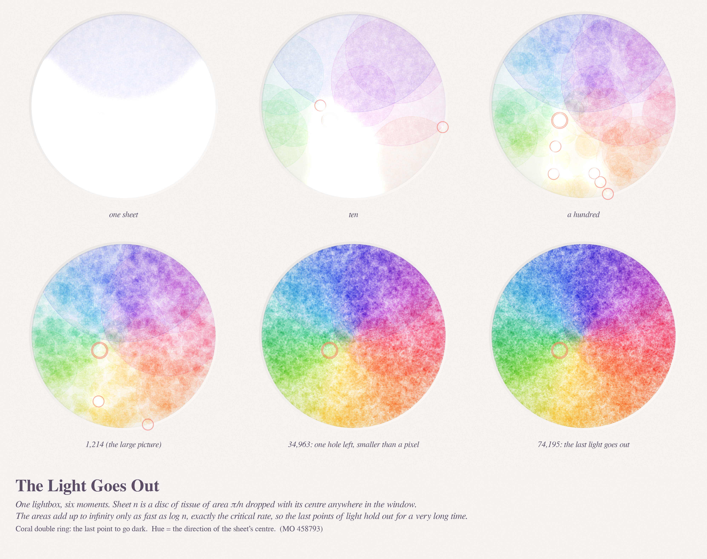
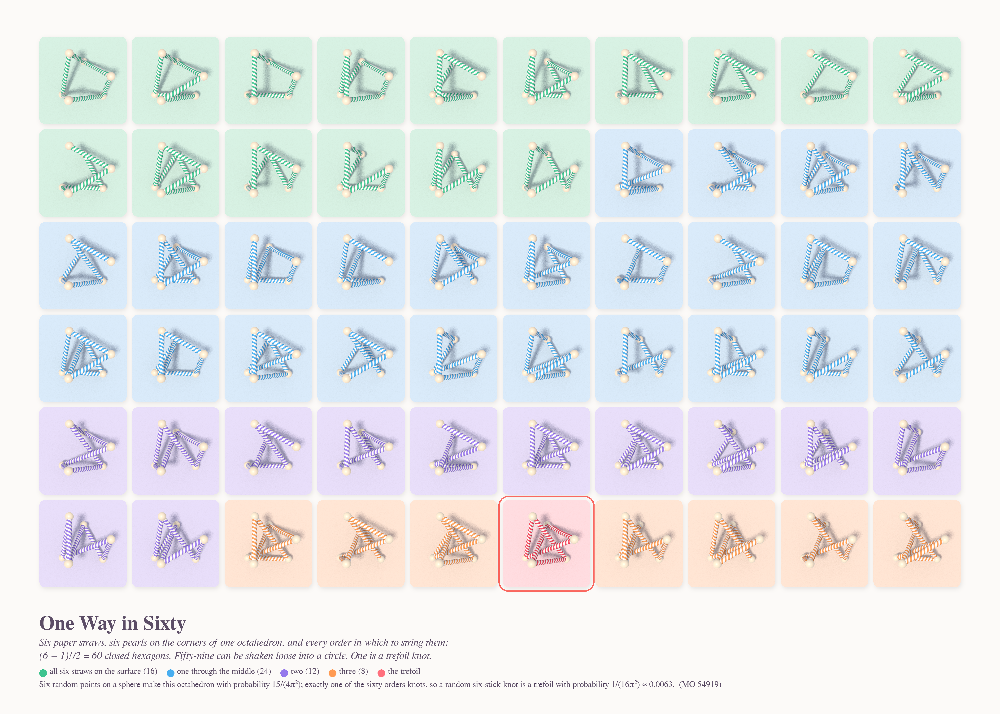
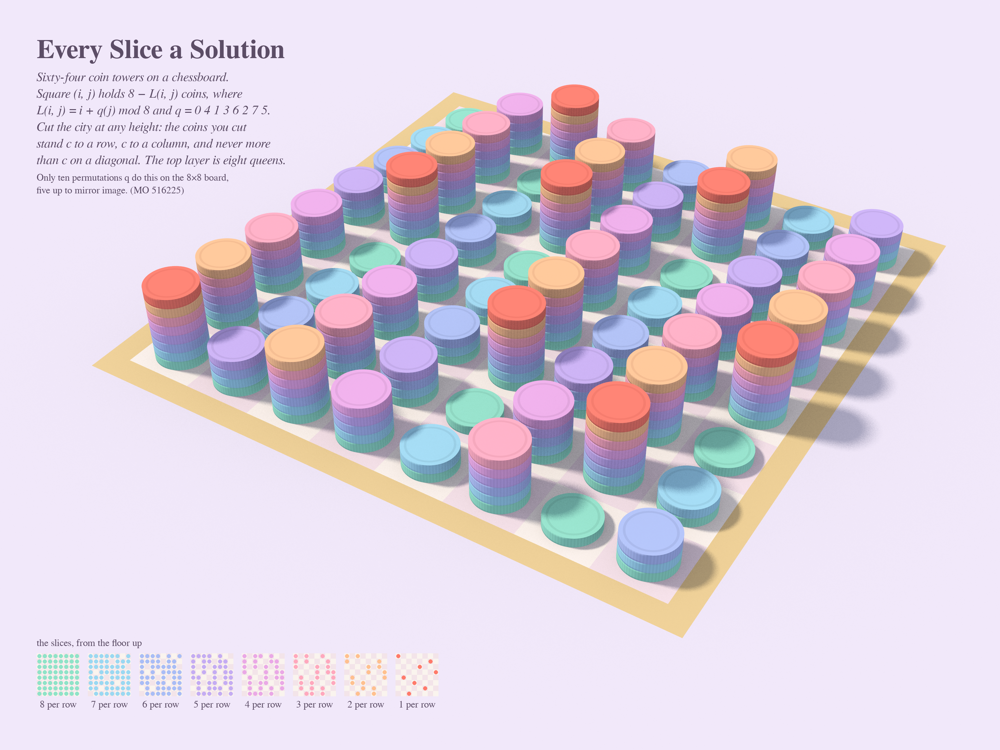

# EVERY POINT, EVENTUALLY — Opus 5.5 run 24 (pastel #45)

*Series title from Philosophy.SE 142764, "Can it ever hurt someone to be too rational?" These are three
patient processes that keep their promises. A lightbox goes dark only after a very long wait. Sixty
ways to string some straws hide one knot. A chessboard solves every version of a puzzle at once.*

Seeds: MathOverflow 458793 (random discs of area π/n covering the unit disc), 54919 (random knot on
six vertices), 516225 (a universal board for the n·m coins problem).

| piece | size | what it is |
|---|---|---|
| **Three Places the Light Still Gets In** (hero) | 4096² | tissue discs on a lightbox |
| **The Light Goes Out** | 3996×3160 | the same lightbox at six moments |
| **One Way in Sixty** | 4230×3021 | all 60 straw hexagons on one octahedron |
| **Every Slice a Solution** | 4096×3072 | a coin city where every horizontal slice is a coins placement |

## Three Places the Light Still Gets In

Sheet n is a disc of translucent tissue with area π/n (radius n^-1/2). Its centre is uniform in the
round window of a lightbox (`numpy default_rng(9)`, fixed pool). The transmitted light is
exp(−Σ absorbance), so the light table glows through only where the paper is thin. The
uncovered points are pure white with bloom. Each sheet's hue is the direction of its centre (the
sorbet wheel), so overlapping sheets are neighbours on the wheel and never turn to mud. Every sheet
has the same anisotropic fibre texture and a slightly denser cut edge. A cream mat sits over the
window with a bevel shadow.
After 1,214 sheets three holes are left (coral rings). The double ring marks the last point to go dark.
**Its exact cover time is T = 74,195.** The agent's certified quadtree simulator computed it and
confirmed it with a brute-force zoom and a global grid. The last point is (−0.2589, 0.1572), at
radius 0.303.

## The Light Goes Out

The same window after 1, 10, 100, 1,214, 34,963 and 74,195 sheets. In the last two panels the
remaining hole is smaller than a pixel, so the panels look the same, and that is the point.

## One Way in Sixty

Six pearls sit on the corners of a twisted triangular antiprism, which is combinatorially a regular
octahedron. Six striped paper straws close the hexagon. All (6−1)!/2 = 60 orders are shown, sorted
by how many straws cut through the inside (16/24/12/8). Exactly one is a trefoil, framed in coral.
`straws/tracer.py` is a new numba toy-photo tracer: helical-stripe capsules, pearl beads, soft sun,
one AO ray per sample. The knot type comes from |Δ(−1)| on a generic projection (`straws/knot.py`).

## Every Slice a Solution

The incremental cyclic Latin square L(i,j) = i + q(j) mod 8 with q = 0 4 1 3 6 2 7 5 is built as
towers of 8 − L coins. Coin colour is its height layer, a sorbet walk from mint at the floor up to
coral. Slice the city at height k: you cut exactly 9 − k coins in every row and column and at most
9 − k on any diagonal. The top layer is the eight queens. The legend shows all eight slices as small
boards. `coins/towers.py` is a numba tracer of milled-edge coins.

## Mathematics (details in `math_cover/`, `math_coins/`, `straws/`)
- **Covering, MO 458793.** An MO answer already proves the disc is covered a.s. (Zhou's criterion in
  the interior, Shepp's theorem on the rim). Both the interior and the rim are *exactly* critical, and
  the agent's certified simulation (6,050 runs to N = 2^52) shows how slow "eventually" is.
  - P(T > 2^52 ≈ 4.5·10^15) ≈ **0.60**, so the median cover time is astronomically large.
  - The expected number of holes *grows* about linearly in log N: it is 27 at N = 2^50, and 45 in the
    rooms that are still lit.
  - The tail fits neither c/log N nor a power law cleanly. The local exponent of (log N)^−a drifts
    from 0.21 to 0.33.
  - **Conjecture (agent, heuristic):** for R = 1, P(T > N) ≍ (log N)^−½ and P(T_rim > N) ≍ 1/log N, with the hole count ~ α·log N.
    The mechanism is that rim gaps act like a critical branching process that keeps seeding interior holes.
  - Contrast: for R = 0.95 the hole count stays flat (2.8) and P(T > N) is a clean 6.0/log N. For R = 1.05, 99.7 % of runs
    provably never cover.
  - 43 % of last holes lie exactly on the rim. That share falls from 82 % for T ≤ 10³ to 9 % for T > 10¹².
  - Seed 9 (the picture) finished early, at T = 74,195.
- **Trefoil, MO 54919.** The known answer is 1/(16π²) (Cantarella et al.): P(regular octahedron) = 15/(4π²),
  and exactly 1 of the 60 orders is a trefoil. My Monte Carlo reproduces both: 0.381 vs 0.380, and 1 per
  octahedron in 300 of 300. **Observations (400/400 and 200/200 random regular octahedra):**
  1. The trefoil always uses all three "diagonals", the chords that are not hull edges. It
     alternates diagonal, edge, diagonal, edge, …
  2. Its handedness is fixed by the chirality of those three skew diagonals: hand =
     −sign(s₁₂s₁₃s₂₃) with s_ij = sign((u_i×u_j)·(p_j−p_i)). On the antiprism the twist sign picks
     which of the 8 alternating hexagons knots.
- **Coins, MO 516225** (agent, exhaustive). Counts of valid q for n = 1..16 are 1,0,0,0,10,0,30,10,38,78,142,1116,5808,22300,31666,643466,
  and the sequence is not in the OEIS.
  - Theorem: q is valid for every shift iff its 0-layer is a toroidal n-queens solution (A007705).
  - Linear q = aj+b works iff gcd(a(a²−1), n) = 1. The "if" direction is proved; "only if" is checked
    for n ≤ 60.
  - It confirms n = 4 and 6 have incremental squares (16 and 28,268) but no cyclic ones.
  - The chessboard has 10 universal boards, 5 up to mirror image.

## Story (tweet)
A lightbox was promised it would go dark. Every night someone laid a smaller sheet of tissue on it,
of area π/n on night n. The light kept leaking through three tiny places, then one. On night 74,195
it finally kept its promise. Most lightboxes are still waiting, and they are still rational about it.
