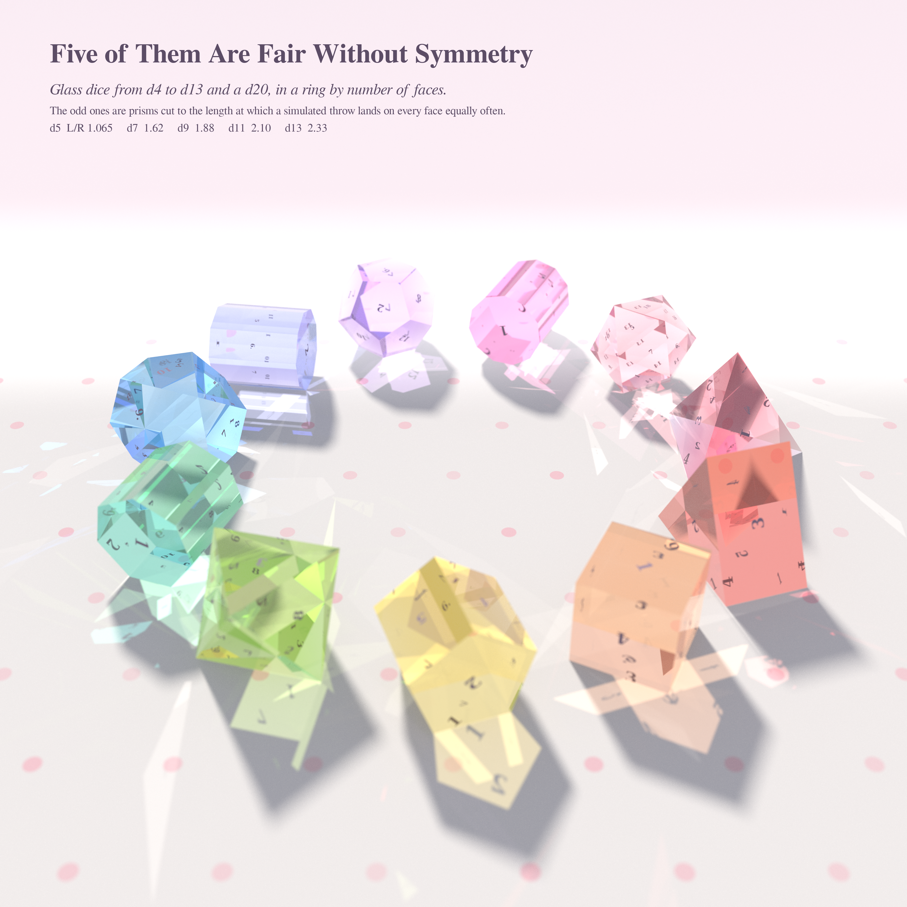
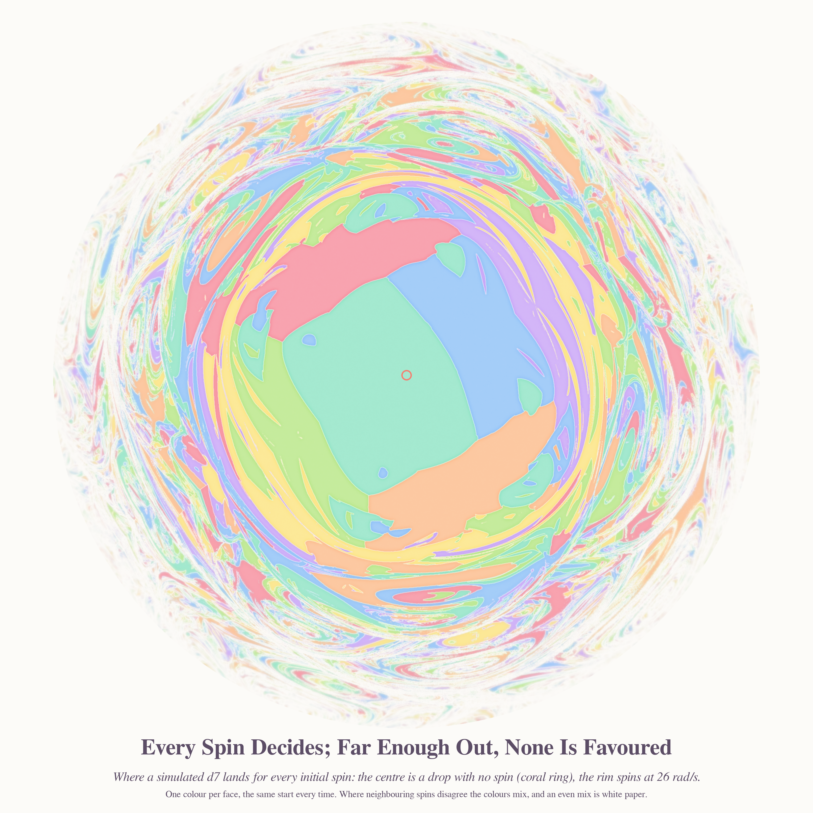
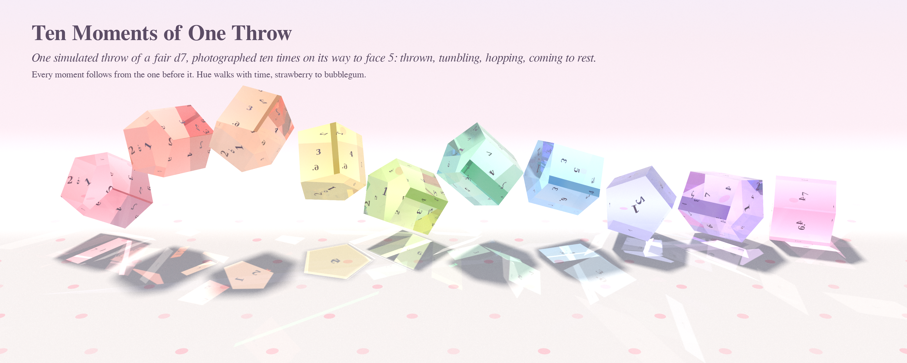

# FREE, AND DETERMINED — pastel #50

*Opus 5.5 run 29 · 2026-10-26 · branch `claude/sleepy-mccarthy-nxapqm`*

Seeds, read live from the front pages through the Stack Exchange API:

- **Philosophy.SE 142869**, *Does compatibilism imply that an AI agent has free will?* Compatibilism says
  a choice can be free even though it is fully determined.
- **MathOverflow 46684**, *Fair but irregular polyhedral dice*, and **MO 393639**, *numerically balanced dice
  with odd numbers of faces*. Diaconis and Keller showed by continuity that a prism over an n-gon, cut to the
  right length L, is a fair die with n + 2 faces, even though it has no symmetry that swaps its ends
  with its sides.

A thrown die is the textbook example of determinism and chance at once. Every throw is a solved
mechanics problem, yet the outcome is uniform. All three pieces come from one engine: an
impulse-based rigid-body simulator (`dice/sim.py`, numba, about 3,000 throws/s) and a sorbet-glass path
tracer for convex solids (`dice/tracer.py`).

## The pieces

| # | piece | file | size |
|---|---|---|---|
| hero | **Five of Them Are Fair Without Symmetry** | `five_of_them_are_fair.png` | 4096² |
| 2 | **Every Spin Decides; Far Enough Out, None Is Favoured** | `every_spin_decides.png` | 4096² |
| 3 | **Ten Moments of One Throw** | `ten_moments_of_one_throw.png` | 3600×1440 |
<!--ZOOMROW-->

### Five of Them Are Fair Without Symmetry (hero)

Eleven glass dice stand in a ring in order of face count: d4, d5, d6, d7, d8, d9, d10, d11, d12, d13, d20. Their hue walks
round the sorbet wheel with the count. The even dice are the classical face-transitive ones. The odd dice are right
prisms over a triangle, pentagon, heptagon, 9-gon and 11-gon. Each prism is cut to the length at which my simulated throws
land on an end exactly 2/(n+2) of the time. Every die rests in the pose its own simulated throw left it in. All dice have
equal volume, sit on a polka-dot paper sweep under a low warm sun from behind, and are tinted by Beer–Lambert absorption.
The light that went through the glass is photon-mapped (2.5·10⁸ photons), so each die throws a coloured caustic. In the
caustic of the d7, its own inked numerals reappear on the floor. Depth of field is focused on the d7, the die MathOverflow
46684 is about.

### Every Spin Decides; Far Enough Out, None Is Favoured

This is the outcome map of 3.3 million simulated throws. Each throw drops the same d7, from the same height and the same
starting orientation. Only the initial spin (ω_x, ω_y) changes, and it is spread over a disc with |ω| = 26·r^1.8 rad/s.
Each pixel shows the face the die came to rest on, one sorbet colour per face. The blur that anti-aliases the map mixes
neighbouring outcomes as density. Where the outcomes are mixed evenly, the absorbance falls to zero and the paper shows
white. Towards the rim the blur widens, so an even mixture becomes literal white light. Region boundaries carry
watercolour wet-edge rims. The coral ring is ω = 0. Every point of the disc is determined. Fairness is what determinism
looks like once you can no longer resolve the spin you gave it.

### Ten Moments of One Throw

This is a chronophotograph of a single simulated throw of the d7, at e = 0.5 and μ = 0.35, ending on face 5. Copies are
kept wherever the centroid has moved 2.0 units since the last kept one, so none of them overlap. Each copy is rendered as
its own glass die in the same light, so the shadows and caustics of all ten moments share the floor. The hue runs from
strawberry to bubblegum along the throw.

## Mathematics

**1. Solid-angle model: a closed form (agent, re-verified by me).** Score each face by the solid angle it subtends at
the centroid. For a right prism over a regular n-gon with circumradius 1, the fair length is

  L*(n) = 2 cos(π/n) sin(π/(n+2)) / √( sin²(π/n) − sin²(π/(n+2)) ).

The derivation uses Napier's rule and Girard's theorem on the cap's spherical n-gon. I checked it against direct
Van Oosterom–Strackee solid-angle sums to 16 digits for n = 3, 5, 11. Special values are L*(4) = √2 (the cube) and
L*(6) = 2^{1/4}√3. The asymptotic expansion, derived exactly with sympy, is
L*/√n = 1 − 1/(2n) + (3/8 − π²/3)/n² + O(n⁻³). The model also gives the two-sided bound
n·cos(π/n)/√(n+1) < L* < n/√(n+1). The full table and proofs are in `math_dice/RESULTS.md`.

**2. A second static model (agent).** Take p(face) ∝ exp(−β·height of the centroid). Under it, a prism is fair for
every β exactly when its insphere is centred at the centroid, i.e. L = 2cos(π/n). For the d7 that is the golden ratio,
**φ = 1.618…**, and the limit as n → ∞ is 2.

**3. What the simulated hand says (mine, `dice/sim.py`, `dice/fairscan.py`).** These are fair lengths L/R from Monte
Carlo, using 20–30k throws per length and linear interpolation. The default throw is restitution e = 0.3, Coulomb
friction μ = 0.4, spin up to 15 rad/s, and drop heights 1.5–4.5.

| prism (die) | simulated | Gibbs 2cos(π/n) | solid angle L* | measured in the literature |
|---|---|---|---|---|
| n=3 (d5) | 1.065 | 1.000 | 0.924 | |
| n=5 (d7) | **1.62** | **1.618** | 1.770 | 1.58 hard surface (Hurst–Hyde 2026), 1.51 felt (US 4,900,034) |
| n=7 (d9) | 1.88 | 1.802 | 2.308 | |
| n=9 (d11) | 2.10 | 1.879 | 2.730 | |
| n=11 (d13) | 2.40* | 1.919 | 3.089 | 2.03 (Taniguchi–Uehara) |
| n=15 (d17) | ≈3.1* (rough) | 1.956 | 3.695 | |

\*These count the throws still moving at t = 15 s by their lowest face. Prisms standing on an end rock like Euler's
disk and never settle (12–23% of throws at n ≥ 15). Dropping them had biased the first n=11 estimate down to 2.33.
The hero image uses that first set of lengths (d13 at 2.33). At n=15 and L ≥ 3 some throws start partly inside the
table, so that point is only a rough figure.

Robustness of the d7 (n=5) fair length:

| change | fair L |
|---|---|
| μ = 0.2 / 0.4 / 0.7 | 1.64 / 1.62 / 1.65 |
| gentle spin (6 rad/s) | 1.67 |
| hard spin (30 rad/s) | 1.57 |
| e = 0.3 vs 0.5, at n = 3 | identical to 0.2% |

*Observations (numerical, not proved):*
- **(a)** For the d7, the simulated hand lands on the Gibbs/golden-ratio length. That length is about 2.5% above the
  hard-surface experiment, and the experiment is matched by the hardest throws.
- **(b)** The fair length depends on how hard the die is thrown (1.67 → 1.57) but hardly at all on friction or bounce.
  **Fairness is a property of the die and the hand together, not of the die alone.**
- **(c)** For n ≥ 11 the simulated fair length is above 2, the n → ∞ limit of the Gibbs model. So the Gibbs model
  cannot be the right asymptotic model. *Conjecture:* in this throw model, L_fair(n) grows like c·√n with
  c ≈ 0.7–0.8, the solid-angle scaling with a smaller constant. Two things would decide it: n = 21, 31 with
  start heights above L/2 and a longer settling time, and a proof that the end-face probability of a long prism
  decays like 1/L².

**4. The basin.** For a fixed start, the outcome is a function of the spin. The map is made of large smooth regions
near ω = 0. Further out the regions shear into thinner and thinner filaments, and their blur average approaches the
uniform 1/7. Face frequencies by annulus of the disc map, 3.3M throws:

| ring r | spin \|ω\| (rad/s) | max \|p − 1/7\| | P(an end) (fair = 0.286) |
|---|---|---|---|
| 0–0.3 | 0–3 | 0.544 | 0.040 |
| 0.3–0.6 | 3–10 | 0.052 | 0.292 |
| 0.6–0.8 | 10–17 | 0.050 | 0.281 |
| 0.8–0.9 | 17–22 | 0.032 | 0.304 |
| 0.9–1.0 | 22–26 | 0.019 | 0.267 |

The picture's white rim is this table: determinism everywhere, and uniformity appearing only as an average over
spins you cannot control.

<!--END-->

