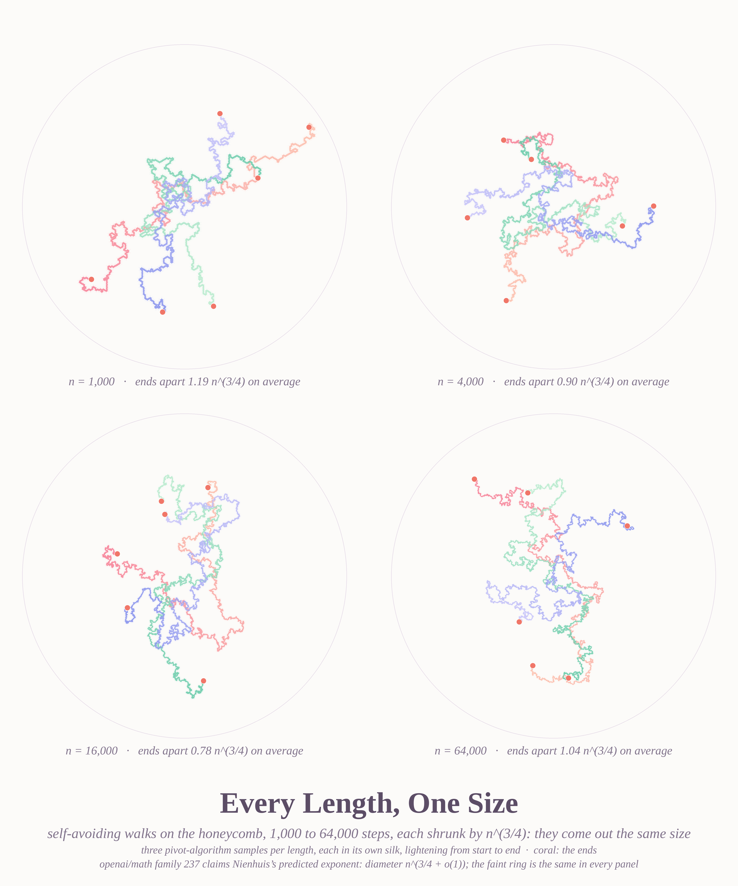
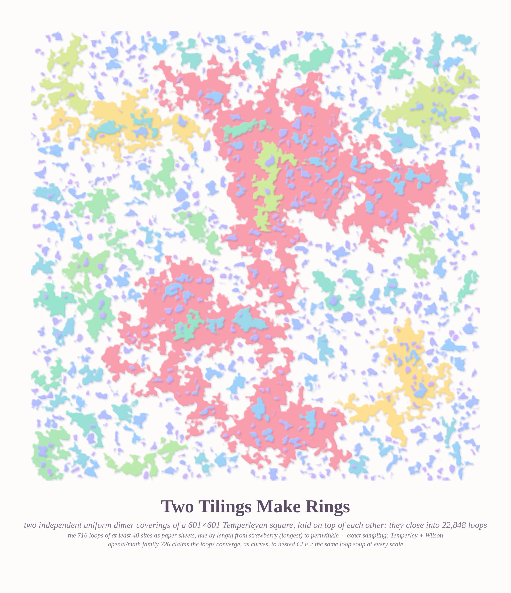
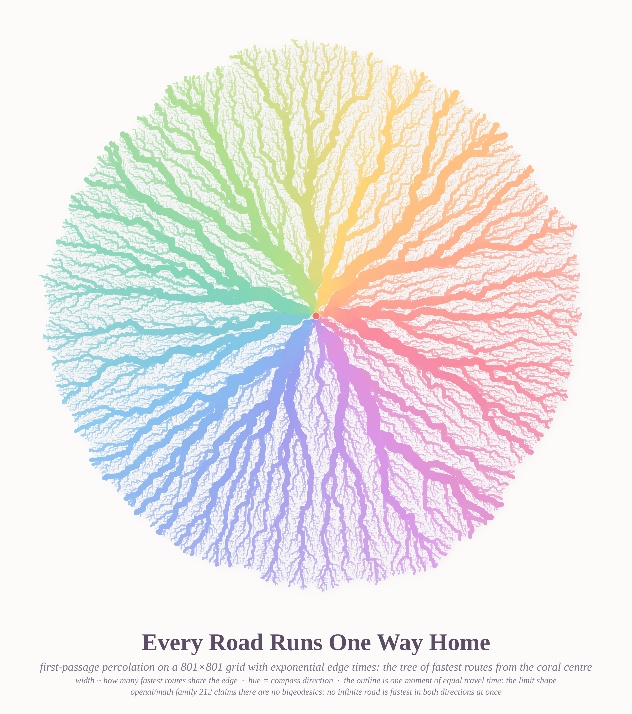
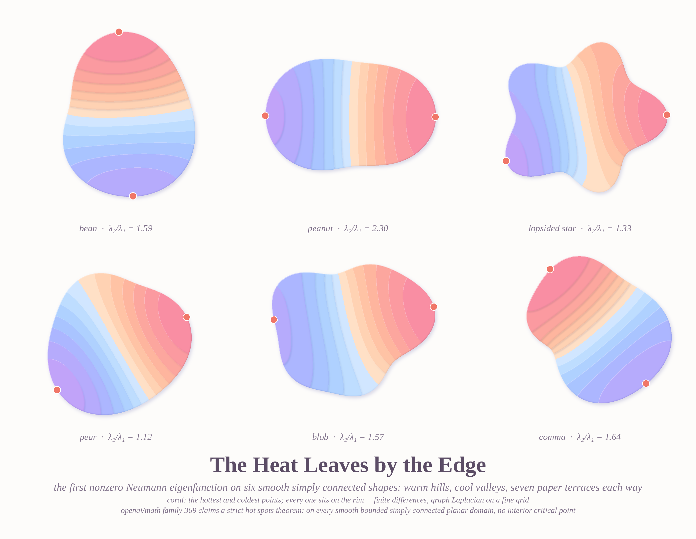
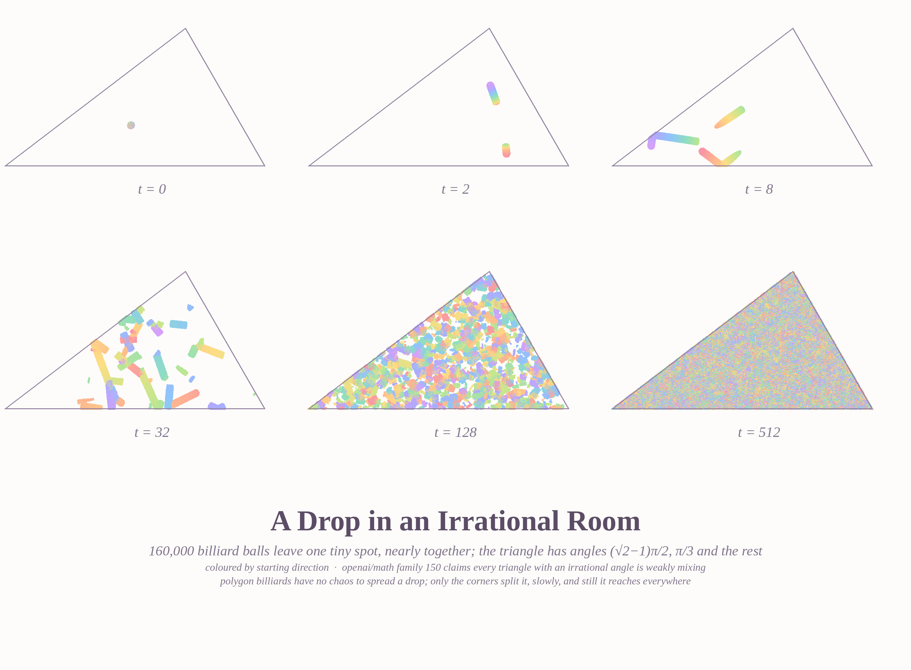
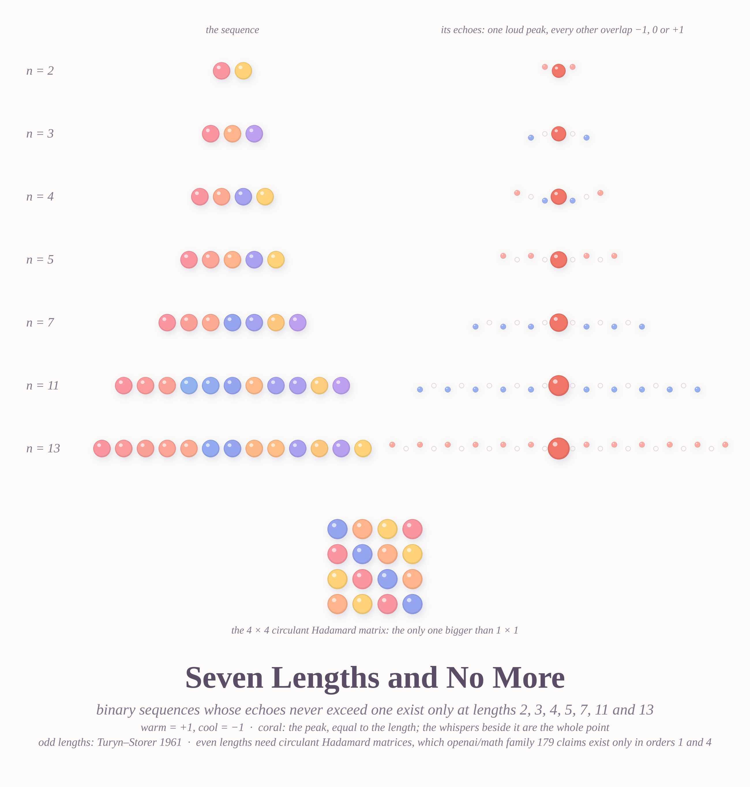
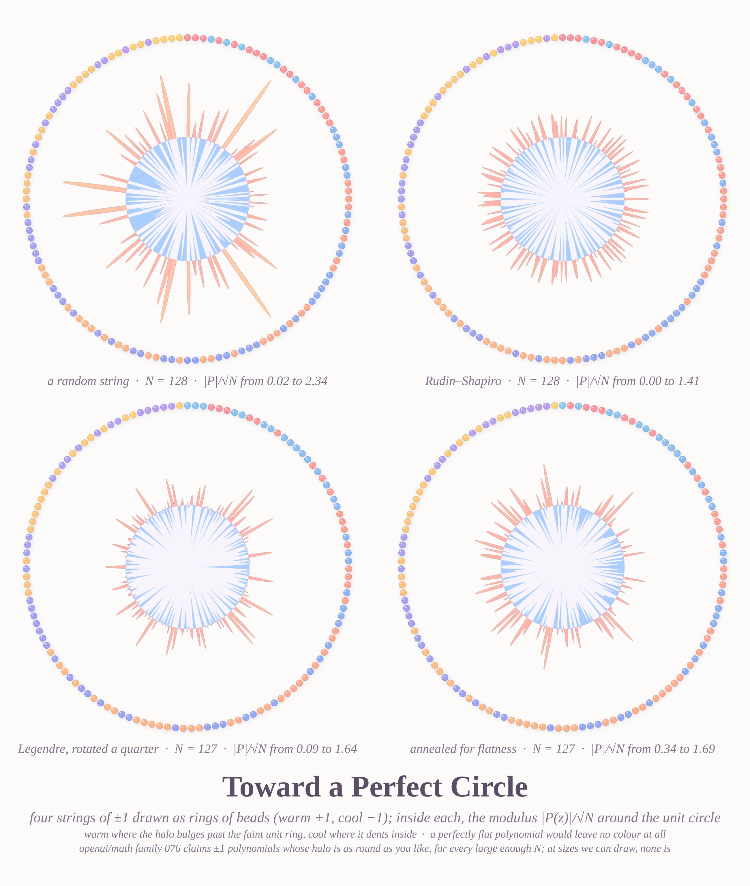

# SEVEN CLAIMS, DRAWN — pastel #30b (Opus 5.5, 2026-10-07, on request)

Seven pictures of objects from [openai/math](https://github.com/openai/math), a catalogue of 722 manuscripts
produced by an internal OpenAI model. **What is drawn is the classical object** (random walks, dimers, billiards,
eigenfunctions, ±1 sequences), computed here from scratch. **The theorems are the repository's claims**; every
caption names its family. Several families have partial Lean formalizations; none of this is a check of the
proofs.

### Every Length, One Size — family 237 (honeycomb self-avoiding walk, ¾ exponent)

Three pivot-algorithm walks at each of 1,000 / 4,000 / 16,000 / 64,000 steps, each shrunk by n^(−3/4). If the
claimed exponent is right, all four panels come out the same size. They do: mean end-to-end distance
1.19 / 0.90 / 0.78 / 1.04 × n^(3/4).

### Two Tilings Make Rings — family 226 (double dimers → CLE₄)

Two independent uniform dimer coverings of a 601×601 Temperleyan square, sampled exactly with Temperley's
bijection and Wilson's algorithm. Overlaid, they close into 22,848 loops. The 716 loops with at least 40 sites are
paper sheets, smoothed by about 1.3 lattice cells. Hue follows loop length (strawberry is longest); shadows follow
nesting.

### Every Road Runs One Way Home — family 212 (no bigeodesics in first-passage percolation)

Exponential edge times on an 801×801 grid; the tree of fastest routes from the centre. Width follows how many
fastest routes share an edge, and hue follows compass direction. The outline is one moment of equal travel time
(the limit shape).

### The Heat Leaves by the Edge — family 369 (hot spots for simply connected domains)

The first nonzero Neumann eigenfunction on six smooth simply connected shapes (finite differences, shift-invert),
drawn as seven paper terraces each way. In every case the hottest and coldest points (coral) sit on the rim, at
distance one grid cell from the boundary.

### A Drop in an Irrational Room — family 150 (weak mixing of triangular billiards)

160,000 billiard balls leave one tiny spot in a triangle with angle (√2−1)π/2. Snapshots at t = 0, 2, 8, 32,
128 and 512 show the drop stretching into bars, scattering into confetti, then filling the room evenly.

### Seven Lengths and No More — family 179 (circulant Hadamard / Barker)

The Barker sequences of lengths 2, 3, 4, 5, 7, 11 and 13 as candy beads, with their aperiodic autocorrelations
beside them: one loud coral peak, every other overlap −1, 0 or +1. Below is the 4×4 circulant Hadamard
matrix. The odd-length classification is classical (Turyn–Storer); the even-length part rests on the claimed
circulant Hadamard theorem.

### Toward a Perfect Circle — family 076 (ultraflat real Littlewood polynomials)

Four ±1 strings of length about 128: random, Rudin–Shapiro, rotated Legendre, and one I annealed for flatness.
Each is drawn as a ring of beads around its modulus |P(z)|/√N. The halo is warm where it bulges past 1 and cool
where it dents below. The paper's construction only works for N far beyond anything drawable, so this is a
picture of the problem, not of the solution. At this size the best I found stays between 0.34 and 1.69.

## Files
`pivot.c` (from `art_hdqm/`), `render_saw.py`; `dimers.py` (Temperley + Wilson, numba), `render_dimer.py`;
`fpp.py`, `render_fpp.py`; `hotspots.py`, `render_hot.py`; `billiard.py`, `flow.py`, `render_flow.py`;
`render_barker.py`; `flat.py` (Rudin–Shapiro, Legendre, annealing), `render_flat.py`; `caption.py`.

## What I learned
- **A process is better shown as a time strip than as one long exposure.** The full billiard orbit was uniform
  pink mush; six snapshots of a dropped blob show the mixing itself.
- **Draw macroscopic loops, smoothed at lattice scale.** Raw double-dimer loops wiggle around every cell; keeping
  loops of at least 40 sites and smoothing their interiors by about 1.3 cells turns lattice noise into paper islands.
- **Taper rivers toward their source.** Width by subtree size alone turns the root into a blob; capping width at
  about half the distance to the source gives a clean starburst.
