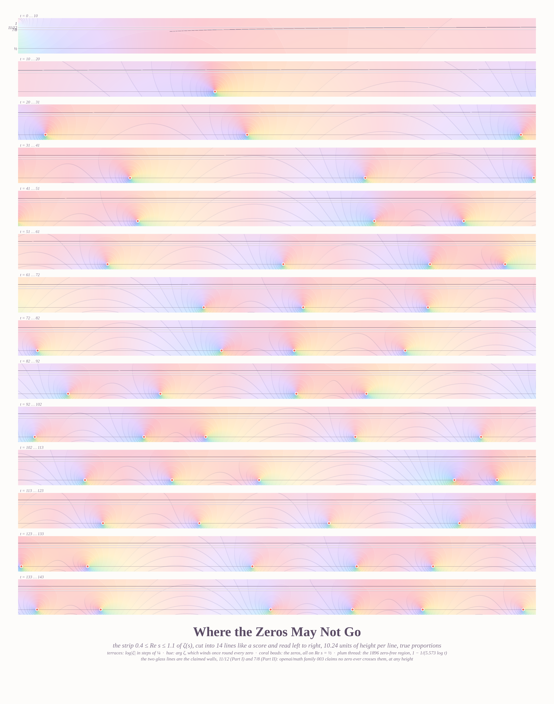
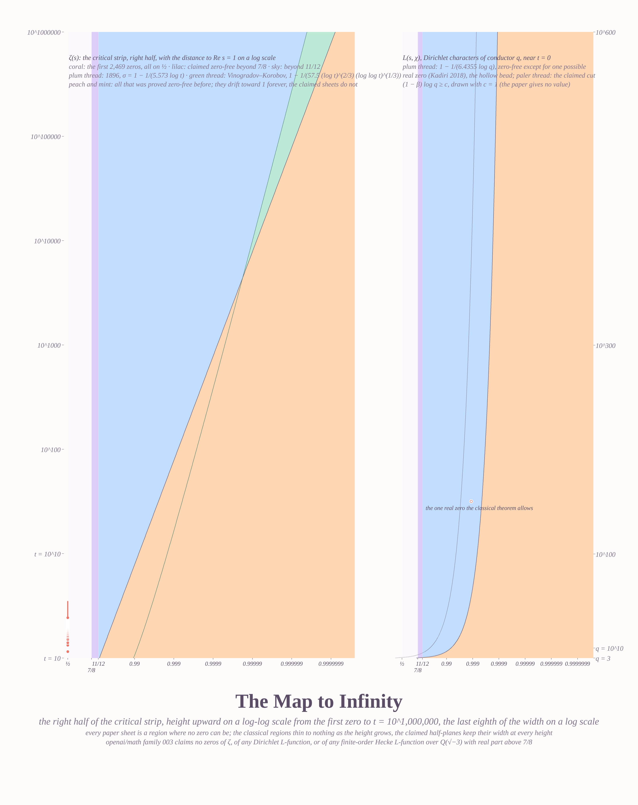
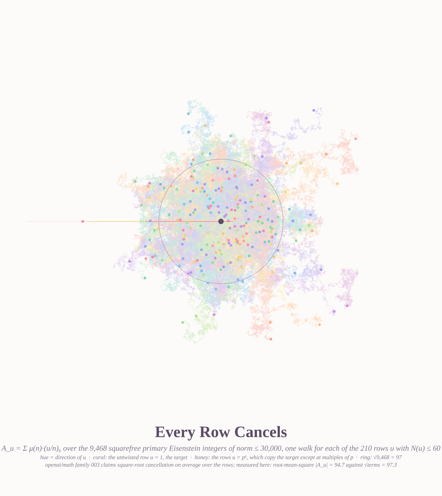
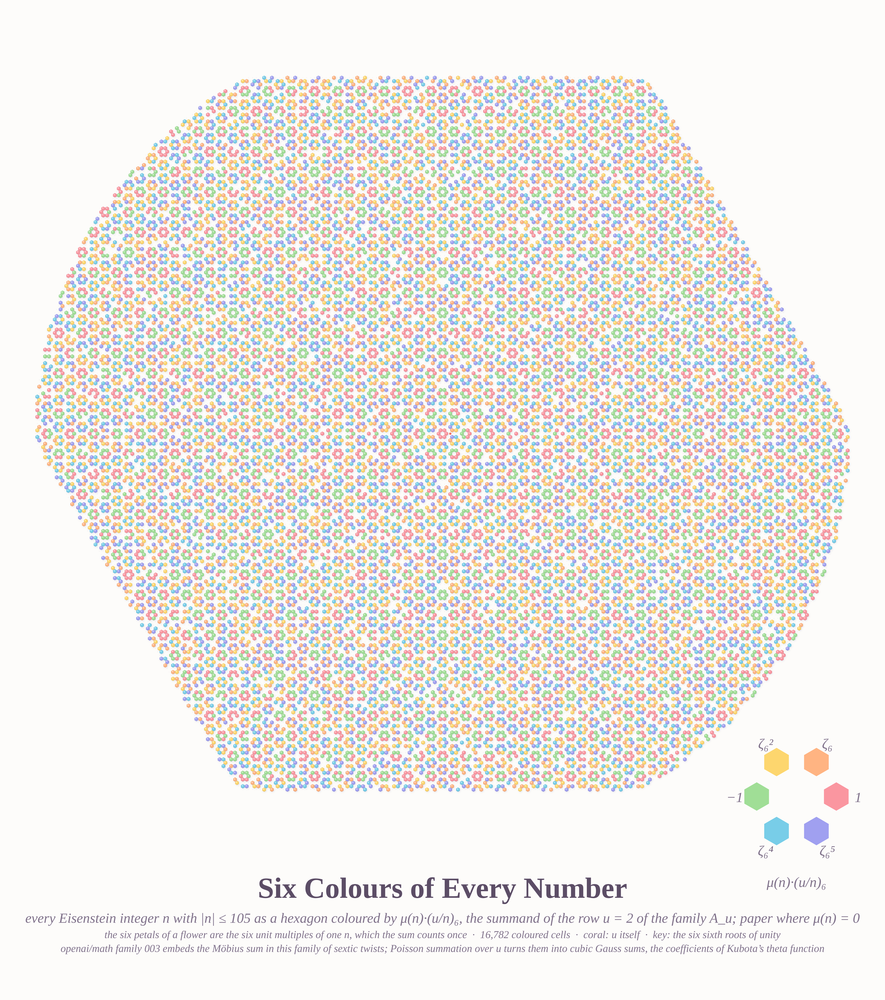
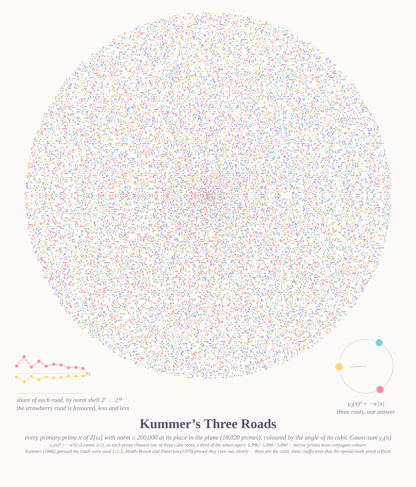

# WHERE THE ZEROS MAY NOT GO — five pictures of the quasi-Riemann hypothesis (2026-10-07, on request)

A series on openai/math family 003, *The Quasi-Riemann Hypothesis*: the claim that ζ(s), every Dirichlet
L-function and every finite-order Hecke L-function over Q(√−3) has no zero with Re s > 7/8 (Part II), after
11/12 (Part I). Every object here is computed from scratch (`notes_math.md` lists the checks); the theorem
itself is the repository's claim, and each caption says so. The ζ statement has a Lean Comparator challenge
in the repository; the applications do not.

### Where the Zeros May Not Go — 4382 × 5729

The strip 0.4 ≤ Re s ≤ 1.1 of ζ(s) from t = 0 to 143, cut into fourteen lines like a score, at true
proportions. Terraces of log|ζ| in steps of ¼; hue is arg ζ, which winds once round every zero; coral beads
are the zeros, all on Re s = ½. The plum thread is the 1896 zero-free region 1 − 1/(5.573 log t). The two
glass lines are the claimed walls at 11/12 and 7/8.

### The Map to Infinity — 3200 × 4032

The same right half-strip with the last eighth of its width stretched on a log scale, and height on a
log-log scale from the first zero up to t = 10^1,000,000. Every paper sheet is a region with no zeros: the
classical regions (de la Vallée Poussin, Vinogradov–Korobov) drift toward Re s = 1 forever; the claimed
half-planes keep the same width at every height. The right panel is the Dirichlet picture by conductor q,
with Kadiri's region, the one real zero it allows (hollow bead), and the claimed cut (1 − β) log q ≥ c.

### Every Row Cancels — 4096 × 4587

The family the proof lives in: A_u = Σ μ(n)·(u/n)₆ over the 9,468 squarefree primary Eisenstein integers of
norm ≤ 30,000, one walk in the plane for each of the 210 rows u with N(u) ≤ 60, hue by the direction of u.
Coral is the untwisted target row u = 1 (the Möbius sum of Q(√−3)); honey the rows u = p⁶, which copy the
target except at multiples of p. The ring is √9,468. Measured: root-mean-square |A_u| = 94.7 against
√terms = 97.3 — the square-root cancellation on average that the claimed estimate (2.3) asserts.

### Six Colours of Every Number — 4096 × 4628

The summands of one row: every Eisenstein integer n with |n| ≤ 105 as a hexagon coloured by μ(n)·(2/n)₆,
one of the six sixth roots of unity, paper where μ(n) = 0. The six petals of each flower are the six unit
multiples of one n, which the sum counts once. The key at lower right gives the six colours.

### Kummer's Three Roads — 4096 × 4792

Every primary prime π of Z[ω] with norm ≤ 200,000 (18,020 primes) at its own place in the plane, coloured
by the angle of its cubic Gauss sum γ₂(π). Lemma 4.2 of the paper, γ₂(π)³ = −π/|π|, was checked for all of
them; it leaves each prime a choice of three cube roots, a third of the wheel apart. Kummer (1846) guessed
the roads were used 1:2:3; Heath-Brown and Patterson (1979) proved they even out. Counts here:
6,996 / 5,490 / 5,490, with the bias shrinking shell by shell (inset ledger). These Gauss sums are the cubic
theta coefficients the proof reflects.

## Files
`eis.py` (Z[ω] arithmetic, sextic symbols, Gauss sums), `gauss_sweep.py`, `tables.py`, `zeta.py`,
`zeta_rows.py`, `rszeros.py`, `render_score.py`, `render_map.py`, `render_walks.py`, `render_mosaic.py`,
`render_kummer.py`, `caption.py`, `notes_math.md`.

## What I learned
- **Draw the proof's objects, not its slogan.** A zeta landscape is familiar; the sextic family, the Gauss
  sums and the Möbius walks are what the 199 pages are actually about, and they are drawable and checkable.
- **A score beats a tall strip.** 143 units of height at true proportions would be a ribbon 1:200; fourteen
  lines read left to right keep the proportions and the eye.
- **Log-log height and log distance-to-one** are the only axes on which "a half-plane of fixed width" and
  "a region that thins forever" can share a page.
