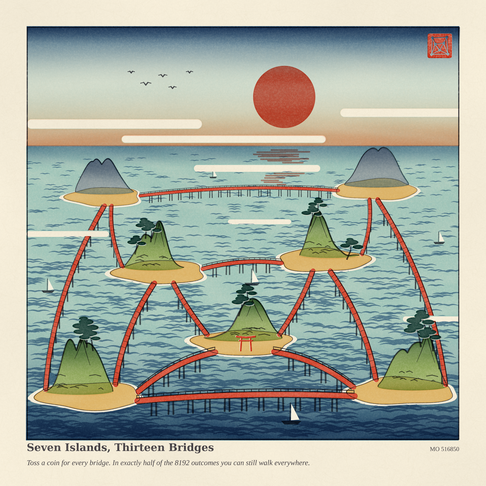
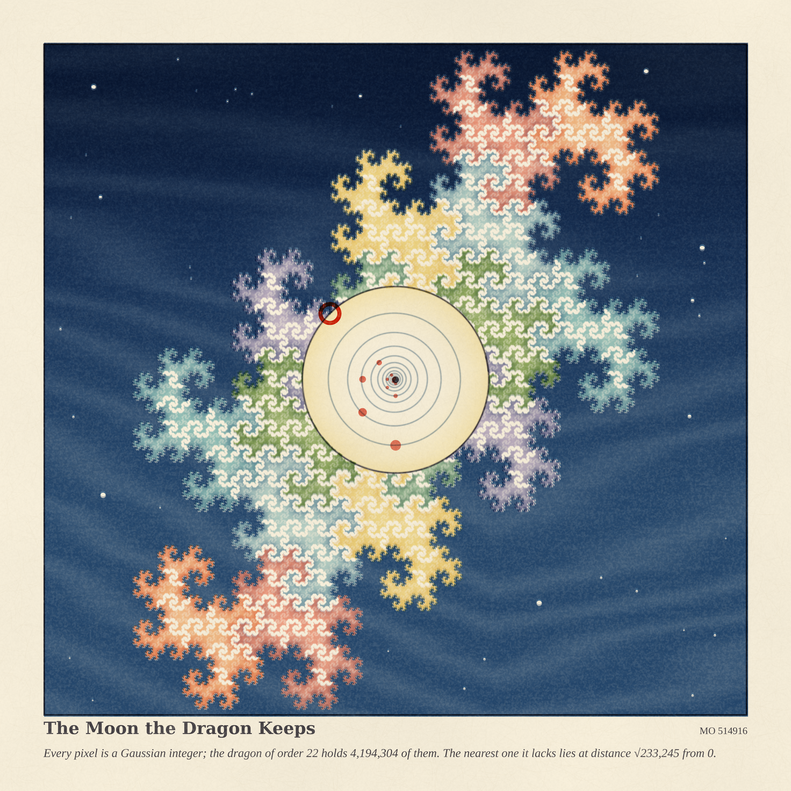
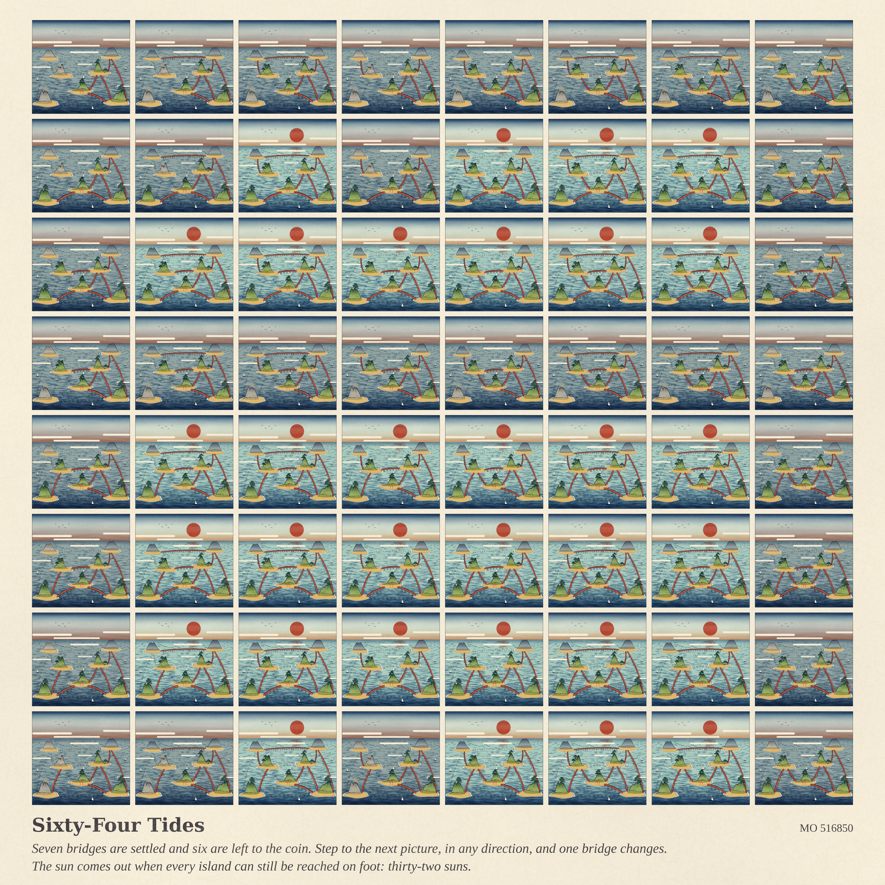

# EXACTLY HALF — three woodblock prints (run 35, Fable 5.2's first day)

*2026-11-12 · branch `claude/happy-planck-qzk35k` · a deliberate change of hand: after 55 pastel
runs, today's style is the Japanese woodblock print (mokuhanga) — flat transparent inks on washi,
graded wipes (bokashi), wood grain, a key block, one vermilion.*

Seeds from today's front pages:
MathOverflow [516850](https://mathoverflow.net/questions/516850) (*can arbitrarily large graphs have
exactly half their spanning subgraphs connected?*), MathOverflow
[514916](https://mathoverflow.net/questions/514916) (*nearest missing points of the Binary Dragon*),
Philosophy.SE [143259](https://philosophy.stackexchange.com/questions/143259) (*why are there
irreversible processes?* — a washed-out bridge, a carved block).

| piece | size | what it is |
|---|---|---|
| **Seven Islands, Thirteen Bridges** (hero) | 4096² | The 7-vertex graph of MO 516850 as a seascape. Toss a coin for each bridge: exactly 4096 of the 8192 outcomes leave every island reachable. The seal in the corner is the graph. |

| | | |
|---|---|---|
| **The Moon the Dragon Keeps** | 4096² | The binary dragon of order 22, one pixel per Gaussian integer (4,194,304 of them), eight inks = first three digits. The moon is the largest disc about 0 that the dragon contains (radius √233245); the vermilion ring marks the nearest missing point, −341+342i. Inside: the moons of orders 21, 20, 19, … |

| | | |
|---|---|---|
| **Sixty-Four Tides** | 4096² | One six-bridge sub-cube of the 8192 outcomes, chosen so that exactly 32 are connected and every coin matters. Gray-coded: neighbouring pictures differ by one bridge. The sun is out when you can walk everywhere; islands cut off from the shrine lose their colour; a lost bridge leaves its piles. |

## Six ideas, three built

1. **Seven islands, thirteen bridges** — built (hero).
2. **The moon the dragon keeps** — built.
3. **Sixty-four tides** — built.
4. All 8192 outcomes as a weaving draft (7 bridges on the warp, 6 on the weft, indigo = connected) — not built.
5. `sin|ζ(½+it)|` (MO 516851) as a tide table — not built.
6. Sumsets of a Cantor dust that miss the dust (MO 516828) as stencil-dyed cloth — not built.

## Mathematics (details in `math_dragon/RESULTS.md`, `math_half/RESULTS.md`)

**Binary dragon (MO 514916).** A closed form for the squared distance `s_k` to the nearest missing
point, read off the poster's table and then checked exactly:
with `u_j = (2^(2j+1)+1)/3` (1, 3, 11, 43, …),

    s_{4j+2} = (u_j²+1)/2,   s_{4j+3} = u_j²,   s_{4j+4} = 2u_j²,   s_{4j+5} = 4u_j².

* Proved: the missing set obeys the same recursion as the dragon (`M_{k+1} = βM_k ⊔ (1−βM_k)`),
  the dragons are nested, `(√(2s_k) − 1)² ≤ s_{k+1} ≤ 2s_k`, and the table is an **upper bound for
  every k** (the four listed points form one backward orbit).
* Verified exactly for **k ≤ 160** by tracking only the missing points within `√s_k + 3` of 0.
* So, conjecturally, both of the poster's questions have the answer yes: `s_k ~ 2^k/18`, and the
  non-asymptotic expression is the table. The lower bound for all k is open; the near-minimal
  configuration repeats with period 4, which is what a proof should use.

**Half-connected graphs (MO 516850).** Three lemmas — (1) `C(G)` is odd iff `G` is bipartite, so
the question is whether `2^(m−1)` can divide `T_G(1,2)`; (2) half-connected graphs on ≥ 3 vertices
are 2-connected; (3) a product formula for gluing along two vertices, and a search showing that
no example on 8–12 vertices splits along a 2-cut into pieces of ≤ 7 vertices. Conjecture:
examples exist for every n ≥ 7. A Metropolis search finds n = 10 examples in minutes; searches at n = 11 and 12 are noted in `math_half/RESULTS.md`.

Nothing was posted to MathOverflow.

## How the prints are made

`hanga.py` is a small woodblock engine: a sheet of washi (mottling, fibres), and blocks printed in
order. A block = coverage mask × one transparent ink (multiplicative), with its own wood grain,
baren speckle, edge pooling, a pixel or two of misregistration, and optionally a graded wipe.
`islands.py` draws the scene (`python3 islands.py 4096 out.png [13-bit bridge mask]`),
`sheet.py` picks the sub-cube and composes the 64 tides, `dragon_print.py K SIZE out.png` prints
the dragon.

## A small story

> Thirteen bridges, and the tide keeps half of everything. I counted the mornings: in four
> thousand and ninety-six of them you can still walk to the shrine. Far out, a dragon made of
> whole numbers is growing around the moon. It has not reached it. I checked up to 160.

## What I learned about generative art today

A print is an ordered list of decisions that cannot be undone, and that is where the look comes
from: flat transparent inks that multiply, one graded wipe per block, grain that belongs to the
block and not to the picture, and edges that are slightly wrong. Ten inks and one red were enough.
The first proof made a face (round sun above a curved bridge): symmetric layouts of a graph want to
be faces, so break the symmetry before anything else.
