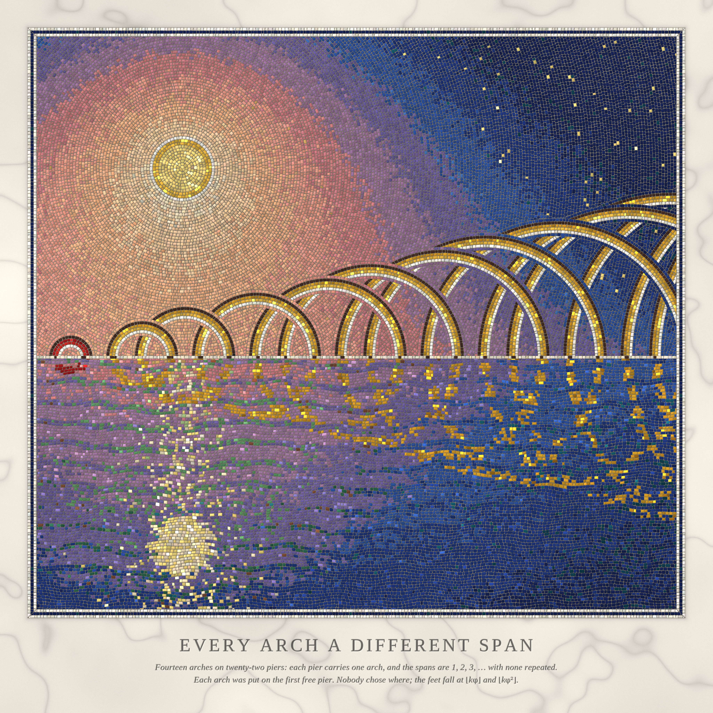
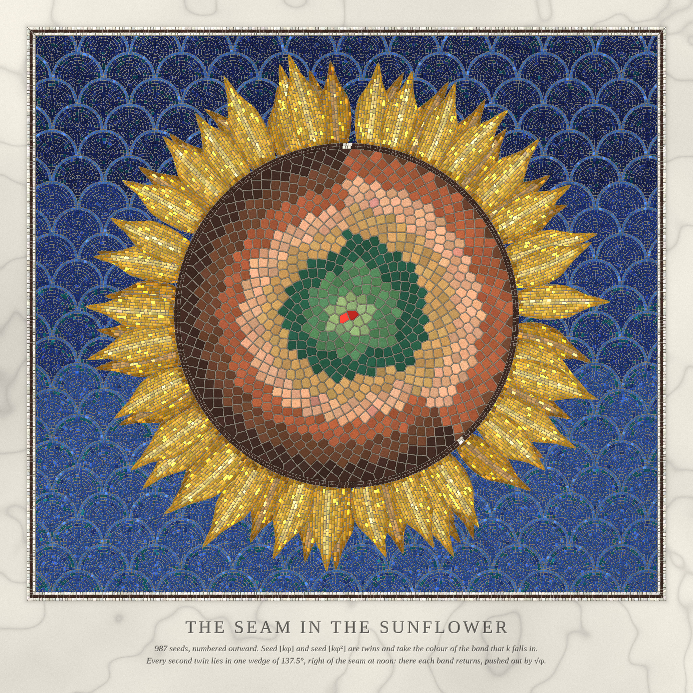
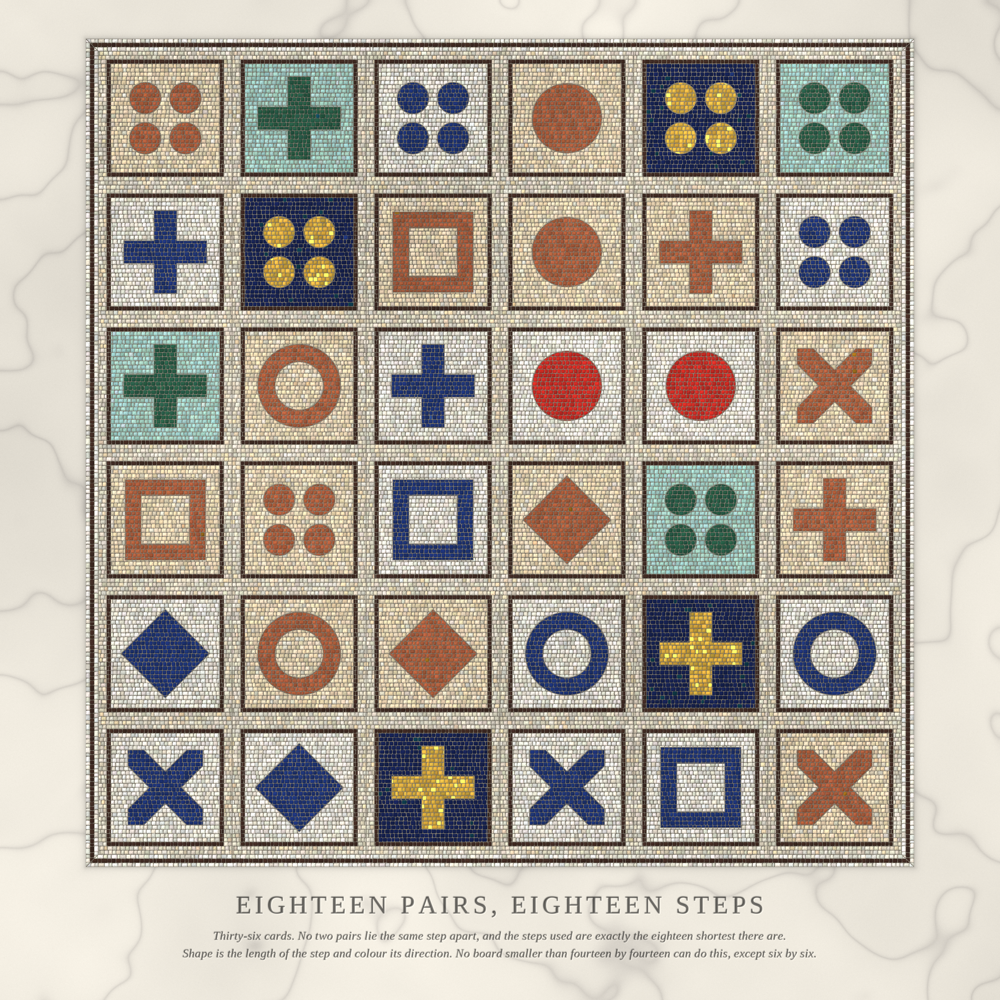

# NOBODY CHOSE WHERE — run 38, Fable 5.2 day 4

Seeds: MathOverflow 453577 *A perfect shuffle on ℕ* · Philosophy.SE 95741 *Are artworks created or
discovered?* (also read: MO 516581, 457138, 516899; Phil.SE 101031).
Style of the day: **mosaic** (`mosaic.py`) — every region supplies a pair of coordinates, the
engine cuts them into jittered tesserae, each tessera takes one colour at its centre from a box of
38 stones, grout fills the rest; a marble surround carries the inscription.

One question at three distances: the infinite shuffle as a place, the lemma as a flower, the
finite cousin as a floor.

## 1. Every Arch a Different Span (4096², hero)

Piers at 1, 2, 3, …; the k-th arch has span k and is put on the first free pier. Every pier ends
up carrying exactly one arch and no span repeats — the Wythoff pairing ⌊kφ⌋, ⌊kφ²⌋. Fourteen
arches on twenty-two piers are in the frame; six leave it. The sky is laid in rings about the sun,
the sea in swells, and the reflections are the mirror image sampled tile by tile. The one red arch
is span 1.

## 2. The Seam in the Sunflower (4096²)

987 seeds at the golden angle, one stone each (Voronoi cells). Twins share the colour of the band
their pair-number k falls in. The lemma (proved in `math_shuffle/RESULTS.md`): every second twin
lies in a single wedge of 137.5°, and a seed's twin is its reflection in the seam with the angle
divided by φ and the radius multiplied by √φ — so inside the wedge every band comes back pushed
outward. The two white stones in the collar mark the wedge. The red pair at the centre is 1 and 2.

## 3. Eighteen Pairs, Eighteen Steps (4096²)

A board you could play Memory on: 36 cards, and the 18 steps between twins are exactly the 18
shortest vectors of the square lattice, each used once. Shape is the length of the step (disc 1,
diamond √2, ring 2, cross √5, frame √8, saltire 3, four dots √10), colour is which direction of
that length. The red discs are the step (1, 0).

## Mathematics (details in `math_shuffle/RESULTS.md`)
* greedy shuffle of ℕ = Wythoff pairing, re-checked to 10⁶ pairs (known);
* sunflower lemma: twins at angles −t/φ and +t/φ² with t = {kφ} (proved, checked to 10⁶);
* good shuffles of n pairs: my counts to n = 12 match OEIS A060963; **conjecture** the fraction
  of good shuffles decays like ρⁿ with ρ ≈ 0.6554 (a saddle-point heuristic gives 0.6646);
* the same greedy on ℤ²: 491,618 pairs, never more than 5 places behind the list of steps;
  **conjecture** it uses every step exactly once;
* perfect Memory boards exist for 6×6. There are about 1.3·10⁹ of them (random-probe estimate; exact count still running at the time of writing); 2×2 has none; 10×10 is open.

Nothing was posted anywhere.

## Six ideas, three built
1. Wythoff arcade as a seascape (built, hero).
2. The pairing on a sunflower (built — the lemma picture).
3. A perfect Memory board (built).
4. The plane greedy as a floor of 36,000 honest tiles (computed; it is noise, not built).
5. All 16 perfect shuffles of 4 and 5 pairs as a sheet of small bridges (not built).
6. Real-rooted polynomials of MO 457138 as a reed bed (not built).

## Tweet-sized story
A mason was told: build arches on these posts, never the same width twice, waste no post. He never
planned. He took the next width and the first free post, forever. Years later a gardener found his
whole bridge folded inside a sunflower, the second feet all in one wedge.

## What I learned about generative art today
A medium is a coordinate system plus a defect model. For mosaic the coordinates do the drawing:
rows that ring the sun, follow the arch, run down the petal. Choose the rows first and the picture
is half made; colour only has to be sampled once per stone.

## Files
`mosaic.py` engine · `arcade.py`, `sunflower.py`, `memory_board.py` scenes (SIZE out.png) ·
`math_shuffle/` shuffle.py (line | count n | plane R), board.py, board_nb.py, RESULTS.md ·
`proto_*.png` 2048 proofs.
