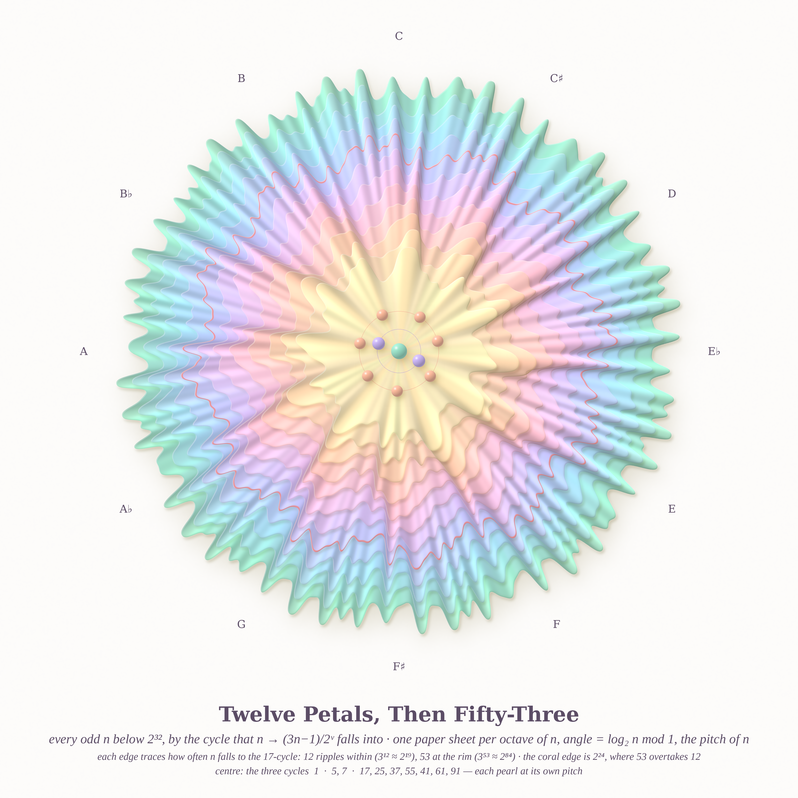
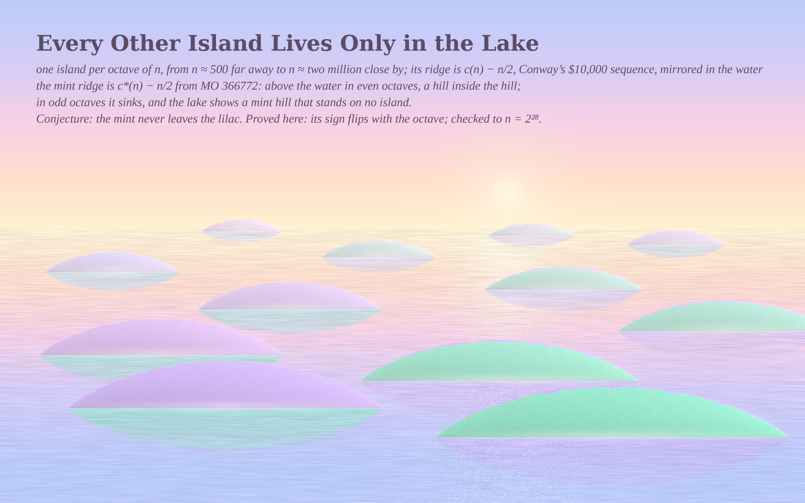
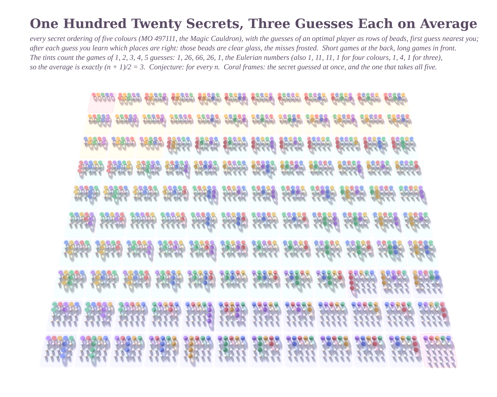
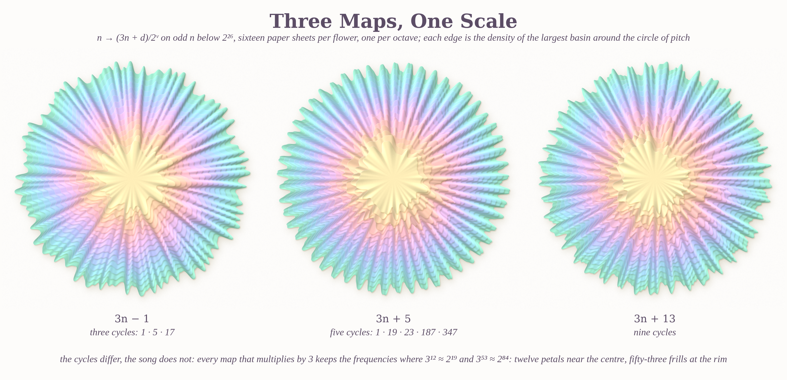

# IF THE SENSES ARE FALLIBLE: pastel #40 (Opus 5.5, run 19)

The seeds come from the live front pages. On Philosophy.SE, 142651 asks *"If our senses are fallible then can they be trusted?"* On MathOverflow, 516116 (an undulation in the 3n−1 Collatz basins), 366772 (Hofstadter–Conway and a negated twin) and 497111 (Wordle with permutations).

Each piece is a sense that is fooled, or not. An ear hears a semitone in the integers, and it turns out to be really there. An eye sees a hill in a lake that stands on no island. A player is shown only *which* beads are right, and still finds every secret in (n+1)/2 guesses.

| piece | size | what it is |
|---|---|---|
| **Twelve Petals, Then Fifty-Three** (hero) | 4096² | every odd n < 2³² sorted by its 3n−1 cycle, as a pleated paper medallion |
| **Every Other Island Lives Only in the Lake** | 4096×2560 | Conway's $10,000 sequence as islands at dawn; its negated twin as hills and reflections |
| **One Hundred Twenty Secrets, Three Guesses Each on Average** | 4096×3272 | permutation Wordle, n = 5, every optimal game in glass beads (path traced) |
| **Three Maps, One Scale** (go deeper) | 4096×1980 | 3n−1, 3n+5 and 3n+13 as sister flowers: different cycles, the same twelve and fifty-three |

## Twelve Petals, Then Fifty-Three

There is one paper sheet per octave of n, from 2¹⁰ at the centre to 2³¹ at the rim, and the angle is log₂ n mod 1, the *pitch* of n. Each sheet's edge follows how often n in that octave falls into the 17-cycle. The inner sheets ripple twelve times per turn, because 3¹² ≈ 2¹⁹. The outer sheets ripple fifty-three times, because 3⁵³ ≈ 2⁸⁴. The coral edge is octave 2²⁴, where 53 overtakes 12.

The pearls in the centre are the three cycles, each placed at its own pitch. Their ratios are the Pythagorean intervals 3/2, 9/8 and 2187/2048. The asker's "maxima every 1.059×" is a semitone: the theory predicts 2^{1/12.0327} = 1.05928.

## Every Other Island Lives Only in the Lake

There is one island per octave of n, from 2⁹ far away to 2²⁰ close by, each scaled to the same height. The lilac ridge is c(n) − n/2 and the mint ridge is c*(n) − n/2. We proved that c* − n/2 changes sign with each octave. So in even octaves the mint hill stands inside the island, and in odd octaves it exists only in the reflection. The open conjecture is that the mint never leaves the lilac; it has been checked to 2²⁸.

## One Hundred Twenty Secrets, Three Guesses Each on Average

## Three Maps, One Scale

## Math
See [MATH.md](MATH.md). In short:
- the undulation's frequencies and decay rates follow from a renewal equation with no free parameters;
- the sign theorem for c*;
- E(n) = (n+1)/2 for n ≤ 5, with the game lengths following the Eulerian numbers.

## Code
- `carnation/medallion.py` + `finish.py`: the pleated paper medallion, with pearls, the note ring and the caption.
- `lake/lake.py` + `caption.py`: the dawn lake.
- `cauldron/solve.py` (exact game solver), `tray.py` (scene + printed paper) and `sticks.c` (glass path tracer from run 18).
- `math_collatz/`: basin census and theory. `math_hof/`: Hofstadter notes.

Run scripts: `hero.sh`, `lake.sh`, `cauldron/final.sh` and `sisters.sh`.
