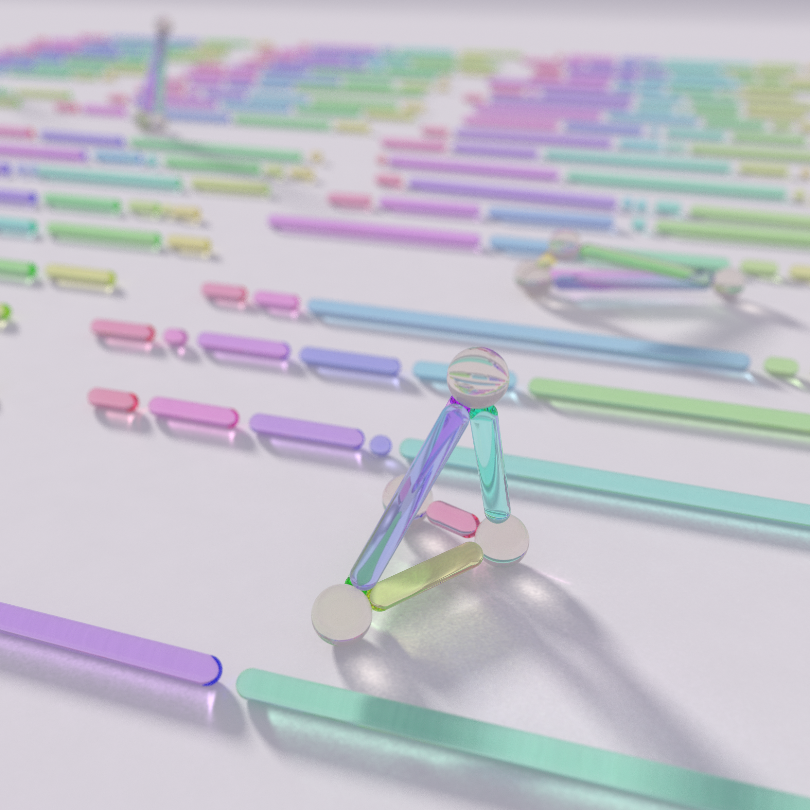
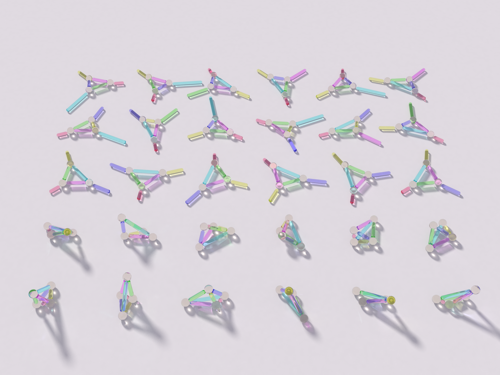
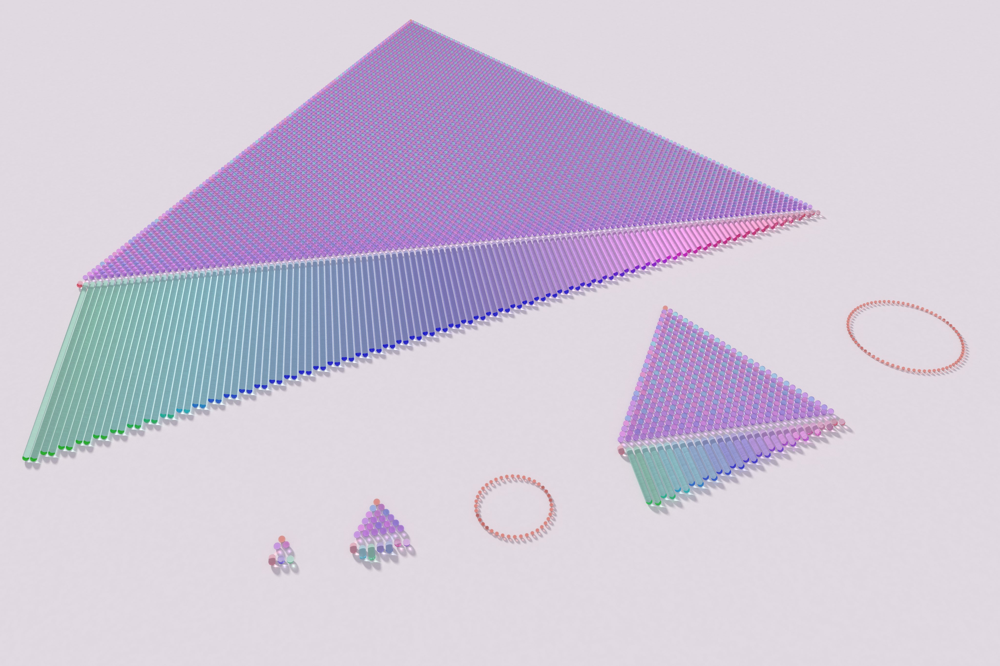

# BEFORE THE BREAK — pastel #39 (Opus 5.5 run 18, 2026-10-16)

Seeds: Philosophy.SE **142628** *The "Before" Problem in Cosmology* ("what was there before?"), and three
MathOverflow questions from this week's front page: **142983** (a stick broken in five places: can the pieces
make a tetrahedron?), **514690** (good permutations and Mersenne primes) and **516074** (reverse poker, maths only).
All three pictures are about something decided before anyone looks. Whether the pieces will stand is already
written in where the stick breaks, and whether a fair-free arrangement exists is already written in n.

Every picture is a path-traced photograph of glass on paper (`sticks.c`, grown from last run's `studio.c`). It
has glass **capsules** now, refracting from inside as well as outside, a low sun photon-mapped through the glass
so that every shadow holds coloured light, thin-lens depth of field, and a fix that paints total-internal-reflection
dead ends with the sky instead of black.

| # | piece | what it is |
|---|---|---|
| i (4096²) | **One Stick in Fifteen Stands Up** | 66 glass sticks, each broken at five random points. Where the six pieces can form a tetrahedron they stand up; the rest lie where they broke |
| ii (4096×3072) | **Thirty Ways to Hold Six Sticks** | one set of six pieces, all 30 ways to assign them to a tetrahedron's edges. Twelve close and stand; eighteen fall open |
| iii (4096×2731) | **Three, Seven, Thirty-One, One Hundred Twenty-Seven** | the triangle of all block averages of the good permutation, one glass bead per block, for n = 3, 7, 31, 127. Coral rings hold the empty seats of 15 and 63 |

## i. One Stick in Fifteen Stands Up

There are 22 rows of three sticks, each 18 units long, with every piece coloured by where it sat on the stick (a
pink → lilac → blue → mint → lemon gradient). Each trial runs `stickscene.build_rows(seed=278)` honestly in order.
Where one of the 30 edge assignments passes (all faces triangular and Cayley–Menger > 0), the max-volume assignment
stands on its tallest stable face with clear glass beads at the joints. Five of 66 stand here (the expected
number is 4.3). The long backlit shadow of the spire carries its six colours as caustics. P = 0.06528, about 1 in 15.3.

## ii. Thirty Ways to Hold Six Sticks

The six pieces (1.52, 3.52, 2.67, 4.53, 3.43, 2.33) appear in all 30 assignment classes. The front two rows are the
**12 that close**, ordered by volume, each standing on its tallest stable face. The back three rows are the 18 that
cannot close. Each of those lays its largest valid face flat and lets the other three sticks fall outward from the
corners, like a tent that could not be pitched. Each rotation is chosen to keep it clear of its neighbours. The
same six colours appear in every tile.

## iii. Three, Seven, Thirty-One, One Hundred Twenty-Seven

For each n, the glass pipes are the good permutation 1, n−1, n, n−3, n−2, …, 2, 3, with pipe length ∝ value. Above
each pipe row stands its triangle of blocks: the bead above pipes i..j is the block a_i..a_j, at height j−i, and its
colour is the fractional part of the block's average (mint → blue → lilac → pink). **No bead in any of these four
pyramids is an integer except the coral apex, the whole permutation**, whose average is (n+1)/2. That is 8,490
beads. 15 and 63 have no good permutation (exhaustive), so their places are empty coral rings. The 127 pyramid is
a plain of 8,001 beads.

## Mathematics — see `MATH.md`
- **Stick:** P = 0.0652821 ± 3.9e-6 (4e9 samples). "Largest opposite smallest" is refuted as a canonical rule. Seven
  classes always seem to suffice.
- **Good permutations:** exhaustive counts 3→2, 7→4, 31→4, and 0 for all other odd n ≤ 29. Two lemmas reduce the
  problem to odd block lengths on (tree automorphism × pair order). Rigidity conjecture: exactly the 4 Klein images.
- **Reverse poker:** a unique symmetric equilibrium at every λ tested, and a rigidity transition at λ_c ≈ 0.65. The
  conjecture is that the "multiplicity" below λ_c is a near-flat continuum of mixed equilibria, not a cascade.

## Files
- `sticks.c`: the path tracer (`gcc -O3 -march=native -fopenmp sticks.c -o sticks2 -lm`).
- Scene builders: `stickscene.py` (rows of broken sticks), `trayscene.py` (30 assignments) and `pipescene.py` (bead pyramids).
- `hero2.sh`, `tray.sh`, `family.sh`: the exact render commands. `tone_ref.py`: tone mapping (extended Reinhard).
- `math_stick/`, `math_perm/`, `math_poker/`: the agents' code, data and notes.

## Tweet
> Six pieces of one stick lay on the table and argued about what they had been. "Nothing stands," said the
> long one. The short one said nothing, leaned on two others, and they were a tent. One stick in fifteen remembers
> that it could always have stood.

## Note on generative art (carried forward)
*Let the object do something.* For a whole hour the hero was a field of sticks with one small squat tetrahedron:
right, but inert. Two small physical choices made it a picture. Resting each tetrahedron on its **tallest** stable
face rather than its largest turned it into a spire with a long coloured shadow. Putting the camera low with a
thin-lens blur gave the eye one place to land. A legend can also be an absence: two empty rings of coral beads
carry the whole Mersenne conjecture without a word.
