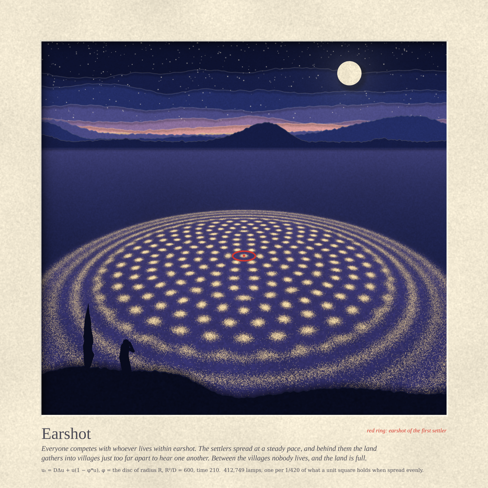
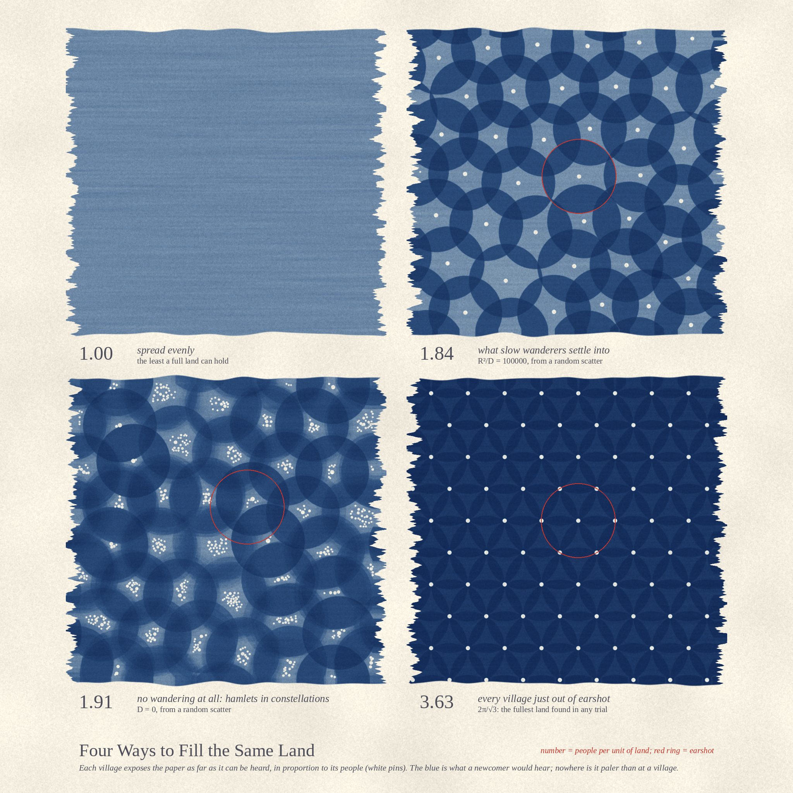
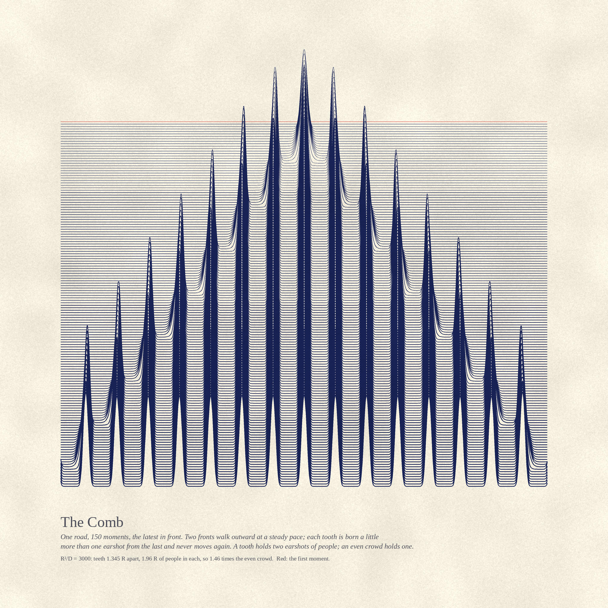

# Earshot — 2026-11-25 (Fable 5.2, day 12)

Seeds: MathOverflow 518158 (*A Fisher–Kolmogorov equation with nonlocal competition*), Philosophy.SE 144637
(*"there is no field" vs "the field is zero"*) and 144647 (*infinitely small distances*).

One equation at three distances — place, measure, process — in the settled hand (night indigo, cream, one red:
the ring of earshot).

| piece | size | what it is |
|---|---|---|
| **Earshot** (hero) | 4096² | Cut-paper night plain. 412,749 lamps drawn from a simulation of u_t = DΔu + u(1 − φ*u), R²/D = 600, at time 210: rings of pioneers at the front, villages behind. The ground is tinted by the dose φ*u, so the settled land is paler than the wilderness even where nobody lives. |

| **Four Ways to Fill the Same Land** | 2048² | Sun print. Every village exposes its disc of earshot in proportion to its people; blue = dose, so the mean blue of a panel is its density: 1.00, 1.84, 1.91, 3.63. |

| **The Comb** | 2048² | Ridgeline engraving of the one-dimensional run (R²/D = 3000): 150 moments, latest in front. |

## Six ideas (three built)
1. **Night plain with lamps sampled from the PDE** — built (hero).
2. **Sun print of the dose for four states** — built.
3. **Ridgeline of the 1-D space–time** — built.
4. Chalk board of the lemma 1 ≤ density ≤ 2^d with the half-radius disc — folded into `math_earshot/RESULTS.md`.
5. Mosaic of E₈ villages projected to the plane (the 64.94-fold land) — not built.
6. Happy primes in odd bases as a street of odd-numbered doors (MO 518155) — not built.

## Mathematics (details in `math_earshot/RESULTS.md`)
* Measured: threshold R²/D = 185.19 (plane), 84.20 (line); settled densities 1.26 → 1.84 as R²/D goes 250 → 10⁵;
  with no diffusion 1.97 ± 0.06 from random starts.
* Proved: a settled land holds at least the even crowd (≥ 1) and at most 2^d; and the Cohn–Elkies
  sphere-packing bound applies to settled *measures*, not only point packings. So the fullest land is 2 on the line,
  64.94 on E₈ in eight dimensions, 32,372.9 on the Leech lattice in twenty-four.
* Conjectured: in the plane the fullest land is the hexagonal "flower", 2π/√3 = 3.63 (equivalent to sharpness of
  the LP bound in dimension 2, which is open); a front leaves the land about half full.

## Tweet-sized story
A listener on a hill counts lamps. The settlers walked outward at an even pace and behind them the lamps drew
into villages, each just out of the next one's hearing. The dark between them is not empty: stand there and you
hear more neighbours than anywhere else. Gathered, the land holds more than it did spread thin — and in the best
arrangement I can prove nothing about, 3.63 times more.

## Craft note
Sampling discrete lamps from a density (one lamp = a fixed number of people) and splatting them in perspective gave
a luminous picture with honest counts on the first proof; tinting the ground by the *convolved* field showed the
invisible half of the equation for free.

## Reproduce
`python3 sim2d.py 600 1536 38.4 210 front` → `python3 earshot.py 4096 40 earshot_4096.png`;
`for s in 250 600 2000 10000 100000: python3 sim2d.py $s 512 12.8 600 c$s 7` → `python3 sunprint.py 2048 four_ways_2048.png`;
`python3 sim1d.py 3000 40 493 t3000` → `python3 comb.py 2048 the_comb_2048.png`.
(`sim2d.py` uses a growth cutoff below 10⁻⁷ so round-off cannot seed the wilderness.)
