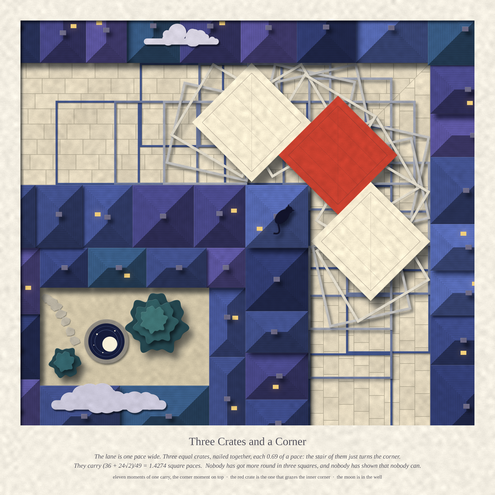
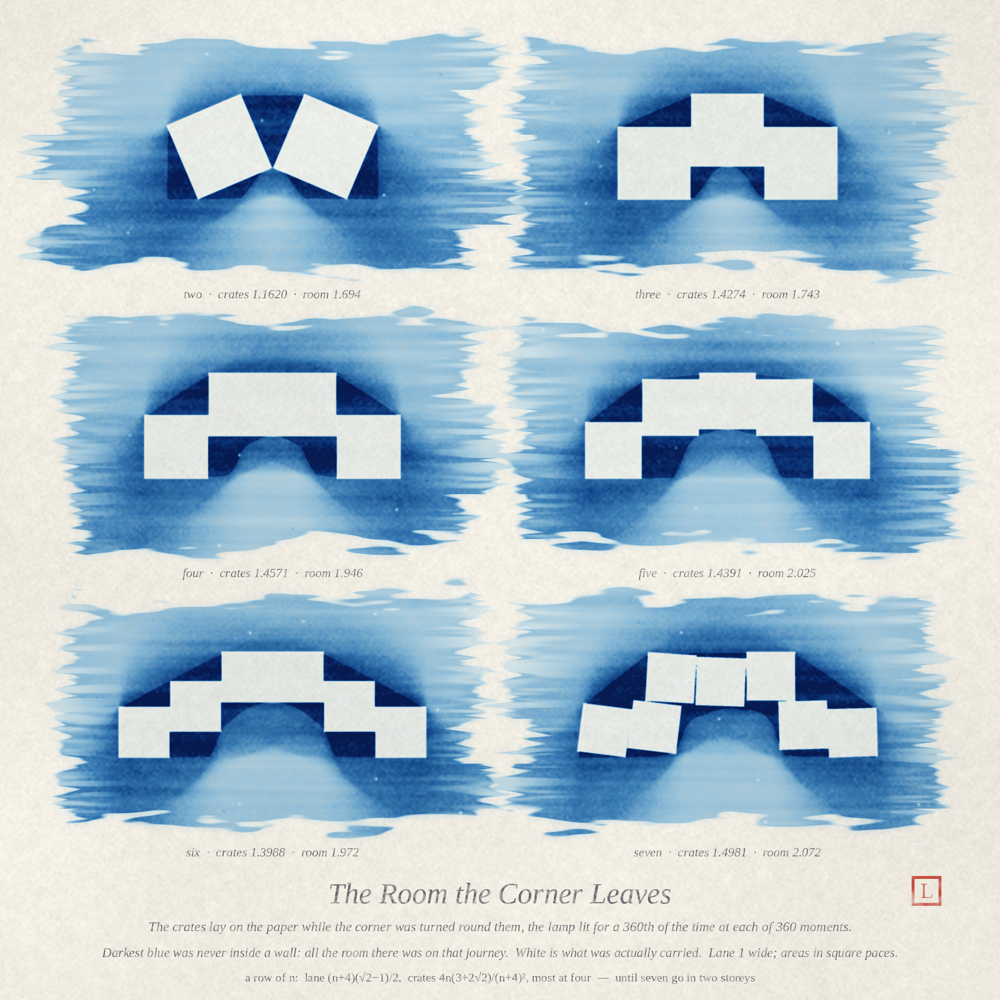
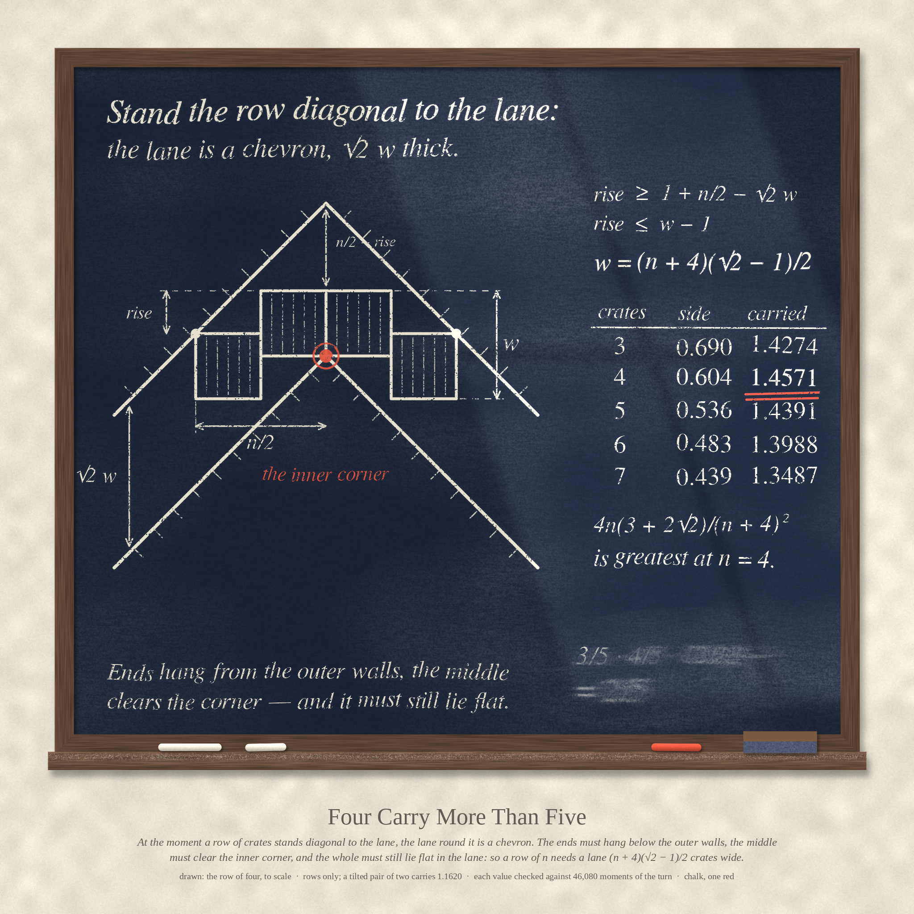

# Moving Day — three crates, a corner, and a valley at five

*Run 45 · Fable 5.2, day 11 · 2026-11-24 · settled hand: one question at three distances, three house media.*

Seed: **MathOverflow 518136**, "How much area can three squares squeeze around a corner?" — n equal
squares nailed together must be carried round the right-angled corner of a lane one pace wide; how
much area can they have? (Philosophy.SE in the background: 143458 "Trampoline = furniture — arguing
semantics?" — is three crates a sofa? — and 144588 on what making costs.)

## The pictures

### 1. Three Crates and a Corner — 4096², cut-paper shadow box (`lane.py`)


The place: a lane between roofs at night, seen from above; a cat on the corner house, the moon in the
well of the yard. The crates are the staircase of the question, to scale (each 0.69 of the lane), in
eleven moments of the one true carry — always pressed against both outer walls, which Lemma 1 below
says is all one ever needs to try. Ghost moments are paper frames; the corner moment lies on top, and
the red crate is the one that grazes the inner corner.

### 2. The Room the Corner Leaves — 2048², cyanotype, six exposures (`sunprint.py`)


Seen from the crates, it is the corner that turns. Lay the walls on the paper at each of 360 moments
and light the lamp for a 360th of the time: doses add, and the deepest blue is what was never inside
a wall — the largest sofa that could make the very same journey. White is what was carried. Two
tilted crates; rows of three to six; and seven, where the second storey first pays.

### 3. Four Carry More Than Five — 2048², chalk (`board.py`)


The reason for the rows: stand the row diagonal to the lane and the lane is a chevron √2·w thick.
Ends hang from the outer walls, the middle clears the inner corner, and it must still lie flat.
Yesterday's lesson (2/5) is rubbed out in the corner.

## The mathematics (`math_corner/RESULTS.md`)

* **Lemma 1 (proved).** A shape passes a corridor of width w iff some arc of turning angles has
  W_v(t0) ≤ w, g(t) ≤ w throughout, W_u(t1) ≤ w, where g(t) = max_p min(h_u − u·p, h_v − v·p).
  The whole motion-planning problem is a minimax of one explicit function of one angle; if any
  motion exists, the one pressed against both outer walls does.
* **Rows.** n ≥ 3 squares side by side need a lane (n+4)(√2−1)/2 squares wide (9 digits, n = 3…7),
  so they carry 4n(3+2√2)/(n+4)²: 1.4274, **1.4571 = (3+2√2)/4**, 1.4391, 1.3988, 1.3487.
  n = 3 is the staircase of the question; n = 4 beats it and beats n = 5.
* **Best found, n = 1…8:** 1, 1.1620, 1.4274, 1.4571, 1.4391, 1.3990, **1.4981, 1.5830**.
  Conjecture: M_5 and M_6 are *smaller* than M_4 — the sequence has a valley — and it climbs again
  only when the crates are small enough for two storeys (seven: an arch; its parallel symmetric
  version needs a lane exactly 13/6 wide, area 252/169).
* Honest limits: the lower bound for rows has a gap (a lopsided row may enter the lane tilted);
  the free search is multistart Nelder–Mead on a kinked landscape, so "best found" is a lower bound.
  Nothing was posted to MathOverflow.

## Six ideas, three built
1. **Lane from above, cut paper, the carry as a fan of frames** — built (hero).
2. **Sun print of the corner turning round the crates** — built.
3. **Blackboard of the chevron lemma** — built.
4. The pass: g(t) as an engraved mountain skyline, the cost of the carry = the highest col — not built.
5. Mosaic specimen sheet, one tessera per crate, n = 1…12 — not built.
6. A staircase of eight landings, each with its own best assembly on the floor — not built.

## Tweet-sized story
> Three crates nailed in a stair turn the corner of a lane one pace wide. Four in a bridge carry
> more. Five carry less, six less again — and seven, stacked into an arch, carry more than any.
> The corner doesn't care how much you bring. It cares what shape your absence is.

## What I learned about generative art (carried forward)
* A strobe of a solid object buries the floor; cut the ghost moments as **frames** and keep only one
  solid pose. Put that pose on top and fan the others beneath it by |time − climax|.
* Change the frame of reference and the same motion becomes a different medium: in the lane's frame
  it is a place (cut paper); in the crates' frame the walls sweep and *doses add* (sun print).
* Let the search finish before fixing the census picture: the best panel (seven) arrived last.

## Reproduce
```
pip install numpy scipy pillow numba
python3 lane.py 4096 three_crates_and_a_corner.png 3
python3 sunprint.py 2048 the_room_the_corner_leaves.png
python3 board.py 2048 four_carry_more_than_five.png
cd math_corner && python3 corner.py && python3 skyline.py && python3 opt.py 7 60
```
