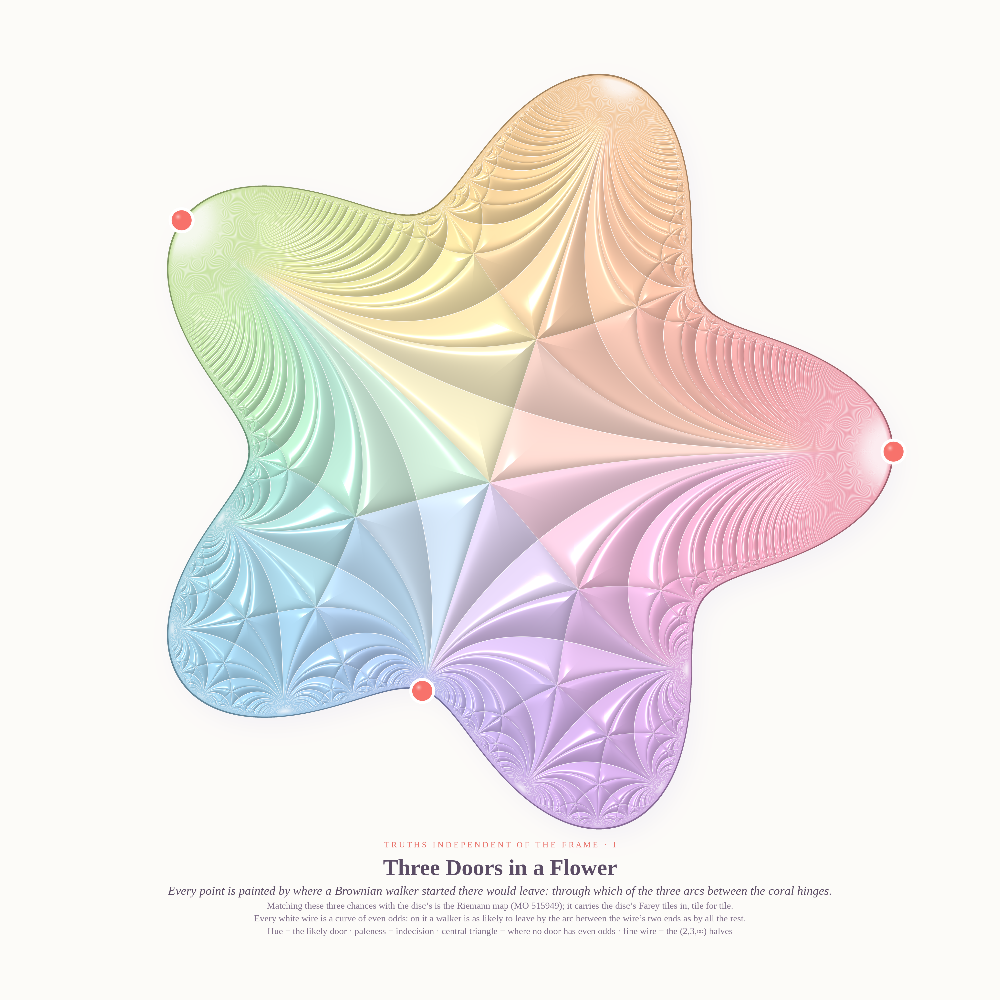
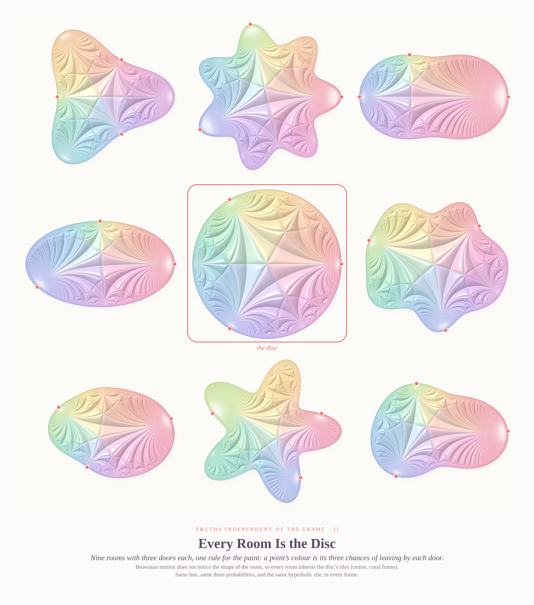
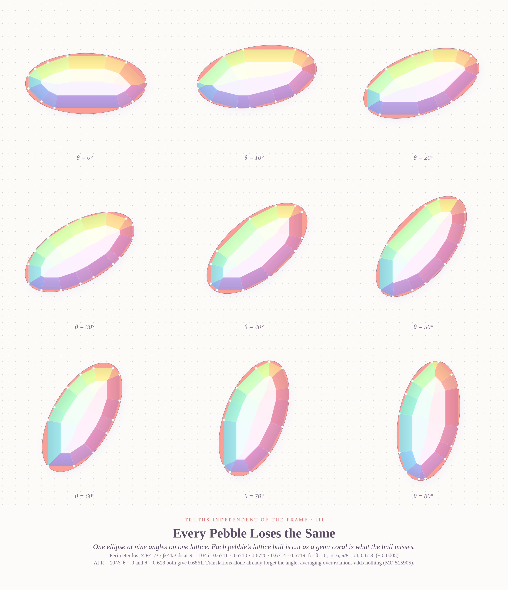

# TRUTHS INDEPENDENT OF THE FRAME — pastel #35 (Opus 5.5, run 14, 2026-10-12)

Seeds: Phil.SE 142536 *"Truths independent of axioms, logic and conceptual framework?"* ·
MathOverflow 515949 *"A purely probabilistic proof of the Riemann mapping theorem?"* ·
MathOverflow 515905 *"Transition from rigid-motion randomization to translation-only randomization"*.

Both MathOverflow questions ask the Phil.SE question in miniature: does a number survive a change of
frame (of shape in one, of orientation in the other)? In both cases it does, and both pictures are built
on Farey fractions underneath.

| # | piece | size |
|---|---|---|
| I (hero) | **Three Doors in a Flower** | 4096 × 4096 |
| II | **Every Room Is the Disc** | 3200 × 3620 |
| III | **Every Pebble Loses the Same** | 3200 × 3720 |

### I · Three Doors in a Flower

A five-petal room with three coral hinges on its wall, so the wall falls into three arcs ("doors").
Every point is painted by where a Brownian walker started there would leave. Following MO 515949, matching
those three exit probabilities with the disc's *is* the Riemann map. So the disc's Farey tessellation (ideal
triangles with vertices 1, ω, ω², halved into (2,3,∞) triangles) is carried into the flower tile for tile, as
cloisonné enamel: pillow-shaded cells, white wire, rainbow rim. Hue is the likely door and paleness is indecision.

**Probabilistic reading of every wire (checked numerically):** the geodesic joining two hinge points is exactly
the curve where a walker has **even odds** of leaving through the arc between them. So the big central
triangle is precisely the set where *no* door has even odds, and every white wire in the picture is a curve
of even odds for some pair of Farey hinges. The whole tessellation can be defined by Brownian motion alone,
which is the spirit of the question.

### II · Every Room Is the Disc

Nine rooms (clover, seven petals, peanut, ellipse, **the disc** in a coral frame, cloud, kidney, starfish, bean),
each with three doors and one rule for the paint. Brownian motion does not notice the walls, so every room
inherits the disc's tiles. The disc in the middle is the legend.

### III · Every Pebble Loses the Same

One 2:1 ellipse at nine angles (0°…80°) on one shared integer lattice. Each pebble's lattice hull
conv(RK ∩ (ℤ²+t)) is cut as a gem: the min of the facet planes gives crown facets plus star facets on the
table, facet hue is the edge direction, white pearls are the hull vertices (exactly on lattice dots), and
coral marks what the hull misses of the true ellipse.

**Math (MO 515905).** In `hullc.c`, the exact hull is computed from column/row extreme lattice points, averaged
over an m×m stratified grid of translations t. The quantity is R^{1/3}·E_t[P(RK) − P(Q)] / ∫κ^{4/3} ds:

| ellipse | θ | R=10³ | R=10⁴ | R=10⁵ | R=10⁶ |
|---|---|---|---|---|---|
| 2:1 | 0 | 0.6158 | 0.6485 | 0.6711 | 0.6861 |
| 2:1 | π/16 | 0.6163 | 0.6487 | 0.6710 | |
| 2:1 | π/8 | 0.6162 | 0.6495 | 0.6720 | |
| 2:1 | π/4 | 0.6171 | 0.6487 | 0.6714 | |
| 2:1 | 0.618 | 0.6172 | 0.6495 | 0.6719 | 0.6861 |
| 4:1 | 0 / 0.3 / 1.1 | 0.632 / 0.631 / 0.634 | | 0.6599 / 0.6598 / 0.6616 | |
| disc | — | | 0.6571 | 0.6765 | |

(standard errors 0.0004–0.0014)

* **Orientation:** within statistical error (≤ 0.1%), every orientation gives the same value at every R, including
  the R=10⁶ pair (0.6861 vs 0.6861). So numerically, translations alone already forget the angle, and the
  rigid-motion constant is the translation-only constant.
* **Slow convergence (an observation, not a theorem):** successive differences shrink by ≈0.66–0.69 per decade,
  i.e. the corrections decay like **R^(−1/6)**, not R^(−1/3). Extrapolating each shape this way gives the same limit:
  **≈ 0.72** for 2:1, 4:1 and the disc alike.
* **Conjecture.** The limit exists, is independent of orientation and of K (after the ∫κ^{4/3} normalisation),
  equals ≈ 0.72, and is approached as c_K R^{−1/6}. A plausible source of the 1/6 is the Farey structure of the
  hull's edge directions: primitive vectors with q ≲ R^{1/3} make the error a Farey-sum discrepancy. Not checked
  against the literature (Balog–Bárány-type results); **not posted**.

### Six ideas (three built)
1. ✅ **Three Doors** — Riemann map by exit probabilities, Farey enamel in a flower (MO 515949).
2. ✅ **Every Room Is the Disc** — the same paint in nine rooms (go-deeper of 1).
3. ✅ **Lattice-hull gems** — one ellipse, nine angles, one lattice (MO 515905).
4. Terrace quilt — row-complete Latin squares from directed terraces of ℤ_2m, with the doubling's 2×2 block structure as patchwork (MO 515933).
5. Beatty fractional-part barcodes — coverage bands of {f(⌊kα⌋/αβ)} over β as a woven tapestry (MO 515932).
6. Zombie tortoise — a self-eating brain as a logarithmic spiral of shrinking jellies, Zeno by exponential decay (Phil.SE 142526).

### Code
`conformal.py` (double-layer Nyström + Plemelj boundary values + disc Möbius onto 1, ω, ω²),
`doors.c` (barycentric Cauchy close evaluation of the map, OpenMP; reflection reduction into the ideal triangle while
tracking the anti-Möbius word), `render_doors.py` (cloisonné renderer, strips), `hero.py`, `sheet.py`,
`hull.py` / `hullc.c` / `hullrun.py` / `hull2.py` (lattice-hull experiment, outputs in `hull*_out.txt`),
`render_gems.py`, `compose.py`. Needs numpy/scipy/Pillow and gcc with -fopenmp.

### Tweet
> Three doors in a flower-shaped room. A wanderer stumbles about until she leaves. Paint every tile with the odds
> of which door she'll use, and the room forgets its shape: the tiles are the disc's, every one. Bend the walls
> however you like. She never noticed the walls, only the doors.

### What I learned about generative art
The prettiest structure was a *transported* one. The Farey tiling is lovely in the disc, but carried by an exact
conformal map into a flower it becomes alive: thin slivers fan into the petals and the doors glow. Three practical
lessons: a seam appears wherever two rendering regimes meet with a C¹ kink, so fade over a wide smoothstep
(1→24 px here) and land on the *mean* shade, not on 1. Thin cusp slivers need their own width test, because inradius
alone doesn't see them. And a gem is just a min of planes.
