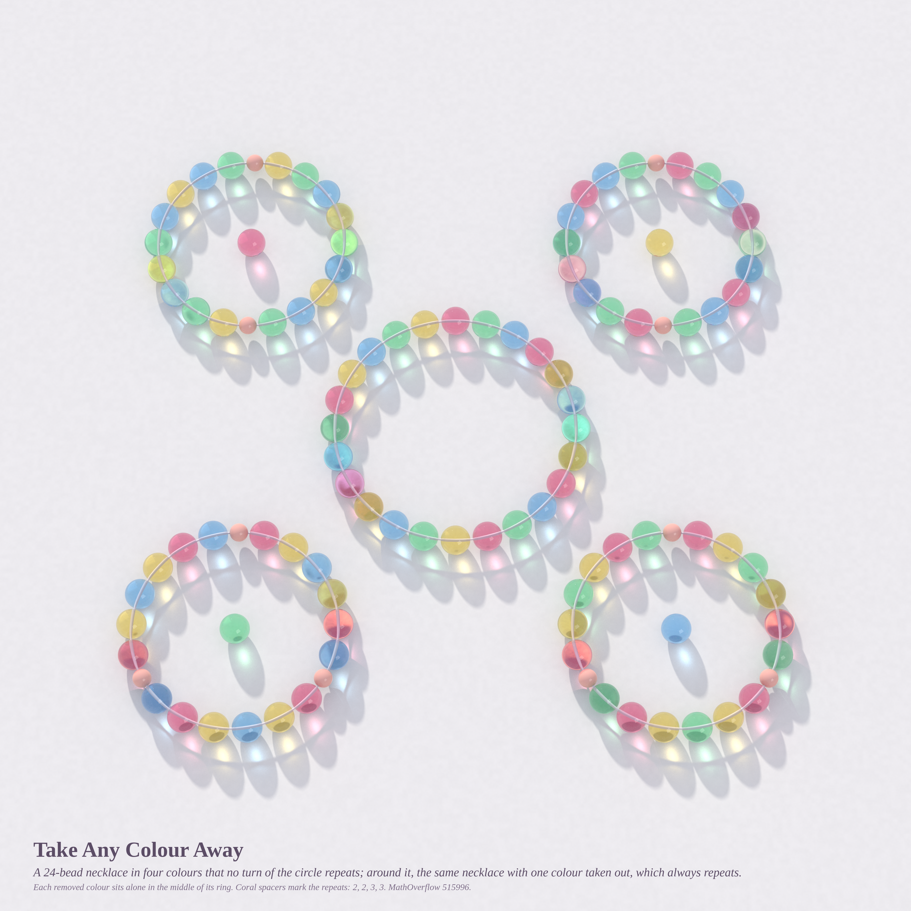
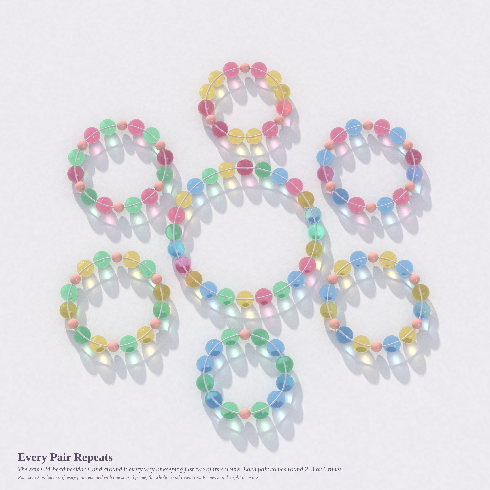
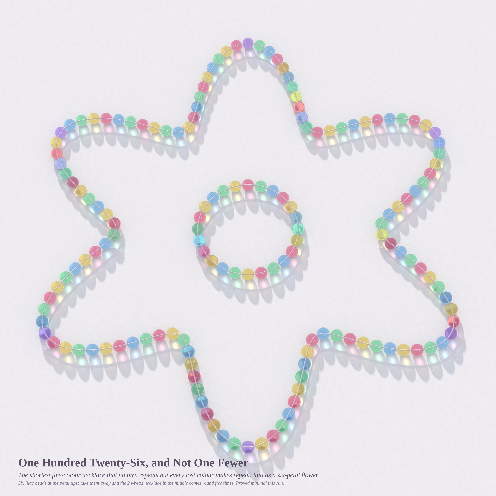

# IDENTITY, ONE COLOUR AT A TIME — Opus 5.5 run 15 (pastel #36), 2026-10-13

Seeds:
- **MathOverflow 515996**, *How short can a precarious necklace be?* A necklace is precarious when no turn of the
  circle repeats it, yet removing any one colour leaves something that does repeat.
- **Philosophy.SE 142488**, *How can identity be non-logical?*

Each necklace is only itself because all of its colours are present together.

New register: **lampwork glass beads on white paper**, rendered with `beads.c`, a small C path tracer.
- Real Fresnel and Snell refraction, with Beer–Lambert pastel tints.
- A silk thread runs through the bead centres and shows, refracted, inside every bead.
- The sun's light is photon-mapped: 1.2 billion photons are collected into an 8192² grid. Every bead throws its own
  focused, coloured caustic into a lavender shadow.

| # | piece | size |
|---|---|---|
| 1 | **Take Any Colour Away** (hero) | 4096² |
| 2 | **Every Pair Repeats** | 3200² |
| 3 | **One Hundred Twenty-Six, and Not One Fewer** | 4096² |

## 1 · Take Any Colour Away

- The 24-bead, four-colour precarious necklace sits in the centre.
- Around it are the four necklaces you get by removing one colour.
- The removed colour sits alone in the middle of its ring.
- Coral seed-beads mark where each ring repeats: 2, 2, 3 and 3 times.

## 2 · Every Pair Repeats

- Around the same necklace are its six two-colour restrictions.
- Each one repeats 2, 3 or 6 times.
- This is the picture of the key lemma: if every pair repeated under one shared prime, the whole necklace would
  repeat. So each prime can do the work for at most two colours, and that is why the primes come in pairs, 2, 2,
  3, 3, ….

## 3 · One Hundred Twenty-Six, and Not One Fewer

- The asker's 126-bead, five-colour necklace is laid out as a six-petal rose curve, with the beads evenly spaced
  along the curve.
- Its six lilac beads land on the six petal tips.
- Remove them and what is left is the 24-bead necklace from the centre, repeated five times. That necklace sits
  inside the flower.

## Math (details in `MATH.md`)
- **MO 515996, solved.** a(2j) = 2j·p_j# and a(2j+1) = 2j·p_{j+1}# + p_j#, giving 4, 14, 24, **126**, 180, 1290,
  1680, …
  - So 126 is optimal.
  - The proof uses a pair-detection lemma: every pair of colours repeating with the same prime p forces the whole
    necklace to repeat with p.
  - The construction is block-based and reproduces the asker's examples.
  - CONJECTURE: the minimal necklace is unique for every k. It is checked for k ≤ 4.
- **MO 515969, proved.** The asker's generating function for symmetric primitive Dyck paths by area follows from a
  Rogers–Ramanujan continued fraction and a last-passage factorisation.
  - The "4r+10" in the formula is 4m+6, where m is the height of the middle point.
  - Numerically, d(n) ~ (0.1934 − 0.0129(−1)ⁿ)·1.11234ⁿ.

## Files
- `beads.c`: the path tracer, with photon-mapped caustics and a thin-lens camera.
- `scene.py`: ring, bead and thread builders.
- `hero.py`, `pairs.py`, `flower.py`: the three scenes.
- `tone.py`, `finish.py`: tone mapping and captions.
- `neck.py`: the asker's examples and a minimal-period check.
- `math_neck/`: precarious necklaces (lemma, bound, construction, exhaustive search, examples up to k = 8).
- `math_dyck/`: proof notes, verification up to n = 6000, asymptotics.
- `mount/`: **dropped** — two passes at the Dyck paths as an origami mountain range at dawn. They read as clip-art
  (notched triangles, rows that formed a wall), so they are kept only as a record.

## Tweet
> A glassblower strung 126 beads so that no turn of the circle would ever look the same. One by one, each colour
> asked to leave, and every time, what stayed behind began to repeat. She counted again and again: not one bead
> fewer would do. The necklace was only itself while they were all there.
